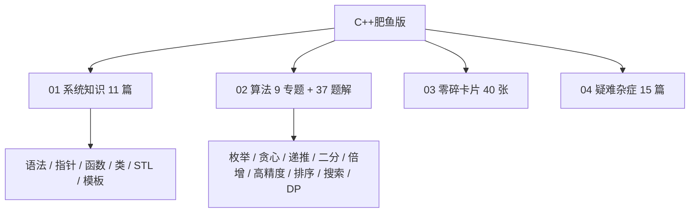

## 这是什么

把你 `C++/` 里的 139 篇旧笔记，按「系统知识 / 算法 / 零碎卡片 / 疑难杂症」重排后的版本。**旧笔记只读，这里全部是新建的。**

## 结构



## 进度

| 模块 | 状态 | 数量 |
|---|---|---|
| 01 系统知识 | ✅ 已完成 | 11 篇 |
| 02 算法 | ✅ 已完成 | 9 专题 + 37 题解 |
| 03 零碎卡片 | ✅ 已完成 | 40 张 |
| 04 疑难杂症 | ✅ 已完成 | 15 篇 |

## 入口

- 系统知识：[[01-00 系统知识总览]]
- 算法：[[02-00 算法总览]]
- 生成规则：[[00 提示词集]]

## 全部笔记

```dataview
TABLE type AS "类型", topic AS "主题", status AS "状态"
FROM "C++肥鱼版"
WHERE type != "提示词" AND type != "总览"
SORT type ASC, title ASC
```

## 使用说明

1. 复习先看每篇的「速记 / 易错点」，卡住再往下翻。
2. 算法题点题名有外链（力扣中文站 / 洛谷），点题解看思路。
3. 专题页只放套路，完整代码在题解里。
4. 所有笔记的 `source` 字段指回原始笔记，想对照随时能翻。

## 后续可选

- 把 40 张卡片按主题合成「速查手册」
- 用提示词 F 生成复习卡 / 自测题
- 补 C++ 项目实战笔记（通讯录 / 职工系统 / STL 演讲比赛）

---

哼，这库是本鱼一口一口吃出来的，别嫌胖。
