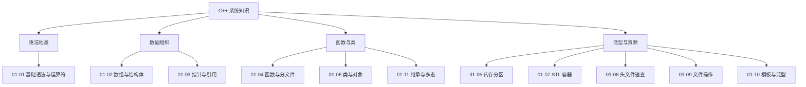

## 这套系统知识怎么排的

按「从语法到对象，再到泛型」的顺序，11 篇笔记，每篇都能单独复习。



## 进度

| 编号 | 笔记 | 状态 |
|---|---|---|
| 01-01 | [[01-01 基础语法与运算符]] | ✅ |
| 01-02 | [[01-02 数组与结构体]] | ✅ |
| 01-03 | [[01-03 指针与引用]] | ✅ |
| 01-04 | [[01-04 函数与分文件编写]] | ✅ |
| 01-05 | [[01-05 内存分区]] | ✅ |
| 01-06 | [[01-06 类与对象]] | ✅ |
| 01-07 | [[01-07 STL 容器]] | ✅ |
| 01-08 | [[01-08 头文件速查]] | ✅ |
| 01-09 | [[01-09 文件操作]] | ✅ |
| 01-10 | [[01-10 模板与泛型]] | ✅ |
| 01-11 | [[01-11 继承与多态]] | ✅ |

## 推荐顺序

01-01 → 01-02 → 01-03 → 01-04 → 01-05 → 01-06 → 01-11 → 01-07 → 01-08 → 01-09 → 01-10。

先语法、再指针、再类和继承，最后 STL / 模板收尾。

## 全部笔记

```dataview
TABLE topic AS "主题", status AS "状态"
FROM "C++肥鱼版/01 系统知识"
SORT title ASC
```

## 关联

- 总入口：[[00 总览]]（待建）
- 算法部分：[[02-00 算法总览]]
- 生成规则：[[00 提示词集]]

---

哼，11 篇系统知识，本鱼一篇一篇啃完的，牙都磨圆了。
