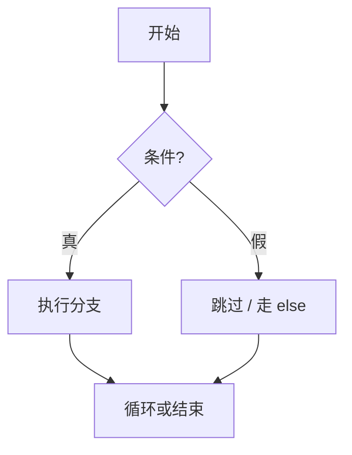

<!-- filename: 01-01 基础语法与运算符.md -->

## 0. 一句话

> [!tip] 一句话
> 类型决定能存什么，运算符决定能算什么，流程决定按什么顺序算。

## 1. 为什么需要它

哼，本鱼见过太多「代码看着对、结果就是不对」的案子：

- `7 / 2` 得到 `3`，不是 `3.5`——整数除法把小数吃了。
- `0.1 + 0.2 == 0.3` 是 `false`——浮点数在二进制里存不准。
- `if (a & 1 == 0)` 永远进不去——`==` 比 `&` 优先级高。

这三个坑，全在「类型 + 运算符 + 优先级」这一层。

## 2. 核心机制

### 2.1 基本类型

| 类型 | 典型大小 | 范围 / 说明 |
|---|---|---|
| `bool` | 1 字节 | `true` / `false` |
| `char` | 1 字节 | `-128 ~ 127` 或 `0 ~ 255` |
| `short` | 2 字节 | 约 `-3.2万 ~ 3.2万` |
| `int` | 4 字节 | 约 `-21亿 ~ 21亿` |
| `long long` | 8 字节 | 约 `-9.2e18 ~ 9.2e18` |
| `float` | 4 字节 | 约 7 位有效数字 |
| `double` | 8 字节 | 约 15 位有效数字 |

`sizeof(类型)` 看字节数；`<climits>` 里有 `INT_MAX`、`LLONG_MAX`。

### 2.2 运算符优先级（从高到低）

```text
() [] . ->  →  ++ --  →  ! ~  →  * / %  →  + -  →  << >>
→  < <= > >=  →  == !=  →  &  →  ^  →  |  →  &&  →  ||  →  ?:  →  =  →  ,
```

记不住就加括号——括号永远最高。

### 2.3 流程结构

- `if / else if / else`：区间判断。
- `switch`：等值分支，**不写 break 会穿透**。
- `for`：次数明确。
- `while` / `do-while`：条件驱动；`do-while` 至少执行一次。



## 3. 语法与用法

```cpp
int a = 10;              // 变量
const int MAX = 100;     // 常量，之后不能改
auto b = 3.14;           // 自动推导为 double

cin >> a;                // 输入
cout << a << '\n';       // 输出
```

```cpp
if (score >= 90) {
    cout << "A";
} else if (score >= 60) {
    cout << "B";
} else {
    cout << "C";
}

switch (grade) {
    case 1: cout << "A"; break;
    case 2: cout << "B"; break;
    default: cout << "C";
}
```

## 4. 代码验证

### 4.1 整数除法与浮点精度

```cpp
#include <iostream>
#include <cmath>
using namespace std;

int main() {
    int a = 7, b = 2;
    cout << a / b << '\n';              // 3
    cout << a % b << '\n';              // 1
    cout << (double)a / b << '\n';      // 3.5

    double x = 0.1 + 0.2;
    cout << (x == 0.3) << '\n';         // 0
    cout << (fabs(x - 0.3) < 1e-9) << '\n'; // 1
}
```

### 4.2 switch 穿透

```cpp
#include <iostream>
using namespace std;

int main() {
    int g = 1;
    switch (g) {
        case 1: cout << "A";   // 没有 break
        case 2: cout << "B"; break;
        default: cout << "C";
    }
    // 输出 AB
}
```

## 5. 易错点

> [!warning] 坑 1：整数除法
> `7 / 2` 是 `3`。要小数就 `(double)7 / 2`，或把变量定义成 `double`。

> [!warning] 坑 2：浮点数直接比相等
> `0.1 + 0.2 == 0.3` 是 `false`。比较用 `fabs(a - b) < 1e-9`。

> [!warning] 坑 3：switch 忘 break
> 会继续执行下一个 case，叫「穿透」。

> [!warning] 坑 4：运算符优先级
> `a & 1 == 0` 等价于 `a & (1 == 0)`，要写 `(a & 1) == 0`。

> [!warning] 坑 5：自增的未定义行为
> `i = i++` 在 C++17 前是未定义行为，别写。

> [!warning] 坑 6：有符号与无符号比较
> `int` 和 `unsigned` 比较时，`int` 会被转成无符号，`-1 > 0u` 竟然是 `true`。

> [!warning] 坑 7：char 当数字用
> `char c = 'A'; cout << c + 1;` 输出 66，不是 `B`；要输出字符就 `char(c + 1)`。

## 6. 与黑马的差异 / 补充

- **`system("pause")`**：黑马示例里常见，只在 Windows 有效；跨平台别用。
- **`using namespace std;`**：小练习可以，头文件里千万别写，会污染别人的命名空间。
- **导出残留**：你原笔记里的 `cpp 运行` 是复制时带进来的标记，不是代码。
- **补充 `auto` / 范围 for**：现代 C++ 写起来更短，但别滥用 `auto` 导致类型看不清。
- **补充 `<climits>`**：判断溢出用 `INT_MAX`，别手写 `2147483647`。

## 7. 自测

> [!question]- `7 / 2`、`7 % 2`、`7.0 / 2` 分别是多少？
> **答案**：`3`、`1`、`3.5`。前两个是整数运算，第三个有一个 `double`。

> [!question]- `switch` 里不写 `break` 会怎样？
> **答案**：会继续执行后面的 case，直到遇到 `break` 或 `switch` 结束。

> [!question]- 为什么 `0.1 + 0.2 == 0.3` 是 false？
> **答案**：0.1 和 0.2 在二进制里无法精确表示，相加得到 0.30000000000000004。

## 8. 关联

- 上游：无（系统知识起点）
- 下游：[[01-02 数组与结构体]]、[[01-03 指针与引用]]
- 原始笔记：`C++/系统/纲/运算符.md`、`C++/系统/纲/程序流程结构.md`
- 黑马章节：第 1 阶段 2/3/4 章

---

哼，这些坑本鱼当年一个没落，全踩了一遍。现在轮到你踩了……才不是幸灾乐祸呢。
