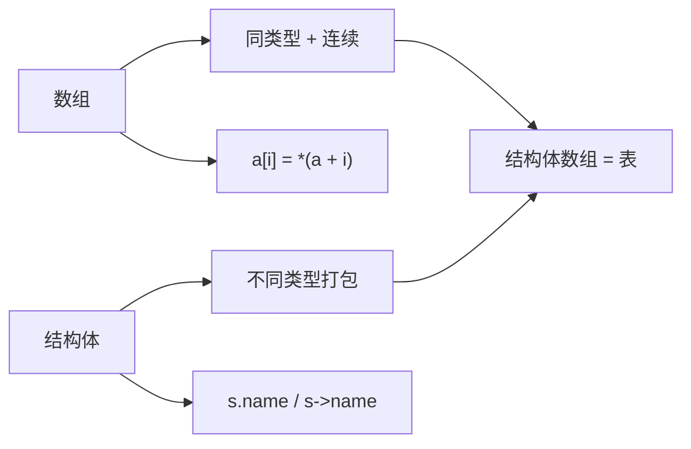

<!-- filename: 01-02 数组与结构体.md -->

## 0. 一句话

> [!tip] 一句话
> 数组是「同类型、连续内存」的一排格子，结构体是「不同类型打包」的一个盒子。

## 1. 为什么需要它

- 存 100 个成绩，不可能开 100 个变量——数组。
- 一个学生有姓名、年龄、分数，类型不同，数组装不下——结构体。
- 把结构体放进数组，就是最简单的「表」，后面所有管理系统都靠它。

## 2. 核心机制

### 2.1 数组

- 元素同类型、内存连续。
- 下标从 0 开始，`a[0]` 是第一个。
- 数组名在大多数场景下会退化成「首元素地址」。

### 2.2 数组传参退化

```cpp
void f(int a[10]);   // 等价于 void f(int* a)
```

函数里 `sizeof(a)` 得到的是指针大小（64 位下 8），不是数组总字节数。所以传数组必须额外传长度。

### 2.3 结构体

```cpp
struct Student {
    string name;
    int age;
    int score;
};
```

- 成员可以是不同类型。
- 支持嵌套、数组、指针、函数参数。
- `sizeof(Student)` 可能大于成员之和（内存对齐）。



## 3. 语法与用法

### 3.1 一维数组

```cpp
int a[5];                      // 未初始化，值是垃圾
int b[5] = {1, 2, 3};          // 其余补 0
int c[] = {1, 2, 3, 4, 5};     // 长度自动推导为 5
```

### 3.2 二维数组

```cpp
int g[3][4] = {{1, 2, 3, 4},
               {5, 6, 7, 8},
               {9, 10, 11, 12}};

cout << g[1][2];   // 7
```

### 3.3 结构体

```cpp
Student s1;                       // 定义
s1.name = "小明";
s1.score = 90;

Student s2 = {"小红", 18, 95};    // 聚合初始化
Student list[2] = {s1, s2};       // 结构体数组
Student* p = &s1;
cout << p->score;                 // 90
```

## 4. 代码验证

### 4.1 数组长度与退化

```cpp
#include <iostream>
using namespace std;

void printSize(int a[]) {
    cout << sizeof(a) << '\n';       // 8（指针大小）
}

int main() {
    int arr[5] = {1, 2, 3, 4, 5};
    cout << sizeof(arr) / sizeof(arr[0]) << '\n';  // 5
    printSize(arr);
}
```

### 4.2 结构体数组

```cpp
#include <iostream>
#include <string>
using namespace std;

struct Student {
    string name;
    int score;
};

int main() {
    Student s[3] = {{"小明", 90}, {"小红", 95}, {"小刚", 88}};

    for (const auto& x : s)
        cout << x.name << " " << x.score << '\n';
}
```

## 5. 易错点

> [!warning] 坑 1：数组越界
> `a[5]` 访问长度为 5 的数组是未定义行为，可能不报错但已经踩内存。

> [!warning] 坑 2：数组长度必须是常量
> 标准 C++ 里 `int n; cin >> n; int a[n];` 不是标准写法，用 `vector`。

> [!warning] 坑 3：传参后 `sizeof`
> 函数里 `sizeof(a)` 是指针大小，不是数组长度。

> [!warning] 坑 4：数组不能直接赋值
> `int b[5] = a;` 非法；要逐个复制或用 `memcpy` / `std::array` / `vector`。

> [!warning] 坑 5：结构体比较大小时漏成员
> 默认没有 `operator<`，排序要自己写比较器。

> [!warning] 坑 6：结构体对齐
> `sizeof(Student)` 可能比成员总和多，网络传输/文件读写要小心。

## 6. 与黑马的差异 / 补充

- **黑马用 `int a[10]` 固定长度**：现代 C++ 更推荐 `std::array<int, 10>` 或 `std::vector<int>`。
- **黑马讲「数组名是常量指针」**：更准确的说法是「数组名在大多数表达式里退化为首元素地址」，但 `sizeof` 和 `&arr` 例外。
- **补充 `std::array`**：有 `size()`、能赋值、能范围 for，比裸数组安全。
- **补充结构体排序**：`sort(v.begin(), v.end(), [](auto& a, auto& b){ return a.score > b.score; });`

## 7. 自测

> [!question]- 函数参数写成 `int a[]`，函数里 `sizeof(a)` 是多少？
> **答案**：指针大小（64 位下 8 字节），不是数组长度。

> [!question]- `int a[5] = {1,2};` 剩下的元素是多少？
> **答案**：自动补 0，变成 `{1,2,0,0,0}`。

> [!question]- 结构体能直接比较相等吗？
> **答案**：不能直接用 `==`（除非自己重载），要逐个成员比较。

## 8. 关联

- 上游：[[01-01 基础语法与运算符]]
- 下游：[[01-03 指针与引用]]、[[01-06 类与对象]]
- 原始笔记：`C++/系统/纲/数组.md`、`C++/系统/纲/结构体.md`
- 黑马章节：第 1 阶段 5、8 章

---

嘿嘿，数组和结构体是「表」的前身，后面所有管理系统都是它俩的孩子。
