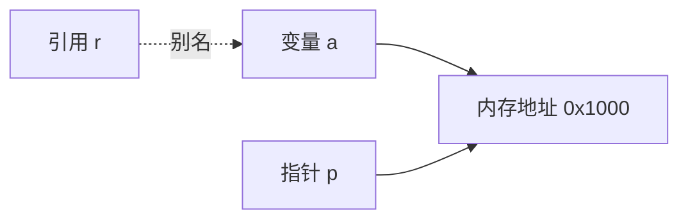

<!-- filename: 01-03 指针与引用.md -->

## 0. 一句话

> [!tip] 一句话
> 指针存地址、能改指向；引用是别名、从一而终。

## 1. 为什么需要它

- 函数里交换两个变量，值传递改不了外面——要指针或引用。
- 传大对象（结构体、`vector`）不想拷贝——用 `const T&`。
- 链表、树、动态内存——只能靠指针。

## 2. 核心机制

### 2.1 指针

```cpp
int a = 10;
int* p = &a;     // p 存 a 的地址
*p = 20;         // 解引用，改 a
```

- 指针变量本身也占内存，64 位下 8 字节。
- 可以为空：`nullptr`；可以改指向。
- 未初始化的指针是野指针，解引用是未定义行为。

### 2.2 引用

```cpp
int a = 10;
int& r = a;      // r 是 a 的别名
r = 20;          // a 也变成 20
```

- 必须初始化，不能改绑。
- 底层通常用指针实现，但语法上是别名。
- `const T&` 能绑定临时量，并延长其生命周期。

### 2.3 对比

| 维度 | 指针 | 引用 |
|---|---|---|
| 是否可为空 | 可以 `nullptr` | 不可以 |
| 是否可改绑 | 可以 | 不可以 |
| 是否占内存 | 占（8 字节） | 通常不额外占 |
| 访问方式 | `*p` / `p->` | 直接用 |
| 常见用途 | 动态内存、链表 | 函数参数、返回值 |



## 3. 语法与用法

### 3.1 指针的 const

```cpp
int a = 10;
const int* p1 = &a;        // 指向常量：不能 *p1 = 20
int* const p2 = &a;        // 指针常量：不能 p2 = &b
const int* const p3 = &a;  // 都不能改
```

口诀：`const` 在 `*` 左边，锁值；在 `*` 右边，锁指针。

### 3.2 引用做参数 / 返回值

```cpp
void addOne(int& x) { ++x; }          // 改实参

int& at(vector<int>& v, int i) {      // 返回引用，可继续赋值
    return v[i];
}
```

### 3.3 常量引用

```cpp
void print(const string& s);   // 不拷贝，也不允许改
```

## 4. 代码验证

### 4.1 指针交换 vs 引用交换

```cpp
#include <iostream>
using namespace std;

void swapPtr(int* a, int* b) {
    int t = *a;
    *a = *b;
    *b = t;
}

void swapRef(int& a, int& b) {
    int t = a;
    a = b;
    b = t;
}

int main() {
    int x = 1, y = 2;
    swapPtr(&x, &y);
    cout << x << " " << y << '\n';   // 2 1

    swapRef(x, y);
    cout << x << " " << y << '\n';   // 1 2
}
```

### 4.2 返回局部变量的引用（反例）

```cpp
int& bad() {
    int x = 10;
    return x;        // 局部变量销毁，引用悬空
}
```

编译能过，运行是未定义行为——**能编译不等于对**。

## 5. 易错点

> [!warning] 坑 1：野指针
> `int* p; *p = 1;` 未初始化就解引用，直接崩。定义时就 `= nullptr`。

> [!warning] 坑 2：返回局部变量的地址 / 引用
> 函数返回后栈帧失效，指针/引用都悬空。

> [!warning] 坑 3：引用必须初始化
> `int& r;` 编译不过；引用不能先声明后绑定。

> [!warning] 坑 4：引用不能改绑
> `r = b;` 是赋值，不是让 `r` 改指向 `b`。

> [!warning] 坑 5：`const` 位置看反
> `const int*` 锁值，`int* const` 锁指针。

> [!warning] 坑 6：指针运算越界
> `p + 10` 超出数组范围是未定义行为，别拿它当「随便加」。

> [!warning] 坑 7：引用绑字面量
> `int& r = 10;` 非法；`const int& r = 10;` 可以。

## 6. 与黑马的差异 / 补充

- **「引用本质是指针常量」**：黑马这个说法基本对，但标准没规定实现方式，别依赖底层布局。
- **`const T&` 延长临时量生命周期**：黑马没展开，但函数传参时很常用。
- **打印地址别用 `(int)&a`**：64 位会截断，直接 `cout << &a`。
- **补充 `nullptr`**：替代 `NULL`，类型安全。
- **补充智能指针**：实际工程少用裸指针管理内存，后面 RAII 再讲。

## 7. 自测

> [!question]- 指针和引用最核心的区别？
> **答案**：指针可为空、可改绑；引用必须初始化、不能改绑。

> [!question]- `const int* p` 和 `int* const p` 分别锁什么？
> **答案**：前者锁「指向的值」，后者锁「指针本身」。

> [!question]- 为什么不能返回局部变量的引用？
> **答案**：函数返回后局部变量销毁，引用指向已释放的栈内存。

## 8. 关联

- 上游：[[01-02 数组与结构体]]
- 下游：[[01-04 函数与分文件编写]]、[[01-05 内存分区]]
- 原始笔记：`C++/系统/纲/指针.md`、`C++/系统/纲/引用.md`
- 黑马章节：第 1 阶段 7 章、第 3 阶段 2 章

---

哼，指针是本鱼当年的噩梦：野指针一解引用，程序直接表演原地消失。
