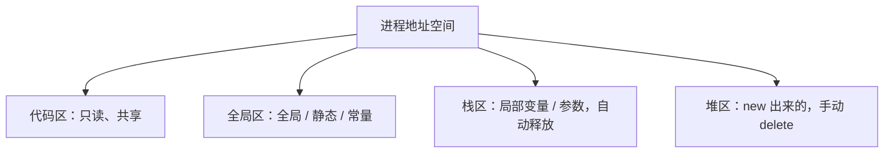

<!-- filename: 01-05 内存分区.md -->

## 0. 一句话

> [!tip] 一句话
> 程序的内存按「谁分配、谁释放、活多久」切成四块：代码区、全局区、栈区、堆区。

## 1. 为什么需要它

哼，这块当年可把本鱼坑惨了。

写个函数返回局部变量的地址，编译不报错，第一次打印还是 `10`，第二次就变成乱码——不是玄学，是栈帧已经没了。搞懂四区，你才知道：哪些地址能返回、哪些必须 `delete`、为什么大数组不能放栈上。

## 2. 核心机制

| 区域 | 放什么 | 谁分配 / 释放 | 生命周期 |
|---|---|---|---|
| 代码区 | 机器指令 | 操作系统 | 整个程序 |
| 全局区 | 全局变量、静态变量、常量（含字符串字面量） | 系统 | 程序结束 |
| 栈区 | 局部变量、函数参数、返回地址 | 编译器自动 | 函数调用结束 |
| 堆区 | `new` 出来的对象 | 程序员手动 | 到 `delete` 或进程结束 |

### 2.1 程序运行前：代码区 + 全局区

- **代码区**：共享（同一份代码只存一份）、只读（防止程序改自己的指令）。
- **全局区**：全局变量、`static` 变量、`const` 全局常量、字符串字面量。

### 2.2 程序运行后：栈区 + 堆区

- **栈**：自动、连续、快、小（Linux 默认约 8MB）。函数一返回，栈帧就废。
- **堆**：手动、离散、慢、大。`new` 申请，`delete` 释放。



## 3. 语法与用法

| 写法 | 含义 | 配套释放 |
|---|---|---|
| `new int(10)` | 单个，初始化为 10 | `delete p` |
| `new int` | 单个，不初始化 | `delete p` |
| `new int()` | 单个，初始化为 0 | `delete p` |
| `new int[10]` | 数组，10 个元素 | `delete[] p` |

```cpp
int* p = new int(10);
delete p;

int* arr = new int[10];
delete[] arr;
```

## 4. 代码验证

### 4.1 打地址，看谁和谁挨着

```cpp
#include <iostream>
using namespace std;

int g = 10;            // 全局区
static int s = 20;     // 全局区
const int cg = 30;     // 全局区（常量）

int main() {
    int a = 1, b = 2;          // 栈区
    int* p = new int(3);       // 堆区

    cout << "栈 a: " << &a << '\n';
    cout << "栈 b: " << &b << '\n';
    cout << "全局 g: " << &g << '\n';
    cout << "静态 s: " << &s << '\n';
    cout << "常量 cg: " << &cg << '\n';
    cout << "堆 p: " << p << '\n';

    delete p;
}
```

输出（地址每次运行都不同，只看相对位置）：

```text
栈 a: 0x7ff7bfeff4a8
栈 b: 0x7ff7bfeff4ac
全局 g: 0x10000c000
静态 s: 0x10000c004
常量 cg: 0x10000c008
堆 p: 0x7ff84b705a80
```

> [!tip] 本鱼碎碎念
> 栈和堆的地址隔了十万八千里，全局/静态/常量却挨在一起——这就是「区」的直观证据。

### 4.2 反例：返回局部变量的地址

```cpp
int* bad() {
    int x = 10;
    return &x;        // 栈帧已销毁
}

int main() {
    int* p = bad();
    cout << *p;       // 未定义行为
}
```

编译器会警告 `-Wreturn-local-addr`；运行时可能打印 10、可能乱码、可能直接崩。**没有报错不等于对**。

### 4.3 `new` / `delete` 必须配对

```cpp
int* p = new int(10);
delete p;
p = nullptr;      // 防止悬垂指针

int* arr = new int[5];
delete[] arr;     // 数组必须用 delete[]
```

## 5. 易错点

> [!warning] 坑 1：本鱼当年就是把局部变量地址返回出去
> **现象**：第一次能打印，第二次乱码。
> **原因**：函数返回后栈帧失效，那块内存随时被覆盖。
> **正确写法**：返回堆上的对象（`new`），或返回值本身。

> [!warning] 坑 2：`new[]` 配了 `delete`
> **现象**：可能崩，可能只析构第一个元素，行为未定义。
> **原因**：数组和单个对象的释放方式不同。
> **正确写法**：`new[]` 配 `delete[]`。

> [!warning] 坑 3：`delete` 之后继续用
> **现象**：数值看起来还“对”，换个环境就崩。
> **原因**：指针还指向已释放的内存（悬垂指针）。
> **正确写法**：`delete p; p = nullptr;`。

> [!warning] 坑 4：大数组放栈上
> **现象**：`int a[10000000];` 直接段错误。
> **原因**：栈默认只有几 MB。
> **正确写法**：大数组用 `new` / `vector` 放堆上。

> [!warning] 坑 5：改字符串字面量
> **现象**：`char* s = "abc"; s[0] = 'x';` 运行时崩溃。
> **原因**：字符串字面量在只读段。
> **正确写法**：`const char* s = "abc";`，要改就用 `std::string`。

> [!warning] 坑 6：用 `(int)&a` 打印 64 位地址
> **现象**：`cast from 'int*' to 'int' loses precision`。
> **原因**：64 位指针塞不进 32 位 `int`。
> **正确写法**：直接 `cout << &a`，或 `reinterpret_cast<uintptr_t>(&a)`。

## 6. 与黑马的差异 / 补充

- **打印地址的写法过时**：黑马用 `(int)&a`，那是 32 位/VS 时代的写法，64 位下编译不过。用 `cout << &a` 或 `uintptr_t`。
- **「常量区」的归属**：黑马把常量区算进全局区；更准确的说法是「静态存储期」，字符串字面量放在只读数据段。
- **栈区不是“用完就清零”**：函数返回只是栈指针回退，旧数据还在，所以才会出现“偶尔还能打印出 10”。
- **补充悬垂指针**：黑马没强调 `delete` 后置空，这是实际项目里最常见的二次释放来源。
- **补充现代写法**：实际工程少用裸 `new/delete`，用 `std::unique_ptr` / `std::vector`（后续 RAII 再展开）。

## 7. 自测

> [!question]- 四个区分别放什么？谁负责释放？
> **答案**：代码区放指令（系统管）；全局区放全局/静态/常量（程序结束释放）；栈区放局部变量和参数（编译器自动）；堆区放 `new` 的对象（程序员 `delete`）。

> [!question]- 为什么返回局部变量的地址是错的？
> **答案**：函数返回后栈帧销毁，那块内存不再属于你，读取是未定义行为。

> [!question]- `new int[10]` 应该怎么释放？只写 `delete p` 会怎样？
> **答案**：必须 `delete[] p`；写 `delete p` 是未定义行为，可能只析构第一个元素或直接崩溃。

## 8. 关联

- 上游：[[01-03 指针与引用]]
- 下游：[[01-06 类与对象]]（构造/析构发生在栈或堆上）
- 原始笔记：`C++/系统/纲/内存分区.md`
- 黑马章节：第 1 章 内存分区模型

---

呜……写完这段，本鱼又想起那个半夜三点的段错误。下次再返回局部变量地址，本鱼就把自己炖了。
