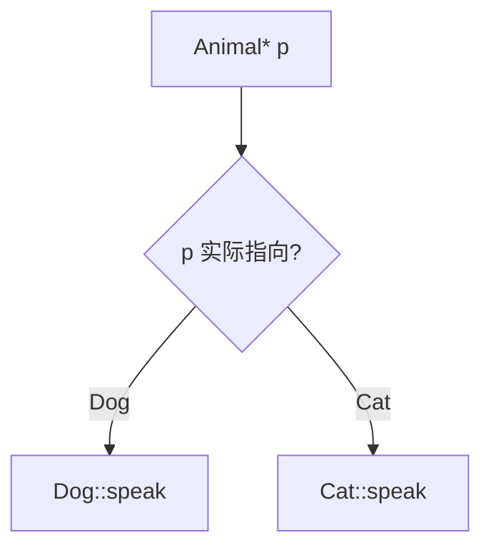

<!-- filename: 01-11 继承与多态.md -->

## 0. 一句话

> [!tip] 一句话
> 继承复用父类，多态让同一条调用语句在不同对象上跑出不同行为。

## 1. 为什么需要它

职工系统里有普通员工、经理、老板，都有姓名、工号、`show()`，但工资算法不同。继承复用公共部分，多态让 `show()` 各显各的。

## 2. 核心机制

### 2.1 继承语法与方式

```cpp
class Dog : public Animal { };
```

| 继承方式 | 父类 public | 父类 protected | 父类 private |
|---|---|---|---|
| `public` | public | protected | 不可见 |
| `protected` | protected | protected | 不可见 |
| `private` | private | private | 不可见 |

实际开发几乎只用 `public`。

### 2.2 构造 / 析构顺序

父构造 → 子构造 → 子析构 → 父析构。

### 2.3 同名成员

子类同名成员会**隐藏**父类成员，要用 `Base::x` 显式访问。

### 2.4 菱形继承与虚继承

`B`、`C` 都继承 `A`，`D` 同时继承 `B`、`C`，`A` 的成员会出现两份 → 二义性。用 `virtual public A` 虚继承，只保留一份。

### 2.5 多态

- 父类函数加 `virtual`，子类重写（`override`）。
- 通过**父类指针/引用**调用，才会动态绑定到子类实现。
- 纯虚函数 `= 0` → 抽象类，不能实例化。
- 基类析构必须是 `virtual`，否则 `delete` 子类对象时子类析构不执行。



## 3. 语法与用法

```cpp
class Animal {
public:
    virtual void speak() const = 0;   // 纯虚函数
    virtual ~Animal() = default;
};

class Dog : public Animal {
public:
    void speak() const override { cout << "woof"; }
};
```

- `override` 让编译器检查是否真的重写。
- `final` 禁止继续重写/继承。

## 4. 代码验证

```cpp
#include <iostream>
using namespace std;

class Animal {
public:
    virtual void speak() const { cout << "animal\n"; }
    virtual ~Animal() { cout << "~Animal\n"; }
};

class Dog : public Animal {
public:
    void speak() const override { cout << "woof\n"; }
    ~Dog() override { cout << "~Dog\n"; }
};

int main() {
    Animal* p = new Dog();
    p->speak();     // woof
    delete p;       // ~Dog 然后 ~Animal
}
```

## 5. 易错点

> [!warning] 坑 1：忘了 `virtual`
> 父类指针调用的是父类版本（静态绑定），多态失效。

> [!warning] 坑 2：基类析构不是虚函数
> `delete` 父类指针只调父类析构，子类资源泄漏。

> [!warning] 坑 3：构造/析构里调虚函数
> 构造父类时子类还没构造好，虚函数不会多态。

> [!warning] 坑 4：同名成员隐藏
> 子类 `int x` 隐藏父类 `x`，要 `Base::x` 才能访问。

> [!warning] 坑 5：菱形继承二义性
> `D d; d.x;` 报 ambiguous，用虚继承或显式 `B::x`。

> [!warning] 坑 6：抽象类实例化
> 含纯虚函数的类不能 `new`，只能通过指针/引用使用子类。

> [!warning] 坑 7：`override` 写错签名
> 参数少个 `const` 就不是重写，加了 `override` 编译器会直接报错（好事）。

## 6. 与黑马的差异 / 补充

- **黑马 4.6/4.7 内容很全**，本笔记只留骨架，细节回原笔记 `C++/系统/纲/类和对象.md`。
- **`system("pause")`**：黑马示例常见，Windows 专用。
- **补充 `override` / `final`**：C++11 起用它们替代「靠命名检查」。
- **补充虚析构**：只要类可能被继承，析构就写成 `virtual`。
- **补充 `dynamic_cast`**：安全向下转型，失败返回 `nullptr`（需 RTTI）。

## 7. 自测

> [!question]- 多态生效的两个条件？
> **答案**：父类函数是 `virtual`，并且通过父类指针/引用调用。

> [!question]- 为什么基类析构要虚？
> **答案**：`delete` 父类指针时才能正确调用子类析构，避免资源泄漏。

> [!question]- 虚继承解决什么问题？
> **答案**：菱形继承中共同基类出现多份、产生二义性的问题。

## 8. 关联

- 上游：[[01-06 类与对象]]
- 下游：[[02-00 算法总览]]（无直接关系，可回总览）
- 原始笔记：`C++/系统/纲/类和对象.md`
- 黑马章节：第 3 阶段 4.6、4.7

---

哼，多态就是「同一句话，不同鱼听出不同意思」——本鱼说饿，你听懂了吗？
