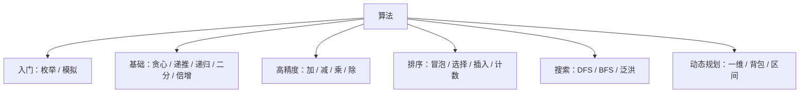

## 这套算法笔记怎么长出来的

按课程截图分六层，每一层拆成专题；专题只放套路，题目放题解，两边双向链接。



## 进度

| 层级 | 专题 | 状态 | 题解 |
|---|---|---|---|
| 入门 | [[01 枚举与模拟]] | ✅ 已建 | 1 / 59 / 66 / 204 / 54 |
| 基础 | [[02 贪心]] | ✅ 已建 | 455 / 435 / 122 / 56 / 55 |
| 基础 | [[03 递推与递归]] | ✅ 已建 | 70 / 509 / 206 / 118 |
| 基础 | [[04 二分]] | ✅ 已建 | 704 / 34 / 69 / 162 / 33 / 278 / 砍树 |
| 基础 | [[05 倍增]] | ✅ 已建 | 50 / P3865 / 1483 |
| 高精度 | [[06 高精度]] | ✅ 已建 | P1601 / P2142 / P1303 / P1480 |
| 排序 | [[07 排序]] | ✅ 已建 | P1177 / 912 / 75 |
| 搜索 | [[08 搜索]] | ✅ 已建 | 200 / 733 / 46 |
| 动态规划 | [[09 动态规划]] | ✅ 已建 | 198 / 416 / 300 |

## 三个铁律

1. 专题页不放完整题解，只放「信号 + 模板 + 例题索引」。
2. 例题必须链到题解，题解开头必须回链专题。
3. 题解不够就补，补的题必须给完整题意，不编题号。

## 全部笔记

```dataview
TABLE type AS "类型", topic AS "专题", status AS "状态"
FROM "C++肥鱼版/02 算法"
WHERE type != "总览"
SORT type ASC, title ASC
```

## 推荐顺序

枚举/模拟 → 排序 → 二分 → 贪心 → 递推/递归 → 搜索 → 动态规划 → 高精度 → 倍增。

先把「能暴力、能模拟、能二分、能贪心」练熟，再上 DP 和倍增。

## 关联

- 全库入口：[[00 总览]]（待建）
- 提示词：[[00 提示词集]]
