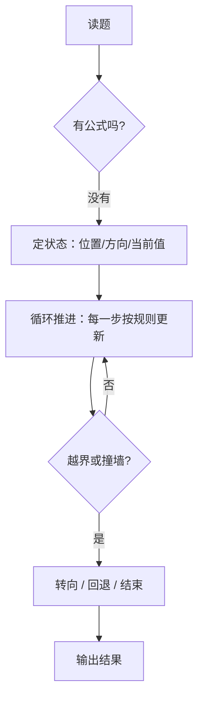

<!-- filename: 01 枚举与模拟.md -->

## 0. 什么时候用

看到下面这些信号，先想「暴力 + 按题意走」，别急着上高级算法：

- 数据范围很小（`n <= 100`、`n <= 1000`），多重循环能过 → `1 两数之和`、`204 计数质数`
- 题目要求「按规则一步步执行」，没有明显公式 → `54 螺旋矩阵`、`59 螺旋矩阵 II`
- 要按顺序填表、走格子、逐位处理 → `66 加一`、`289 生命游戏`
- 枚举的维度能确定（枚举谁、范围多大）→ `1 两数之和`
- 模拟需要维护「当前位置 + 方向」→ `59 螺旋矩阵 II`

## 1. 核心思想

枚举管「把所有可能试一遍」，模拟管「照着题意走一遍」。

- **枚举三件事**：枚举什么、枚举范围、怎么判重 / 剪枝。
- **模拟三件事**：维护哪些状态、方向怎么变、边界怎么判。



哼，别小看这两类。竞赛里最容易拿分的题，往往就是「模拟写得比谁都稳」。

## 2. 模板代码

### 2.1 枚举框架

```cpp
for (int i = 0; i < n; ++i) {
    for (int j = i + 1; j < n; ++j) {
        if (check(i, j)) {
            // 记录答案
        }
    }
}
```

### 2.2 方向数组（走格子 / 螺旋）

```cpp
int dx[4] = {0, 1, 0, -1};
int dy[4] = {1, 0, -1, 0};

int x = 0, y = 0, d = 0;
for (int k = 0; k < n * n; ++k) {
    a[x][y] = k + 1;
    int nx = x + dx[d], ny = y + dy[d];
    if (nx < 0 || nx >= n || ny < 0 || ny >= n || a[nx][ny]) {
        d = (d + 1) % 4;
        nx = x + dx[d];
        ny = y + dy[d];
    }
    x = nx;
    y = ny;
}
```

### 2.3 逐位模拟（加一）

```cpp
for (int i = (int)digits.size() - 1; i >= 0; --i) {
    if (digits[i] < 9) {
        ++digits[i];
        return digits;
    }
    digits[i] = 0;
}
digits.insert(digits.begin(), 1);
```

## 3. 复杂度与适用边界

| 做法 | 时间 | 适用数据范围 |
|---|---|---|
| 双重枚举 | `O(n²)` | `n <= 5000` 左右 |
| 三重枚举 | `O(n³)` | `n <= 300` 左右 |
| 模拟走格子 | `O(n*m)` | 只要每格走常数次 |
| 逐位模拟 | `O(n)` | 位数长度 |

范围再大，就要想排序、二分、哈希、DP 了。

## 4. 我的错题

原笔记里有蛇形方阵、扫雷、压缩码、骑士金币几道模拟题，等搬进题解后再补错因。当前：暂无。

## 5. 易错点

> [!warning] 坑 1：枚举范围开闭写错
> `for (int j = i + 1; ...)` 才不会把同一对算两次；写成 `j = 0` 就重复计数。

> [!warning] 坑 2：方向数组和转向顺序不匹配
> 顺时针是「右、下、左、上」，数组写成「右、下、上、左」就会画出鬼画符。

> [!warning] 坑 3：螺旋矩阵边界更新漏一步
> 每走完一条边就要收缩边界，否则会在角上原地打转。

> [!warning] 坑 4：模拟死循环
> 转向四次还在原地，说明边界条件写错；加一个「走了几步」的计数兜底。

> [!warning] 坑 5：逐位进位全 9
> `[9,9,9]` 要变成 `[1,0,0,0]`，别忘了最高位插入。

> [!warning] 坑 6：下标 0/1 混用
> 题目说第 1 行，代码里是 0；模拟题最容易在这里差一。

## 6. 例题

| 题目 | 难度 | 题眼 | 题解 |
|---|---|---|---|
| [LeetCode 1 两数之和](https://leetcode.cn/problems/two-sum/) | ⭐ | 双重枚举，先写对再优化 | [[LeetCode 1 两数之和]] |
| [LeetCode 204 计数质数](https://leetcode.cn/problems/count-primes/) | ⭐⭐ | 枚举 + 标记倍数 | [[LeetCode 204 计数质数]] |
| [LeetCode 54 螺旋矩阵](https://leetcode.cn/problems/spiral-matrix/) | ⭐⭐ | 四条边 + 收缩边界 | [[LeetCode 54 螺旋矩阵]] |
| [LeetCode 59 螺旋矩阵 II](https://leetcode.cn/problems/spiral-matrix-ii/) | ⭐⭐ | 方向数组 + 撞墙转向 | [[LeetCode 59 螺旋矩阵 II]] |
| [LeetCode 66 加一](https://leetcode.cn/problems/plus-one/) | ⭐ | 从后往前处理进位 | [[LeetCode 66 加一]] |

题解已补齐：1 / 59 / 66 / 204 / 54。

## 7. 同类题

| 题目 | 难度 | 关键点 |
|---|---|---|
| [LeetCode 289 生命游戏](https://leetcode.cn/problems/game-of-life/) | ⭐⭐ | 原地模拟，用额外状态避免覆盖 |
| [LeetCode 118 杨辉三角](https://leetcode.cn/problems/pascals-triangle/) | ⭐ | 逐行递推 |
| 蛇形方阵 | ⭐⭐ | 你的原笔记，方向数组经典题 |
| 扫雷 | ⭐⭐ | 你的原笔记，八方向统计 |

## 8. 自测

> [!question]- 枚举两数之和时，内层循环为什么从 `i + 1` 开始？
> **答案**：避免同一对 `(i, j)` 和 `(j, i)` 被算两次，也避免元素和自己配对。

> [!question]- 螺旋矩阵里，怎么判断「该转向了」？
> **答案**：下一步越界，或者下一步的格子已经被填过（值非 0）。

## 9. 关联

- 上游：[[01-01 基础语法与运算符]]
- 下游：[[02 贪心]]、[[03 递推与递归]]
- 原始笔记：`C++/算法/算法题/（重点）蛇形方阵两种实现方式笔记.md`、`扫雷游戏问题与解决方案.md`
- 黑马章节：无

---

嘿嘿，模拟题就像照着菜谱做菜——步骤写对了，味道就不会差。
