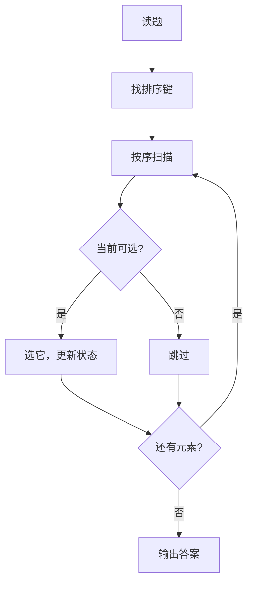

<!-- filename: 02 贪心.md -->

## 0. 什么时候用

- 区间调度、选最多不重叠 → `435 无重叠区间`、`452 用最少数量的箭引爆气球`
- 分配 / 匹配，小的先满足 → `455 分发饼干`
- 多次交易求最大收益 → `122 买卖股票的最佳时机 II`
- 合并重叠区间 → `56 合并区间`
- 每步只关心「当前最优」，且能说清为什么 → `55 跳跃游戏`

看到「最多」「最少」「最大收益」，又不需要枚举所有组合，先想贪心。

## 1. 核心思想

贪心 = **排序 + 每步选当前最优 + 证明它不亏**。

三步走：

1. **定排序键**：按起点、终点、还是比值？选错键，贪心直接报废。
2. **定选择规则**：能选就选、选最小的、选结束最早的。
3. **证明**：交换论证（把最优解换成贪心解不更差）或举反例。



## 2. 模板代码

### 2.1 区间调度（按结束时间）

```cpp
sort(a.begin(), a.end(), [](const auto& x, const auto& y) {
    return x.second < y.second;
});

int ans = 0, lastEnd = INT_MIN;
for (auto& [l, r] : a) {
    if (l >= lastEnd) {
        ++ans;
        lastEnd = r;
    }
}
```

### 2.2 双指针匹配（饼干）

```cpp
sort(g.begin(), g.end());
sort(s.begin(), s.end());

int i = 0, j = 0, ans = 0;
while (i < (int)g.size() && j < (int)s.size()) {
    if (s[j] >= g[i]) { ++ans; ++i; ++j; }
    else ++j;
}
```

## 3. 复杂度与适用边界

| 做法 | 时间 | 说明 |
|---|---|---|
| 排序 + 一次扫描 | `O(n log n)` | 最常见 |
| 堆维护 | `O(n log n)` | 需要「反悔」时 |
| 不排序直接扫 | `O(n)` | 只有题目天然有序时 |

贪心不保证最优！拿不准就举反例，或者退回 DP。

## 4. 我的错题

暂无。等你的错题搬进来再补。

## 5. 易错点

> [!warning] 坑 1：区间调度按起点排序
> 应该按**结束时间**排。按起点排会选一个很长的区间，挡住后面一堆。

> [!warning] 坑 2：`>=` 写成 `>`
> `[1,2]` 和 `[2,3]` 不算重叠，判断应该是 `l >= lastEnd`。

> [!warning] 坑 3：没证明就交
> 贪心最怕「看起来对」。举三个反例，或者写交换论证。

> [!warning] 坑 4：该用堆的题硬贪
> 任务调度、反悔贪心需要优先队列，比如「最多课程」类问题。

> [!warning] 坑 5：收益累加溢出
> 股票、求和类题目，`int` 不够就用 `long long`。

## 6. 例题

| 题目 | 难度 | 题眼 | 题解 |
|---|---|---|---|
| [LeetCode 455 分发饼干](https://leetcode.cn/problems/assign-cookies/) | ⭐ | 小饼干先满足小胃口 | [[LeetCode 455 分发饼干]] |
| [LeetCode 435 无重叠区间](https://leetcode.cn/problems/non-overlapping-intervals/) | ⭐⭐ | 按结束时间排序，能选就选 | [[LeetCode 435 无重叠区间]] |
| [LeetCode 122 买卖股票的最佳时机 II](https://leetcode.cn/problems/best-time-to-buy-and-sell-stock-ii/) | ⭐⭐ | 把所有上涨段加起来 | [[LeetCode 122 买卖股票的最佳时机 II]] |
| [LeetCode 56 合并区间](https://leetcode.cn/problems/merge-intervals/) | ⭐⭐ | 按起点排序，维护当前右端 | [[LeetCode 56 合并区间]] |
| [LeetCode 55 跳跃游戏](https://leetcode.cn/problems/jump-game/) | ⭐⭐ | 维护能到达的最远位置 | [[LeetCode 55 跳跃游戏]] |

题解已补齐：455 / 435 / 122 / 56 / 55。

## 7. 同类题

| 题目 | 难度 | 关键点 |
|---|---|---|
| [LeetCode 452 用最少数量的箭引爆气球](https://leetcode.cn/problems/minimum-number-of-arrows-to-burst-balloons/) | ⭐⭐ | 区间选点，按右端排序 |
| [LeetCode 121 买卖股票的最佳时机](https://leetcode.cn/problems/best-time-to-buy-and-sell-stock/) | ⭐ | 只能交易一次，维护最小价格 |
| [LeetCode 860 柠檬水找零](https://leetcode.cn/problems/lemonade-change/) | ⭐ | 优先用大面额找零 |

## 8. 自测

> [!question]- 区间调度为什么按结束时间排序，而不是开始时间？
> **答案**：结束越早，留给后面的空间越大；按开始排可能先选一个超长区间。

> [!question]- 买卖股票 II 为什么等价于「所有上涨段之和」？
> **答案**：可以在每一天自由买卖，任何一段上涨都能通过「前一天买、今天卖」吃到。

## 9. 关联

- 上游：[[01 枚举与模拟]]
- 下游：[[03 递推与递归]]、[[09 动态规划]]
- 原始笔记：无（新增专题）
- 黑马章节：无

---

哼，贪心就像吃自助：先拿最容易拿的，别一上来就端整只烤鱼——拿不动还挡路。
