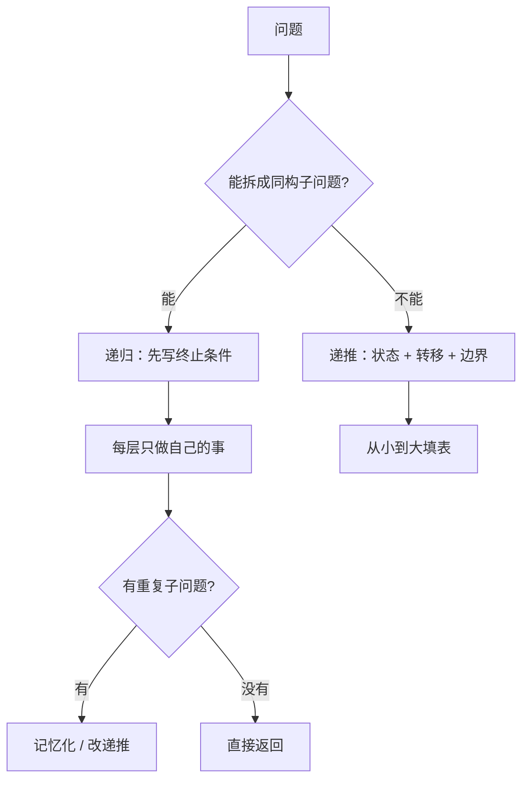

<!-- filename: 03 递推与递归.md -->

## 0. 什么时候用

- 当前状态只由前几个状态推出来 → `70 爬楼梯`、`118 杨辉三角`
- 定义天然是递归的，边界明确 → `509 斐波那契数`、`206 反转链表`
- 大问题能拆成同构的小问题 → `206 反转链表`
- 递归会重复计算，需要记忆化 → `509 斐波那契数`

递推是「从已知推未知」，递归是「自己调自己」。两者经常是一体两面。

## 1. 核心思想

**递推**：定状态 → 找转移 → 定边界 → 按顺序算。

**递归**：定终止条件 → 定每一层做什么 → 信任下一层已经做好。



## 2. 模板代码

### 2.1 递推（滚动变量）

```cpp
int climbStairs(int n) {
    if (n <= 2) return n;
    int a = 1, b = 2;
    for (int i = 3; i <= n; ++i) {
        int c = a + b;
        a = b;
        b = c;
    }
    return b;
}
```

### 2.2 递归（先写终止条件）

```cpp
int fib(int n) {
    if (n <= 1) return n;          // 终止条件
    return fib(n - 1) + fib(n - 2); // 每层做什么
}
```

### 2.3 记忆化

```cpp
vector<int> memo(31, -1);

int fib(int n) {
    if (n <= 1) return n;
    if (memo[n] != -1) return memo[n];
    return memo[n] = fib(n - 1) + fib(n - 2);
}
```

## 3. 复杂度与适用边界

| 写法 | 时间 | 空间 | 说明 |
|---|---|---|---|
| 朴素递归 | `O(2^n)` | `O(n)` 栈 | 只适合 `n <= 30` |
| 记忆化 | `O(n)` | `O(n)` | 递归 + 缓存 |
| 递推 | `O(n)` | `O(1)` 或 `O(n)` | 最稳 |

递归深度默认约 1000，再深就栈溢出，改递推。

## 4. 我的错题

原笔记里有斐波那契的常见错误，等搬进题解后补错因。当前：暂无。

## 5. 易错点

> [!warning] 坑 1：递归没写终止条件
> 直接 `RecursionError` / 栈溢出。先写 `if (n <= 1) return ...`。

> [!warning] 坑 2：递归重复计算
> `fib(40)` 朴素递归要算几十亿次，必须记忆化或改递推。

> [!warning] 坑 3：递推边界写错
> `dp[0]` 和 `dp[1]` 是最容易错的，先手算前几项对一下。

> [!warning] 坑 4：递推顺序反了
> `dp[i]` 依赖 `dp[i-1]`，就必须从前往后算；反过来拿到的全是初值。

> [!warning] 坑 5：结果溢出
> 方案数增长很快，该开 `long long` 就开。

> [!warning] 坑 6：递归里修改全局状态
> 回溯题要记得「恢复现场」，否则上一层拿到脏数据。

## 6. 例题

| 题目 | 难度 | 题眼 | 题解 |
|---|---|---|---|
| [LeetCode 70 爬楼梯](https://leetcode.cn/problems/climbing-stairs/) | ⭐ | 斐波那契变形，滚动变量 | [[LeetCode 70 爬楼梯]] |
| [LeetCode 509 斐波那契数](https://leetcode.cn/problems/fibonacci-number/) | ⭐ | 递归入门 + 记忆化 | [[LeetCode 509 斐波那契数]] |
| [LeetCode 206 反转链表](https://leetcode.cn/problems/reverse-linked-list/) | ⭐⭐ | 递归：先反转后面，再改指针 | [[LeetCode 206 反转链表]] |
| [LeetCode 118 杨辉三角](https://leetcode.cn/problems/pascals-triangle/) | ⭐ | 二维递推，边界全 1 | [[LeetCode 118 杨辉三角]] |

## 7. 同类题

| 题目 | 难度 | 关键点 |
|---|---|---|
| [LeetCode 119 杨辉三角 II](https://leetcode.cn/problems/pascals-triangle-ii/) | ⭐ | 只保留一行，倒序更新 |
| [LeetCode 21 合并两个有序链表](https://leetcode.cn/problems/merge-two-sorted-lists/) | ⭐ | 递归合并 |
| [LeetCode 344 反转字符串](https://leetcode.cn/problems/reverse-string/) | ⭐ | 双指针递归 |
| [LeetCode 46 全排列](https://leetcode.cn/problems/permutations/) | ⭐⭐ | 回溯，恢复现场 |

## 8. 自测

> [!question]- 爬楼梯的递推式和边界是什么？
> **答案**：`dp[i] = dp[i-1] + dp[i-2]`，`dp[1] = 1`，`dp[2] = 2`。

> [!question]- 递归函数写之前，先想哪两件事？
> **答案**：终止条件（什么时候直接返回）和每一层要做什么。

## 9. 关联

- 上游：[[01 枚举与模拟]]
- 下游：[[09 动态规划]]
- 原始笔记：`C++/算法/算法题/（重点）斐波那契数列计算常见错误笔记.md`
- 黑马章节：无

---

哼，递归就像剥洋葱：先想清楚「最后一片」，再想「这一片怎么办」。
- Python 模板：[[10-动态规划]]（同一套路的 Python 写法）
