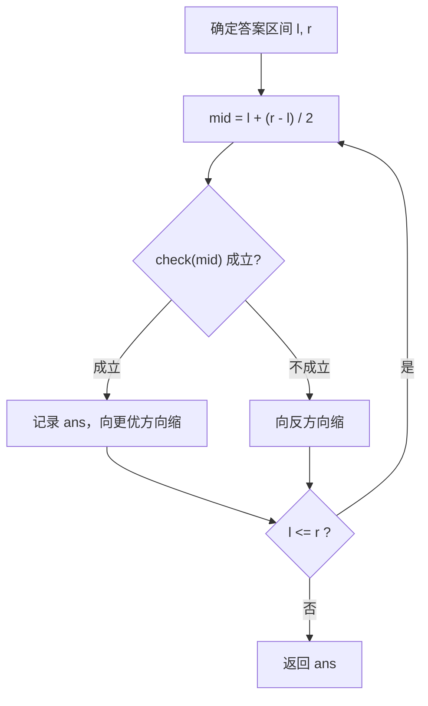

<!-- filename: 二分.md -->

## 0. 什么时候用

看到下面这些信号，先想二分，别急着 for：

- 数组**有序**，或者某一段**局部有序** → `704 二分查找`、`33 搜索旋转排序数组`、`162 寻找峰值`
- 题目要「第一个 / 最后一个满足条件的」→ `34 查找元素范围`、`278 第一个错误版本`
- 题目要「最大化最小值 / 最小化最大值」——这是**二分答案** → `砍树`、`69 x 的平方根`
- 答案范围很大（`1e9`），但 `check(mid)` 很好写 → `砍树`
- 数据范围 `n = 1e5`，`O(n log n)` 能过，`O(n²)` 不行 → `34 查找元素范围`

反过来说：数据无序、又没有单调性，二分不背这个锅。

## 1. 核心思想

哼，二分这东西，写对一次不难，难的是每次都写对。

每一轮砍掉一半：`mid` 满足条件就往「更优方向」缩，不满足就往反方向缩，直到区间为空。



两个前提必须同时成立：

1. **单调性**：`check(mid)` 的结果随 `mid` 单调变化（真真真假假假，或反过来）。
2. **区间可缩**：每一轮必须严格排除掉一部分，否则死循环。

## 2. 模板代码

> [!tip] 本鱼碎碎念
> 整数二分只有两种死法：死循环，和差一。把下面四段背下来，两种都能躲。

### 2.1 精确查找（找到返回下标，否则 -1）

```cpp
int binarySearch(const vector<int>& a, int target) {
    int l = 0, r = (int)a.size() - 1;
    while (l <= r) {
        int mid = l + (r - l) / 2;
        if (a[mid] == target) return mid;
        if (a[mid] < target) l = mid + 1;
        else                 r = mid - 1;
    }
    return -1;
}
```

### 2.2 左边界（第一个 ≥ target）

```cpp
int lowerBound(const vector<int>& a, int target) {
    int l = 0, r = (int)a.size() - 1;
    int ans = (int)a.size();          // 全都小于 target 时返回 n
    while (l <= r) {
        int mid = l + (r - l) / 2;
        if (a[mid] >= target) {
            ans = mid;
            r = mid - 1;              // 继续往左找更小的
        } else {
            l = mid + 1;
        }
    }
    return ans;
}
```

### 2.3 右边界（最后一个 ≤ target）

```cpp
int upperBound(const vector<int>& a, int target) {
    int l = 0, r = (int)a.size() - 1;
    int ans = -1;                     // 全都大于 target 时返回 -1
    while (l <= r) {
        int mid = l + (r - l) / 2;
        if (a[mid] <= target) {
            ans = mid;
            l = mid + 1;              // 继续往右找更大的
        } else {
            r = mid - 1;
        }
    }
    return ans;
}
```

### 2.4 实数二分（固定 100 次）

```cpp
double sqrtBinary(double x) {
    double l = 0, r = max(1.0, x);
    for (int i = 0; i < 100; ++i) {
        double mid = (l + r) / 2;
        if (mid * mid <= x) l = mid;
        else                r = mid;
    }
    return l;
}
```

### 2.5 STL 现成的

```cpp
vector<int> a = {1, 2, 2, 3, 5};
int x = 2;

auto it1 = lower_bound(a.begin(), a.end(), x);  // 第一个 >= x
auto it2 = upper_bound(a.begin(), a.end(), x);  // 第一个 > x
int idx = int(it1 - a.begin());                 // 转下标
```

## 3. 复杂度与适用边界

| 类型 | 区间 | mid 更新 | 循环条件 | 终止 |
|---|---|---|---|---|
| 整数二分 | 离散 | `l = mid + 1` / `r = mid - 1` | `l <= r` | `l > r` |
| 实数二分 | 连续 | `l = mid` / `r = mid` | 固定 100 次或 `r - l > eps` | 精度足够 |

- 时间 `O(log n)`，空间 `O(1)`。
- 整数二分必须 `±1`，否则 `l = mid` 会原地打转。
- 实数二分**不能** `±1`，精度会直接丢一半。
- `mid = l + (r - l) / 2`，别写 `(l + r) / 2`，会溢出。

## 4. 我的错题

> [!warning] 坑 1：本鱼当年把 `l = mid` 写出了死循环
> **现象**：`[2, 3]` 上 `mid` 永远是 2，程序卡死。
> **原因**：整数区间没有严格缩小。
> **正确写法**：整数二分一律 `l = mid + 1` 或 `r = mid - 1`。

> [!warning] 坑 2：区间开闭和循环条件对不上
> **现象**：左闭右开却写 `l <= r`，最后多算一个越界元素。
> **原因**：`[l, r)` 的右端点取不到，循环条件应是 `l < r`。
> **正确写法**：选定一种区间定义后，全程不换。

> [!warning] 坑 3：模糊查找忘了记录 `ans`
> **现象**：最后返回 `l`，但答案在缩区间的过程中被跳过了。
> **原因**：`l` 只是边界，不一定是可行解。
> **正确写法**：`check(mid)` 成立时先 `ans = mid`，最后返回 `ans`。

> [!warning] 坑 4：有重复元素却用精确查找
> **现象**：`[1,2,2,3]` 找第一个 2，返回了下标 2。
> **原因**：精确查找命中就返回，不保证是边界。
> **正确写法**：要边界就用左/右边界模板。

> [!warning] 坑 5：答案越界没判
> **现象**：找比所有元素都大的数，返回 `n`，后面 `a[ans]` 越界。
> **正确写法**：返回前判 `ans < n`，或者用 `lower_bound` 的迭代器写法。

## 5. 易错点

- **`l <= r` 还是 `l < r`**：闭区间用 `<=`，左闭右开用 `<`，混用必错。
- **`mid` 溢出**：`(l + r) / 2` 在 `l, r` 接近 `INT_MAX` 时溢出。
- **实数精度**：`1e-8` 一般够；要求更高就多循环几次。
- **`check` 的单调性**：不单调的 `check` 二分出来的结果是错的，不是慢。
- **二分答案的上下界**：下界取「一定不可行」，上界取「一定可行」，否则会漏解。
- **`upper_bound` 语义**：STL 的 `upper_bound` 是「第一个 > x」，不是「最后一个 ≤ x」，别搞反。

## 6. 例题

| 题目 | 难度 | 题眼 | 题解 |
|---|---|---|---|
| [LeetCode 704 二分查找](https://leetcode.cn/problems/binary-search/) | ⭐ | 精确查找模板，先把 `l <= r` 写对 | [[LeetCode 704 二分查找]] |
| [LeetCode 34 在排序数组中查找元素的范围](https://leetcode.cn/problems/find-first-and-last-position-of-element-in-sorted-array/) | ⭐⭐ | 两次二分，分别找左右边界 | [[LeetCode 34 在排序数组中查找元素的第一个和最后一个位置]] |
| [LeetCode 69 x 的平方根](https://leetcode.cn/problems/sqrtx/) | ⭐⭐ | 二分答案，`mid * mid` 防溢出 | [[LeetCode 69 x 的平方根]] |
| [LeetCode 162 寻找峰值](https://leetcode.cn/problems/find-peak-element/) | ⭐⭐⭐ | 局部有序也能二分 | [[LeetCode 162 寻找峰值]] |
| [LeetCode 33 搜索旋转排序数组](https://leetcode.cn/problems/search-in-rotated-sorted-array/) | ⭐⭐⭐ | 先判哪半边有序 | [[LeetCode 33 搜索旋转排序数组]] |
| [LeetCode 278 第一个错误的版本](https://leetcode.cn/problems/first-bad-version/) | ⭐⭐ | 找第一个 true | [[LeetCode 278 第一个错误的版本]] |
| [砍树](https://www.luogu.com.cn/problem/P1873) | ⭐⭐⭐ | 二分答案：最大化可行高度 | [[砍树]] |

题解已补齐：704 / 34 / 69 / 162 / 33 / 278 / 砍树。

## 7. 同类题

| 题目 | 类型 | 关键点 |
|---|---|---|
| [LeetCode 704 二分查找](https://leetcode.cn/problems/binary-search/) | 精确查找 | 模板题，先写对 `<=` |
| [LeetCode 34 在排序数组中查找元素范围](https://leetcode.cn/problems/find-first-and-last-position-of-element-in-sorted-array/) | 左右边界 | 两次二分，分别找左右 |
| [LeetCode 69 x 的平方根](https://leetcode.cn/problems/sqrtx/) | 右边界 / 二分答案 | `mid * mid` 用 `long long` |
| [LeetCode 162 寻找峰值](https://leetcode.cn/problems/find-peak-element/) | 局部有序 | `l < r`，比较 `mid` 与 `mid+1` |
| [砍树（二分答案）](https://www.luogu.com.cn/problem/P1873) | 最大化可行解 | `check(H) = 砍下的木材 ≥ M` |
| [LeetCode 33 搜索旋转排序数组](https://leetcode.cn/problems/search-in-rotated-sorted-array/) | 局部有序 | 先判哪半边有序 |

## 8. 自测

> [!question]- 手写 `lower_bound`：在 `[1,2,2,2,3]` 里找第一个 2 的下标。
> **答案**：返回 1。用 2.2 的模板，`ans` 记 1 后继续向左缩，最终停在 1。

> [!question]- 为什么整数二分写 `l = mid` 会死循环，实数二分却可以？
> **答案**：整数除法会向下取整，`mid` 可能等于 `l`，区间不缩小；实数除法不会取整，`mid` 严格落在中间。

> [!question]- 二分答案的 `check` 需要满足什么？
> **答案**：单调性——`mid` 可行时，比它更保守的一侧也可行（或反过来），否则二分不成立。

## 9. 关联

- 上游：[[01-01 基础语法与运算符]]
- 下游：[[LeetCode 704 二分查找]]、[[LeetCode 34 在排序数组中查找元素的第一个和最后一个位置]]
- 原始笔记：`C++/算法/法/二分法.md`
- 黑马章节：无（黑马基础/核心阶段不涉及二分）

> [!warning] 整理说明
> 原笔记里的代码在导出时丢了 `<`、`>` 等符号（`while (left` 后面直接断了），本鱼按逻辑补全，并用 `g++ -std=c++17` 逐段验证过。原结论全部保留，只修了代码。

---

呜……当年本鱼在 `[2, 3]` 上卡了半小时，就因为少写一个 `+1`。现在写这段，尾巴还隐隐作痛。
- Python 模板：[[06-二分与排序]]（同一套路的 Python 写法）
