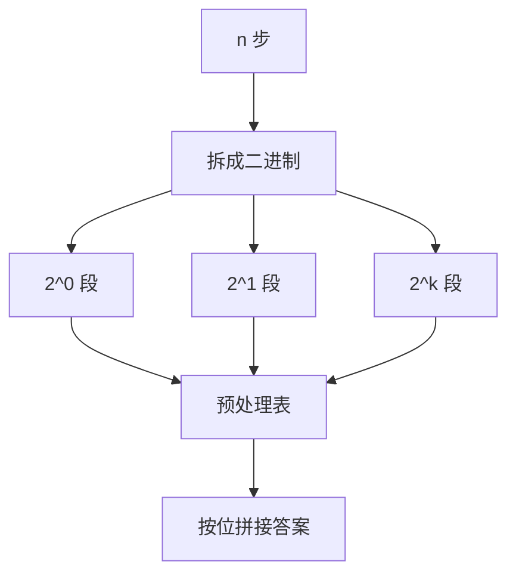

<!-- filename: 05 倍增.md -->

## 0. 什么时候用

- 需要反复「跳 2^k 步」→ `1483 树节点的第 K 个祖先`
- 静态数组、多次区间最值查询 → `P3865 ST 表`
- 求 `x^n`、快速乘，指数很大 → `50 Pow(x, n)`
- 暴力跳太慢，但「跳 2^k 步」可以预处理 → 一般都有倍增的影子

## 1. 核心思想

把「走 n 步」拆成二进制：`n = 2^a + 2^b + ...`，预处理每一段 `2^k` 的信息，查询时按位拼接。

- 预处理 `O(n log n)`，单次查询 `O(log n)`（ST 表 `O(1)`）。
- 本质是「用空间换时间 + 二进制拆分」。



## 2. 模板代码

### 2.1 快速幂

```cpp
double myPow(double x, int n) {
    long long N = n;
    if (N < 0) { x = 1 / x; N = -N; }

    double ans = 1;
    while (N) {
        if (N & 1) ans *= x;
        x *= x;
        N >>= 1;
    }
    return ans;
}
```

### 2.2 倍增表（第 2^j 个祖先）

```cpp
vector<vector<int>> up(n, vector<int>(LOG, -1));
for (int i = 0; i < n; ++i) up[i][0] = parent[i];
for (int j = 1; j < LOG; ++j)
    for (int i = 0; i < n; ++i)
        up[i][j] = up[i][j - 1] == -1 ? -1 : up[up[i][j - 1]][j - 1];
```

### 2.3 ST 表（区间最值）

```cpp
int K = 1;
while ((1 << K) <= n) ++K;

vector<vector<int>> st(K, vector<int>(n));
st[0] = a;
for (int k = 1; k < K; ++k)
    for (int i = 0; i + (1 << k) <= n; ++i)
        st[k][i] = max(st[k - 1][i], st[k - 1][i + (1 << (k - 1))]);

// 查询 [l, r]
int k = lg[r - l + 1];
int ans = max(st[k][l], st[k][r - (1 << k) + 1]);
```

## 3. 复杂度与适用边界

| 结构 | 预处理 | 单次查询 | 适用 |
|---|---|---|---|
| 快速幂 | `O(log n)` | `O(log n)` | 指数运算 |
| 倍增表 | `O(n log n)` | `O(log n)` | 祖先 / LCA |
| ST 表 | `O(n log n)` | `O(1)` | 静态区间最值 |

ST 表不支持修改；要修改就用线段树。

## 4. 我的错题

暂无。等你的错题搬进来再补。

## 5. 易错点

> [!warning] 坑 1：`LOG` 开小
> `n = 5e4` 时 `LOG` 至少 17；通用写法是 `while ((1 << LOG) <= n) ++LOG`。

> [!warning] 坑 2：快速幂的负指数
> `n = INT_MIN` 时 `-n` 溢出，先转 `long long`。

> [!warning] 坑 3：ST 表查询区间长度
> `k = lg[r - l + 1]`，两个块是 `[l, l+2^k-1]` 和 `[r-2^k+1, r]`，别写反。

> [!warning] 坑 4：倍增表越界
> `up[node][j] == -1` 时要直接返回 -1，不能继续查。

> [!warning] 坑 5：`1 << k` 溢出
> `k >= 31` 时 `int` 左移溢出，用 `1LL << k`。

## 6. 例题

| 题目 | 难度 | 题眼 | 题解 |
|---|---|---|---|
| [LeetCode 50 Pow(x, n)](https://leetcode.cn/problems/powx-n/) | ⭐⭐ | 指数二进制拆分 | [[LeetCode 50 Pow(x, n)]] |
| 洛谷 P3865 ST 表 | ⭐⭐⭐ | 预处理 2^k 区间最值 | [[P3865 ST 表]] |
| [LeetCode 1483 树节点的第 K 个祖先](https://leetcode.cn/problems/kth-ancestor-of-a-tree-node/) | ⭐⭐⭐ | 倍增表 + 按位跳 | [[LeetCode 1483 树节点的第 K 个祖先]] |

## 7. 同类题

| 题目 | 难度 | 关键点 |
|---|---|---|
| [LeetCode 372 超级次方](https://leetcode.cn/problems/super-pow/) | ⭐⭐ | 快速幂 + 取模 |
| LCA 最近公共祖先 | ⭐⭐⭐ | 倍增表的经典应用 |
| [LeetCode 29 两数相除](https://leetcode.cn/problems/divide-two-integers/) | ⭐⭐ | 倍增减法 |

## 8. 自测

> [!question]- 快速幂为什么是 `O(log n)`？
> **答案**：每次把指数右移一位，底数平方，指数二进制有 `log n` 位。

> [!question]- ST 表查询为什么用两个重叠块？
> **答案**：区间长度不一定是 2 的幂，用两个长度 `2^k` 的块覆盖，重叠不影响最值。

## 9. 关联

- 上游：[[03 递推与递归]]
- 下游：[[08 搜索]]、[[09 动态规划]]
- 原始笔记：无（新增专题）
- 黑马章节：无

---

嘿嘿，倍增就是「一次跳一大步」——本鱼要是吃饭也能倍增就好了。
- Python 模板：[[06-二分与排序]]（同一套路的 Python 写法）
