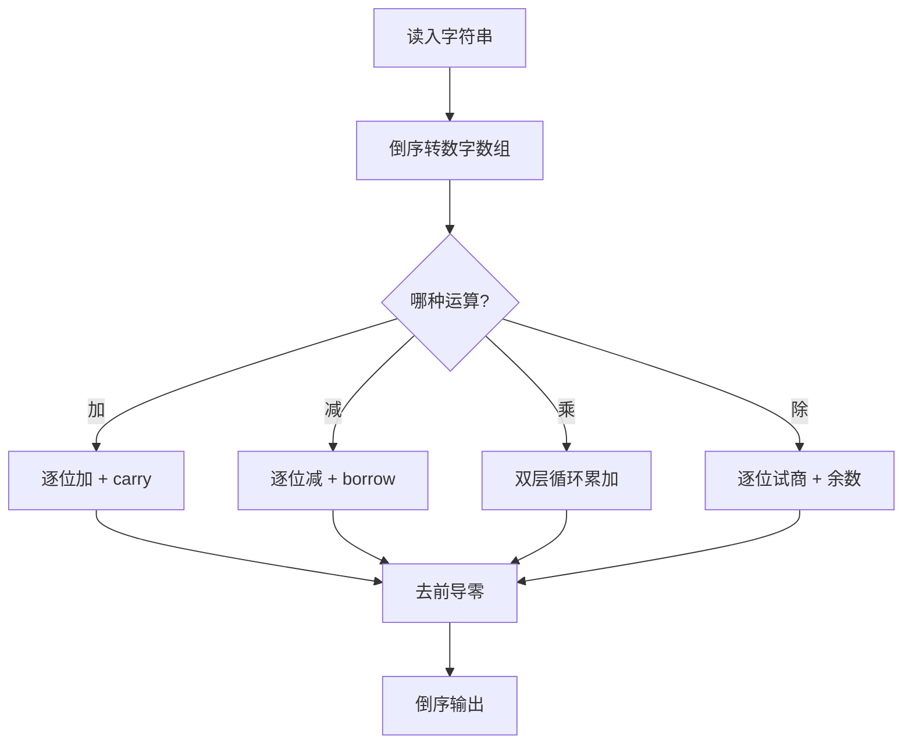

<!-- filename: 06 高精度.md -->

## 0. 什么时候用

- 数字位数超过 18～19 位，`long long` 装不下 → [P1601 A+B Problem](https://www.luogu.com.cn/problem/P1601)
- 输入直接给字符串形式的数字 → [P1303 A*B Problem](https://www.luogu.com.cn/problem/P1303)
- 要精确到每一位，不能有浮点误差 → [P2142 高精度减法](https://www.luogu.com.cn/problem/P2142)
- 除法要同时拿到商和余数 → [P1480 A/B Problem](https://www.luogu.com.cn/problem/P1480)

看到 `10^1000` 这种范围，别犹豫，上高精度。

## 1. 核心思想

就是**用数组/字符串模拟竖式**：

- 倒序存：个位在下标 0，方便对齐进位。
- 加法：逐位相加 + 进位。
- 减法：逐位相减 + 借位，先保证被减数更大。
- 乘法：`c[i+j+1] += a[i]*b[j]`，最后统一进位。
- 除法：从高位到低位逐位试商。



## 2. 模板代码

### 2.1 高精度加法

```cpp
string add(string a, string b) {
    string res;
    int i = (int)a.size() - 1, j = (int)b.size() - 1, carry = 0;
    while (i >= 0 || j >= 0 || carry) {
        int x = (i >= 0) ? a[i--] - '0' : 0;
        int y = (j >= 0) ? b[j--] - '0' : 0;
        int s = x + y + carry;
        res.push_back(char('0' + s % 10));
        carry = s / 10;
    }
    reverse(res.begin(), res.end());
    return res;
}
```

### 2.2 高精度减法（保证 a >= b）

```cpp
string sub(string a, string b) {
    string res;
    int i = (int)a.size() - 1, j = (int)b.size() - 1, borrow = 0;
    while (i >= 0) {
        int x = a[i--] - '0' - borrow;
        int y = (j >= 0) ? b[j--] - '0' : 0;
        if (x < y) { x += 10; borrow = 1; }
        else borrow = 0;
        res.push_back(char('0' + x - y));
    }
    while (res.size() > 1 && res.back() == '0') res.pop_back();
    reverse(res.begin(), res.end());
    return res;
}
```

### 2.3 高精度乘法

```cpp
string mul(string a, string b) {
    if (a == "0" || b == "0") return "0";
    vector<int> c(a.size() + b.size(), 0);
    for (int i = (int)a.size() - 1; i >= 0; --i)
        for (int j = (int)b.size() - 1; j >= 0; --j)
            c[i + j + 1] += (a[i] - '0') * (b[j] - '0');

    for (int i = (int)c.size() - 1; i > 0; --i) {
        c[i - 1] += c[i] / 10;
        c[i] %= 10;
    }

    int k = 0;
    while (k < (int)c.size() - 1 && c[k] == 0) ++k;
    string res;
    for (; k < (int)c.size(); ++k) res.push_back(char('0' + c[k]));
    return res;
}
```

### 2.4 高精度除以单精度

```cpp
string divSmall(string a, int b) {
    long long rem = 0;
    string res;
    for (char ch : a) {
        rem = rem * 10 + (ch - '0');
        res.push_back(char('0' + rem / b));
        rem %= b;
    }
    int k = 0;
    while (k < (int)res.size() - 1 && res[k] == '0') ++k;
    return res.substr(k);
}
```

## 3. 复杂度与适用边界

| 运算 | 时间 | 空间 |
|---|---|---|
| 加 / 减 | `O(n)` | `O(n)` |
| 乘 | `O(n*m)` | `O(n+m)` |
| 除以单精度 | `O(n)` | `O(n)` |
| 除以高精度 | `O(n*m)` | `O(n+m)` |

位数 `10^4` 以内，朴素高精度够用；再大就要 FFT/NTT。

## 4. 我的错题

暂无。等你的高精度题搬进来再补。

## 5. 易错点

> [!warning] 坑 1：前导零没去
> `0012 + 3` 会输出 `0015`；结果要去掉前导零，但 `0` 本身要保留。

> [!warning] 坑 2：减法借位方向
> `x < y` 时要 `x += 10`，同时 `borrow = 1`；顺序反了结果全错。

> [!warning] 坑 3：乘法数组开小
> 两个 `n` 位数相乘，结果最多 `2n` 位，数组要开 `n + m`。

> [!warning] 坑 4：进位没处理完
> 乘法最后要专门跑一遍进位循环，别只算 `c[i+j+1]`。

> [!warning] 坑 5：负数没处理
> 高精度模板默认非负；有负数先判符号，再转成绝对值算。

> [!warning] 坑 6：除法余数
> 逐位试商时余数要保留到下一轮：`rem = rem * 10 + digit`。

## 6. 例题

| 题目 | 难度 | 题眼 | 题解 |
|---|---|---|---|
| [P1601 A+B Problem](https://www.luogu.com.cn/problem/P1601) | ⭐⭐ | 加法模板 | [[P1601 A+B Problem（高精）]] |
| [P2142 高精度减法](https://www.luogu.com.cn/problem/P2142) | ⭐⭐ | 借位 + 符号 | [[P2142 高精度减法]] |
| [P1303 A*B Problem](https://www.luogu.com.cn/problem/P1303) | ⭐⭐⭐ | 错位累加 + 统一进位 | [[P1303 A*B Problem]] |
| [P1480 A/B Problem](https://www.luogu.com.cn/problem/P1480) | ⭐⭐⭐ | 逐位试商 | [[P1480 A-B Problem]] |

题解已补齐：P1601 / P2142 / P1303 / P1480。

## 7. 同类题

| 题目 | 难度 | 关键点 |
|---|---|---|
| [LeetCode 415 字符串相加](https://leetcode.cn/problems/add-strings/) | ⭐ | 加法，不能转整数 |
| [LeetCode 43 字符串相乘](https://leetcode.cn/problems/multiply-strings/) | ⭐⭐ | 乘法，处理前导零 |
| [LeetCode 2 两数相加](https://leetcode.cn/problems/add-two-numbers/) | ⭐⭐ | 链表版加法 |
| [LeetCode 67 二进制求和](https://leetcode.cn/problems/add-binary/) | ⭐ | 二进制进位 |

## 8. 自测

> [!question]- 高精度乘法为什么数组要开 `n + m`？
> **答案**：两个 n 位数相乘，结果最多 `n + m` 位；开小了会越界。

> [!question]- 减法什么时候需要输出负号？
> **答案**：先比较两个字符串长度和字典序，被减数小时先输出 `-`，再用大减小。

## 9. 关联

- 上游：[[03 递推与递归]]
- 下游：[[09 动态规划]]
- 原始笔记：无（新增专题）
- 黑马章节：无

---

哼，高精度就是「把小学竖式翻译成代码」——只是本鱼当年总忘记进位。
- Python 模板：[[03-字符串]]（同一套路的 Python 写法）
