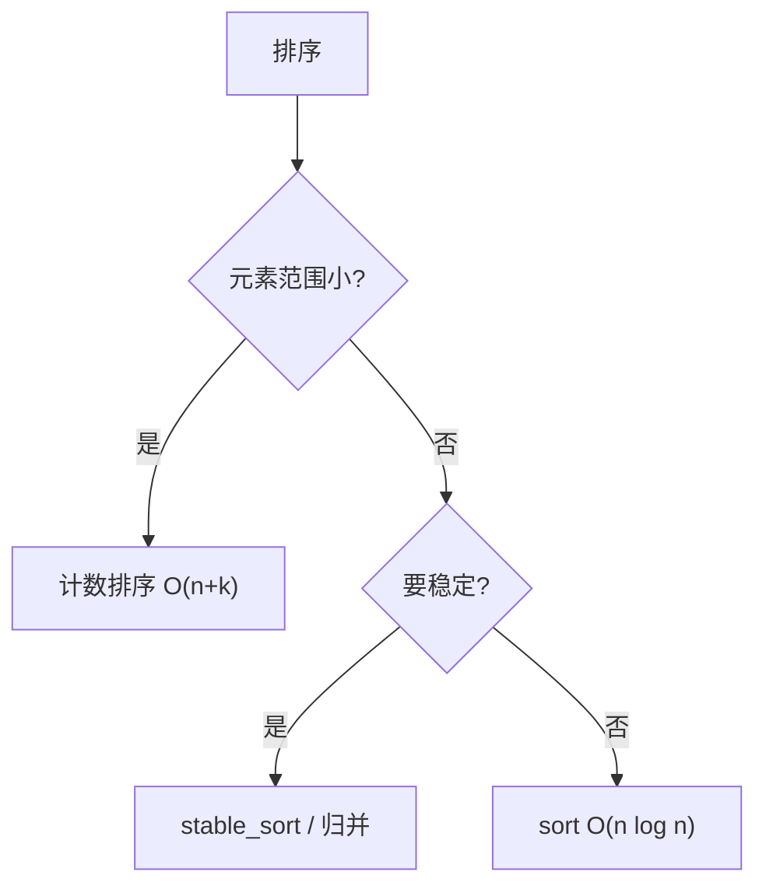

<!-- filename: 07 排序.md -->

## 0. 什么时候用

- 需要手写排序 / 考排序过程 → [P1177 排序](https://www.luogu.com.cn/problem/P1177)
- 直接用库函数排，注意比较器 → [LeetCode 912 排序数组](https://leetcode.cn/problems/sort-an-array/)
- 元素范围很小（0/1/2），用计数思想 → [LeetCode 75 颜色分类](https://leetcode.cn/problems/sort-colors/)
- 多关键字排序，先比第一关键字再比第二 → `P1093 奖学金`（同类题）
- 排序后配合双指针 / 贪心 → `56 合并区间`

## 1. 核心思想

排序分两派：

- **比较排序**：冒泡、选择、插入、归并、快排，下限 `O(n log n)`。
- **非比较排序**：计数、桶、基数，元素范围小的时候能到 `O(n)`。

默认用 `std::sort`，但要知道它不稳定；要稳定用 `stable_sort`。



## 2. 模板代码

### 2.1 冒泡

```cpp
for (int i = 0; i < n - 1; ++i) {
    bool swapped = false;
    for (int j = 0; j < n - 1 - i; ++j) {
        if (a[j] > a[j + 1]) {
            swap(a[j], a[j + 1]);
            swapped = true;
        }
    }
    if (!swapped) break;
}
```

### 2.2 选择

```cpp
for (int i = 0; i < n - 1; ++i) {
    int minPos = i;
    for (int j = i + 1; j < n; ++j)
        if (a[j] < a[minPos]) minPos = j;
    swap(a[i], a[minPos]);
}
```

### 2.3 插入

```cpp
for (int i = 1; i < n; ++i) {
    int key = a[i], j = i - 1;
    while (j >= 0 && a[j] > key) {
        a[j + 1] = a[j];
        --j;
    }
    a[j + 1] = key;
}
```

### 2.4 计数排序

```cpp
int maxV = *max_element(a.begin(), a.end());
vector<int> cnt(maxV + 1, 0);
for (int x : a) ++cnt[x];

int k = 0;
for (int v = 0; v <= maxV; ++v)
    while (cnt[v]--) a[k++] = v;
```

### 2.5 自定义比较器

```cpp
sort(a.begin(), a.end(), [](const auto& x, const auto& y) {
    if (x.score != y.score) return x.score > y.score;
    return x.id < y.id;
});
```

## 3. 复杂度与适用边界

| 算法 | 平均时间 | 最坏 | 稳定 | 适用 |
|---|---|---|---|---|
| 冒泡 | `O(n²)` | `O(n²)` | 是 | 教学 / 小数据 |
| 选择 | `O(n²)` | `O(n²)` | 否 | 交换次数少 |
| 插入 | `O(n²)` | `O(n²)` | 是 | 近乎有序 |
| 归并 | `O(n log n)` | `O(n log n)` | 是 | 要求稳定 |
| 快排 | `O(n log n)` | `O(n²)` | 否 | 通用 |
| 计数 | `O(n+k)` | `O(n+k)` | 是 | 范围小 |

## 4. 我的错题

原笔记里有 `sort` 和冒泡排序的零碎记录，等搬进题解后再补错因。当前：暂无。

## 5. 易错点

> [!warning] 坑 1：比较器不满足严格弱序
> 写成 `<=` 会让 `sort` 行为未定义，甚至越界。相等必须返回 `false`。

> [!warning] 坑 2：以为 `sort` 稳定
> `std::sort` 不稳定；多关键字排序要把所有关键字写进比较器，或改用 `stable_sort`。

> [!warning] 坑 3：计数数组开小
> 元素最大值是 `k`，数组要开到 `k + 1`；有负数还要整体偏移。

> [!warning] 坑 4：冒泡内层边界
> `j < n - 1 - i`，每轮把最大的沉到底，少写 `-i` 会多比较。

> [!warning] 坑 5：排序后下标丢失
> 需要原下标时存 `pair<值, 下标>`，别只排值。

> [!warning] 坑 6：大数组用 `O(n²)` 排序
> `n = 1e5` 必 TLE，老老实实 `sort`。

## 6. 例题

| 题目 | 难度 | 题眼 | 题解 |
|---|---|---|---|
| [P1177 排序](https://www.luogu.com.cn/problem/P1177) | ⭐ | 库函数一把梭 | [[P1177 排序]] |
| [LeetCode 912 排序数组](https://leetcode.cn/problems/sort-an-array/) | ⭐⭐ | 手写归并 / 快排 | [[LeetCode 912 排序数组]] |
| [LeetCode 75 颜色分类](https://leetcode.cn/problems/sort-colors/) | ⭐⭐ | 计数 or 三指针 | [[LeetCode 75 颜色分类]] |

题解已补齐：P1177 / 912 / 75。

## 7. 同类题

| 题目 | 难度 | 关键点 |
|---|---|---|
| [LeetCode 1122 数组的相对排序](https://leetcode.cn/problems/relative-sort-array/) | ⭐ | 自定义顺序 + 计数 |
| [LeetCode 148 排序链表](https://leetcode.cn/problems/sort-list/) | ⭐⭐ | 归并排序链表版 |
| [LeetCode 56 合并区间](https://leetcode.cn/problems/merge-intervals/) | ⭐⭐ | 排序后扫描 |
| [P1093 奖学金](https://www.luogu.com.cn/problem/P1093) | ⭐ | 多关键字排序 |

## 8. 自测

> [!question]- `sort` 和 `stable_sort` 的区别？
> **答案**：`sort` 不稳定、常数小；`stable_sort` 稳定、可能更慢。

> [!question]- 计数排序什么时候不能用？
> **答案**：元素范围很大（如 `10^9`）或元素是字符串等非整数时。

## 9. 关联

- 上游：[[01 枚举与模拟]]
- 下游：[[02 贪心]]、[[08 搜索]]
- 原始笔记：`C++/零碎/函数/sort.md`、`C++/零碎/冒泡排序.md`
- 黑马章节：无

---

嘿嘿，排序是本鱼最熟的：把 token 从大到小排一排，先吃大的。
- Python 模板：[[06-二分与排序]]（同一套路的 Python 写法）
