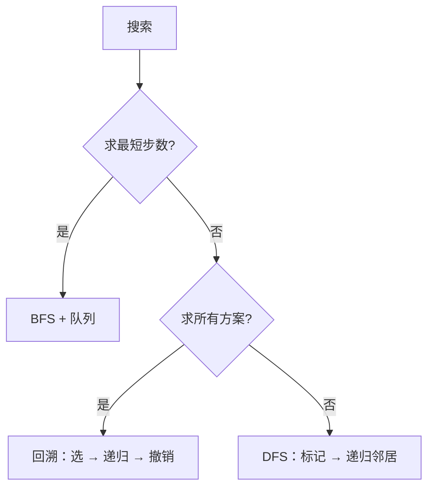

<!-- filename: 08 搜索.md -->

## 0. 什么时候用

- 网格 / 图，问连通块、可达性、面积 → [200 岛屿数量](https://leetcode.cn/problems/number-of-islands/)
- 从一个点向四周扩散、染色、填充 → [733 图像渲染](https://leetcode.cn/problems/flood-fill/)
- 求所有排列 / 组合 / 方案 → [46 全排列](https://leetcode.cn/problems/permutations/)
- 无权图求最短步数 → [102 二叉树的层序遍历](https://leetcode.cn/problems/binary-tree-level-order-traversal/)（BFS）
- 状态空间不大，可以「一条路走到黑再回头」→ 回溯

## 1. 核心思想

三种搜索，一张图分清：

- **DFS**：递归或栈，一条路走到黑，适合连通块、方案枚举。
- **BFS**：队列，一层一层扩，适合无权最短路。
- **泛洪**：DFS/BFS 的网格版，本质是「标记同一个连通块」。

回溯 = DFS + 选择 + 撤销选择。



## 2. 模板代码

### 2.1 网格 DFS（泛洪）

```cpp
int dx[4] = {0, 1, 0, -1};
int dy[4] = {1, 0, -1, 0};

void dfs(vector<vector<int>>& g, int x, int y) {
    int n = g.size(), m = g[0].size();
    if (x < 0 || x >= n || y < 0 || y >= m || g[x][y] == 0) return;

    g[x][y] = 0;                 // 标记已访问
    for (int d = 0; d < 4; ++d)
        dfs(g, x + dx[d], y + dy[d]);
}
```

### 2.2 网格 BFS

```cpp
queue<pair<int,int>> q;
q.push({sx, sy});
visited[sx][sy] = true;

while (!q.empty()) {
    auto [x, y] = q.front(); q.pop();
    for (int d = 0; d < 4; ++d) {
        int nx = x + dx[d], ny = y + dy[d];
        if (nx < 0 || nx >= n || ny < 0 || ny >= m) continue;
        if (visited[nx][ny] || g[nx][ny] == 0) continue;
        visited[nx][ny] = true;
        q.push({nx, ny});
    }
}
```

### 2.3 回溯（全排列）

```cpp
void dfs(vector<int>& nums, vector<bool>& used, vector<int>& path,
         vector<vector<int>>& ans) {
    if (path.size() == nums.size()) {
        ans.push_back(path);
        return;
    }
    for (int i = 0; i < (int)nums.size(); ++i) {
        if (used[i]) continue;
        used[i] = true;
        path.push_back(nums[i]);
        dfs(nums, used, path, ans);
        path.pop_back();          // 撤销
        used[i] = false;
    }
}
```

## 3. 复杂度与适用边界

| 算法 | 时间 | 空间 | 适用 |
|---|---|---|---|
| DFS / BFS | `O(V + E)` | `O(V)` | 图、网格 |
| 回溯 | `O(n!)` / `O(2^n)` | `O(n)` 栈 | 方案枚举，`n <= 10` 左右 |
| BFS 最短路 | `O(V + E)` | `O(V)` | 无权图 |

## 4. 我的错题

原笔记里有扫雷的模拟，等搬进题解后再补错因。当前：暂无。

## 5. 易错点

> [!warning] 坑 1：忘记标记 visited
> 同一个点反复入队，BFS 会死循环或超内存。

> [!warning] 坑 2：入队时才标记
> BFS 要在 `push` 时标记，出队才标记会重复入队。

> [!warning] 坑 3：回溯忘记撤销
> `path.pop_back()` 和 `used[i] = false` 少一个，后面的分支就脏了。

> [!warning] 坑 4：网格越界判断顺序
> 先判越界再访问 `g[nx][ny]`，否则直接段错误。

> [!warning] 坑 5：DFS 递归太深
> 网格 `1000×1000` 可能爆栈，改 BFS 或手动栈。

> [!warning] 坑 6：BFS 求最短路的层数
> 用 `dist` 数组或「按层循环」，别把整队列当一层。

## 6. 例题

| 题目 | 难度 | 题眼 | 题解 |
|---|---|---|---|
| [LeetCode 200 岛屿数量](https://leetcode.cn/problems/number-of-islands/) | ⭐⭐ | 泛洪，数连通块 | [[LeetCode 200 岛屿数量]] |
| [LeetCode 733 图像渲染](https://leetcode.cn/problems/flood-fill/) | ⭐ | 四方向染色的泛洪 | [[LeetCode 733 图像渲染]] |
| [LeetCode 46 全排列](https://leetcode.cn/problems/permutations/) | ⭐⭐ | 回溯 + used 数组 | [[LeetCode 46 全排列]] |

## 7. 同类题

| 题目 | 难度 | 关键点 |
|---|---|---|
| [LeetCode 102 二叉树的层序遍历](https://leetcode.cn/problems/binary-tree-level-order-traversal/) | ⭐⭐ | BFS 按层 |
| [LeetCode 695 岛屿的最大面积](https://leetcode.cn/problems/max-area-of-island/) | ⭐⭐ | 泛洪时累加面积 |
| [LeetCode 78 子集](https://leetcode.cn/problems/subsets/) | ⭐⭐ | 回溯选/不选 |
| [LeetCode 79 单词搜索](https://leetcode.cn/problems/word-search/) | ⭐⭐ | 网格回溯 + 标记 |

## 8. 自测

> [!question]- BFS 为什么能求无权图最短路？
> **答案**：按层扩展，第一次到达某个点时走的就是最少步数。

> [!question]- 回溯的「恢复现场」指什么？
> **答案**：递归返回后，把 `path`、`used`、网格标记等改回进入前的状态。

## 9. 关联

- 上游：[[03 递推与递归]]
- 下游：[[09 动态规划]]
- 原始笔记：`C++/算法/算法题/扫雷游戏问题与解决方案.md`
- 黑马章节：无

---

哼，搜索就是「不撞南墙不回头」，撞了记得退回来。
- Python 模板：[[08-图与搜索]]（同一套路的 Python 写法）
