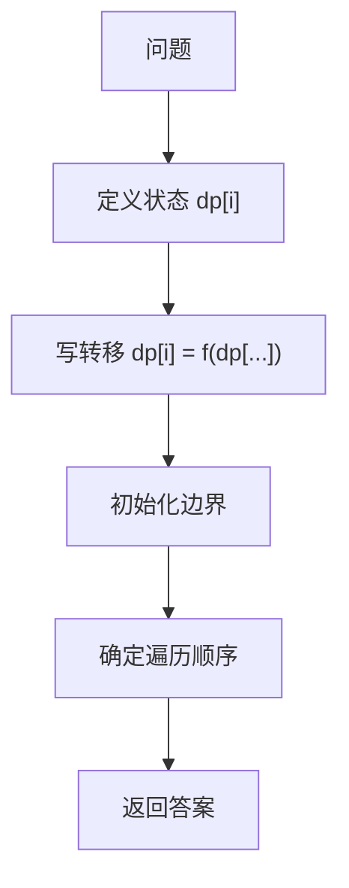

<!-- filename: 09 动态规划.md -->

## 0. 什么时候用

- 求方案数 / 最值，且子问题会重复出现 → [198 打家劫舍](https://leetcode.cn/problems/house-robber/)
- 每个物品选或不选，有容量限制 → [416 分割等和子集](https://leetcode.cn/problems/partition-equal-subset-sum/)
- 序列上的「最长 / 最多」→ [300 最长上升子序列](https://leetcode.cn/problems/longest-increasing-subsequence/)
- 当前状态只由前几个状态推出来 → [70 爬楼梯](https://leetcode.cn/problems/climbing-stairs/)
- 暴力搜索会重复计算同一状态 → 加记忆化 → 递推

## 1. 核心思想

五步定 DP：

1. **状态定义**：`dp[i]` 到底表示什么？一句话说清。
2. **转移方程**：`dp[i]` 从哪些旧状态来。
3. **初始化**：`dp[0]`、`dp[1]` 是多少。
4. **遍历顺序**：保证用到的旧状态已经算好。
5. **答案**：返回 `dp[n]` 还是 `max(dp)`。



## 2. 模板代码

### 2.1 一维 DP（打家劫舍）

```cpp
int rob(vector<int>& nums) {
    int n = nums.size();
    if (n == 0) return 0;
    if (n == 1) return nums[0];

    vector<int> dp(n, 0);
    dp[0] = nums[0];
    dp[1] = max(nums[0], nums[1]);

    for (int i = 2; i < n; ++i)
        dp[i] = max(dp[i - 1], dp[i - 2] + nums[i]);

    return dp[n - 1];
}
```

### 2.2 01 背包（分割等和子集）

```cpp
bool canPartition(vector<int>& nums) {
    int sum = 0;
    for (int x : nums) sum += x;
    if (sum % 2) return false;

    int target = sum / 2;
    vector<bool> dp(target + 1, false);
    dp[0] = true;

    for (int x : nums)
        for (int j = target; j >= x; --j)   // 倒序，防止重复选
            dp[j] = dp[j] || dp[j - x];

    return dp[target];
}
```

### 2.3 LIS（最长上升子序列，O(n²)）

```cpp
int lengthOfLIS(vector<int>& nums) {
    int n = nums.size();
    vector<int> dp(n, 1);
    int ans = 1;

    for (int i = 1; i < n; ++i) {
        for (int j = 0; j < i; ++j)
            if (nums[j] < nums[i])
                dp[i] = max(dp[i], dp[j] + 1);
        ans = max(ans, dp[i]);
    }
    return ans;
}
```

## 3. 复杂度与适用边界

| 模型 | 时间 | 空间 | 典型题 |
|---|---|---|---|
| 一维递推 | `O(n)` | `O(n)` / `O(1)` | 爬楼梯、打家劫舍 |
| 01 背包 | `O(n*W)` | `O(W)` | 分割等和子集 |
| 完全背包 | `O(n*W)` | `O(W)` | 零钱兑换 |
| LIS | `O(n²)` / `O(n log n)` | `O(n)` | 最长上升子序列 |
| 区间 DP | `O(n³)` | `O(n²)` | 最长回文子串 |

## 4. 我的错题

暂无。等你的 DP 错题搬进来再补。

## 5. 易错点

> [!warning] 坑 1：状态定义含糊
> 「dp[i] 表示前 i 个的最优」这种模糊定义，转移一定写不出来。要具体到「以 i 结尾」还是「前 i 个」。

> [!warning] 坑 2：01 背包正序遍历
> 一维数组必须倒序，正序会变成「完全背包」，每个物品能选多次。

> [!warning] 坑 3：初始化漏了
> `dp[0]` 是 0 还是 1，直接决定方案数对不对。

> [!warning] 坑 4：遍历顺序反了
> 依赖 `dp[j - x]` 时，`j` 必须从大到小（01 背包）或从小到大（完全背包）。

> [!warning] 坑 5：答案取错
> 有的题答案是 `dp[n]`，有的是 `max(dp)`，看清定义。

> [!warning] 坑 6：空间压缩后越界
> 压成一维时，注意 `j >= x` 的下界。

## 6. 例题

| 题目 | 难度 | 题眼 | 题解 |
|---|---|---|---|
| [LeetCode 198 打家劫舍](https://leetcode.cn/problems/house-robber/) | ⭐⭐ | 选/不选，隔一个取 | [[LeetCode 198 打家劫舍]] |
| [LeetCode 416 分割等和子集](https://leetcode.cn/problems/partition-equal-subset-sum/) | ⭐⭐ | 01 背包可行性 | [[LeetCode 416 分割等和子集]] |
| [LeetCode 300 最长上升子序列](https://leetcode.cn/problems/longest-increasing-subsequence/) | ⭐⭐ | dp[i] 以 i 结尾 | [[LeetCode 300 最长上升子序列]] |

## 7. 同类题

| 题目 | 难度 | 关键点 |
|---|---|---|
| [LeetCode 322 零钱兑换](https://leetcode.cn/problems/coin-change/) | ⭐⭐ | 完全背包求最小值 |
| [LeetCode 1143 最长公共子序列](https://leetcode.cn/problems/longest-common-subsequence/) | ⭐⭐ | 二维 DP |
| [LeetCode 53 最大子数组和](https://leetcode.cn/problems/maximum-subarray/) | ⭐ | 一维 DP / 贪心 |
| [LeetCode 70 爬楼梯](https://leetcode.cn/problems/climbing-stairs/) | ⭐ | 最简单的递推 |

## 8. 自测

> [!question]- 01 背包一维数组为什么必须倒序？
> **答案**：正序会让 `dp[j - x]` 用到本轮刚更新的值，等于同一物品选了多次。

> [!question]- `dp[i]` 定义为「以 i 结尾」和「前 i 个」有什么区别？
> **答案**：「以 i 结尾」方便处理连续/子序列；「前 i 个」方便处理前缀最优，答案常是 `dp[n]`。

## 9. 关联

- 上游：[[03 递推与递归]]
- 下游：无（算法树终点）
- 原始笔记：无（新增专题）
- 黑马章节：无

---

嘿嘿，DP 就是「把算过的答案记在小本本上」，下次直接抄。
- Python 模板：[[10-动态规划]]（同一套路的 Python 写法）
