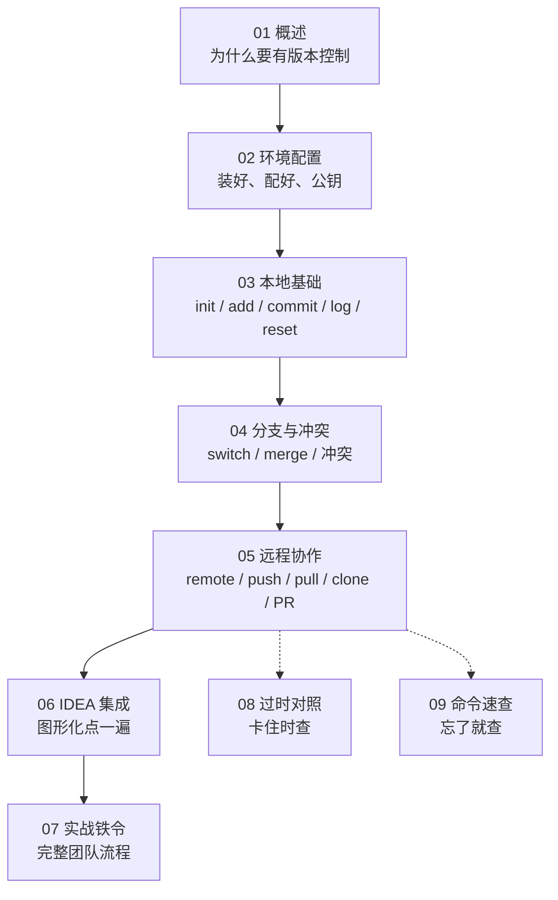

# 00 Git 学习地图

## 这套笔记是什么

黑马程序员《Git 全套教程》31 集（2021 年录制，共约 3 小时 31 分）的整理稿，按**主题**重切成 8 篇 + 2 篇附录，不是按集数切。

配有 [[00-提示词-Git视频笔记]]，换门课也能套。所有命令在 macOS + Git 2.39.2 上实测过，2021 年到现在变了的地方单列在 [[08-2021到2026过时内容对照]]。

## 学习路线

## 正文索引

| 篇 | 一句话 | 对应视频 | 建议 |
| --- | --- | --- | --- |
| [[01-版本控制与Git概述]] | 为什么要版本控制，集中式和分布式差在哪 | P1–P4 | 30 分钟，重概念 |
| [[02-环境安装与配置]] | 装 Git、配账号、配钥匙 | P5、P28 | 30 分钟，一次配好 |
| [[03-本地仓库与基础命令]] | init / add / commit / reset / reflog / .gitignore | P6–P8、P14 | 90 分钟，**最该动手** |
| [[04-分支与合并冲突]] | 分支是指针，合并分快进和三方，冲突怎么解 | P9–P13、P15 | 60 分钟，配实验 |
| [[05-远程仓库与团队协作]] | remote / push / pull / clone，以及现在的 PR 流程 | P16–P22 | 90 分钟，**重点** |
| [[06-IDEA集成Git]] | 命令行那套搬进 IDEA | P23–P27 | 40 分钟，边点边看 |
| [[07-实战流程与几条铁令]] | 完整团队流程 + 事故急救表 | P28–P31 | 40 分钟，当手册 |
| [[08-2021到2026过时内容对照]] | 只有三条真会卡住，另附三条「假过时」澄清 | 全课程 | 卡住时查 |
| [[09-Git命令速查表]] | 按「要干什么」查命令 | 全课程 | 随时查 |

## GitHub 版（另开一册）

上面 9 篇讲的是 Git 本体，换哪个平台都一样；**平台操作另起一册**，入口 [[00-GitHub版地图]]。

| 册 | 管什么 |
| --- | --- |
| [[01-GitHub账号与首次推送]] | 2FA、SSH（含 443 端口）、PAT、gh CLI、建仓首推 |
| [[02-PR协作与分支规则]] | GitHub Flow、PR 评审、三种合并方式、Rulesets、CODEOWNERS、Fork 同步 |
| [[03-Actions与Pages发布]] | 最小 CI、矩阵、缓存、secrets、Pages、Release、LFS |
| [[04-GitHub常见坑与速查]] | 报错对照表、命令表、2021→2026 平台侧差异 |

原来第 [[05-远程仓库与团队协作]] 篇里以码云演示的部分，在 GitHub 上照 [[01-GitHub账号与首次推送]] 走。

## 三条用法

**速成一晚（约 3 小时）**
01 看概念 → 03 跟着敲一遍 → 04 跑冲突实验 → 05 看 push/pull/PR → 07 事故表扫一眼。

**系统精读（一周，每天 30 分钟）**
按 01→07 顺序，每篇把「动手实验」原样跑一遍；跑不通就翻 [[08-2021到2026过时内容对照]]，十有八九是老写法。

**考前/赶工复习（20 分钟）**
直接看 [[09-Git命令速查表]] 和每篇末尾的「背诵卡」，再把 [[04-分支与合并冲突]] 的冲突四步默一遍。

## 练手清单

- [ ] 建一个仓库，完成 3 次提交，再用 `reflog` 找回被 `reset --hard` 掉的那次
- [ ] 写好一份 `.gitignore`，包含 `*.log`、`build/`、`.DS_Store`，并验证 `!` 例外生效
- [ ] 开两个分支改同一行，制造一次冲突并解决
- [ ] 用 `--no-ff` 合并一次，对比快进合并的 `git log --graph` 差别
- [ ] 推到 GitHub/Gitee 一个真仓库，配 SSH 不输密码
- [ ] 故意推送被拒一次，按「pull → 解决 → push」走完
- [ ] 在 IDEA 里把上面流程再点一遍

## 时效声明

- 课程录制：2021-05；讲义 PDF：2021-06。
- 笔记整理与命令实测：2026-10-30，Git 2.39.2 (Apple Git-143)。
- 官方最新版本以 [git-scm.com](https://git-scm.com/) 为准（核对时首页为 2.56.0，2026-09-28 发布）。
- 平台政策（GitHub 认证、Gitee 实名）变化快，以官方文档为准。

## 来源

- 视频：[黑马程序员 Git 全套教程](https://www.bilibili.com/video/BV1MU4y1Y7h5)（B 站，31 集）
- 讲义：`Git讲义.pdf`（26 页，2021-06 生成，Creator 显示 Typora，经 PDFdo 转出）
- 转写：本地 whisper.cpp small 模型，中文，未校对

## 方法论

这套笔记的骨架来自四个东西：康奈尔笔记法的「自测题 + 总结」（对应每篇第 9、10 段）、卡片盒的「一篇一主题 + 双链」、渐进式总结的层层压缩、以及 MOC 当入口。写法细节见 [[00-提示词-Git视频笔记]]。
