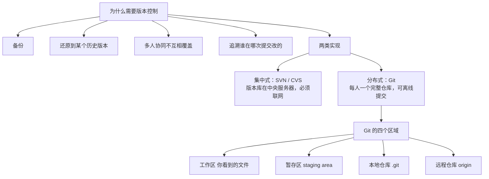
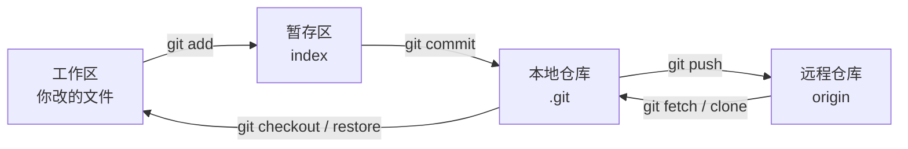

# 01 版本控制与 Git 概述

## 1. 本节定位

- **对应视频**：P1 学习目标（3:18）、P2 版本控制器的方式（9:54）、P3 svn 与 git（4:24）、P4 Git 工作流程简述（1:06）。
- **先修**：不需要写代码，会开终端就行。
- **位置**：整门课的地基。后面所有命令都是这张「四个区域」的图上做手脚，图没看懂，命令就是背。

## 2. 一句话结论

Git 是**分布式**版本控制系统，它把每次提交存成整个项目的快照，存在你本地电脑上；远程服务器只是「方便大家交换」的一块公共白板，不是必需品。

## 3. 知识地图



## 4. 核心概念

### 为什么需要版本控制

讲义里那四个场景，其实就是四件事：

| 场景 | 没有 Git 会怎样 | Git 怎么解 |
| --- | --- | --- |
| 备份 | 硬盘炸了，几个月白干 | 本地仓库 + 推一份到远程 |
| 还原 | 改坏了回不去，只能重写 | 提交历史里随便翻回某一版 |
| 协同 | 两个人先后存同一个文件，后者覆盖前者 | 各自的修改合并，冲突显式暴露 |
| 追溯 | 出了 Bug 不知道谁改的 | `git log` / `git blame` 精确到行 |

### 集中式 vs 分布式

| | 集中式（SVN/CVS） | 分布式（Git） |
| --- | --- | --- |
| 版本库位置 | 只在中央服务器 | 每人本地一份完整的 |
| 联网 | 提交、看历史都要联网 | 离线也能提交、看历史 |
| 单点故障 | 服务器挂了，全员停工 | 任何一份克隆都能恢复 |
| 分支 | 目录级复制，重 | 一个指针，秒开 |

讲义的比喻很准：Git 的中心服务器「地位和每个人的 PC 一样」，只是大家交换代码方便，不关机而已。没有它照样能工作，只是交换麻烦。

### Git 简史（知道个大概就行）

Linux 内核早期靠邮件发补丁；2002–2005 年用 BitKeeper，后来商业公司收回免费授权，Linus 用两周左右写出了 Git（2005）。设计目标写得很直白：速度快、设计简单、强力支持非线性开发（分支）、完全分布式、能扛住 Linux 内核这种量级。

### 四个区域怎么流动



一张图记牢八个动词：`clone / checkout / add / commit / fetch / pull / push`，外加 `merge`。P4 那集老师也是这么说的——先别纠结那张复杂流程图，抓住「有本地仓库、有远程仓库」两个概念就够了。

## 5. 命令速查

本节几乎全是概念，只有三条命令先混个脸熟：

```bash
git --version        # 看版本
git init             # 在当前目录建一个仓库
git status           # 看现在处于什么状态
```

## 6. 补充：现在的「版本控制」长什么样

> [!note] 补充 · 生态变了，概念没变
> 讲义说「常用托管服务有 GitHub、码云、GitLab」。现在多了 Gitea、自建 GitLab、以及各大厂的内部平台；GitHub 访问在国内不稳定，码云（Gitee）需要实名，很多团队直接自建。**概念还是那套，选哪家只是选个放代码的地方。**
>
> 另外 SVN 并没有死，只是退到角落里；反过来 Git 也不是唯一选择，游戏和硬件行业还在用 Perforce（大二进制文件场景）。学 Git 的性价比在于它是事实标准。

> [!warning] 会卡住 · 默认分支可能叫 main
> 讲义后半段的分支示例全用 `master`。GitHub 2020-10 起新仓库默认 `main`，课程录制后就陆续改了。详见 [[08-2021到2026过时内容对照]]。

## 7. 自测 + 背诵卡

**Q1** 为什么说 Git 是分布式的？远程服务器挂了还能提交吗？
<details><summary>答案</summary>
因为每台电脑上都是一份完整的仓库（含全部历史）。远程只是交换用的中转站，挂了照样能 `add`/`commit`/`log`/`branch`，只是没法跟别人同步。
</details>

**Q2** 工作区、暂存区、本地仓库分别对应哪条命令的边界？
<details><summary>答案</summary>
`git add` 把工作区的修改放进暂存区；`git commit` 把暂存区固化成一次提交进本地仓库；`git push` 才推去远程。
</details>

**Q3** 两个人都改了同一个文件的同一行，分别提交到服务器，会发生什么？
<details><summary>答案</summary>
后提交的那个人在推送前必须先把远程的拉下来合并，此时 Git 检测到同一处被两边改过，产生冲突，需要人工决定保留哪一版。
</details>

**背诵卡**

- Git 是快照式、分布式的版本控制，2005 年 Linus 为 Linux 内核写的。
- 四个区域：工作区 → 暂存区 → 本地仓库 → 远程仓库。
- 八个动词：clone、checkout、add、commit、fetch、pull、push、merge。
- 远程仓库不是必需品，只是交换站。
- 集中式（SVN）必须联网，分布式（Git）可以先本地干活。

## 8. 关联

- 下一篇：[[02-环境安装与配置]]
- 汇总：[[08-2021到2026过时内容对照]]
- 官方文档：[git 官方](https://git-scm.com/)、[Pro Git 中文版](https://git-scm.com/book/zh/v2)
