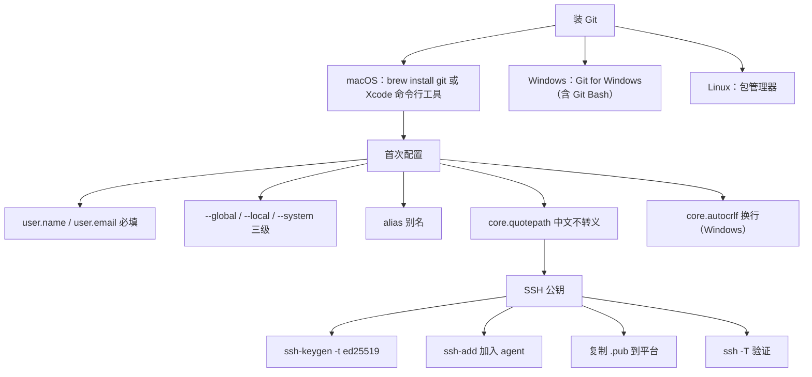

# 02 环境安装与配置

## 1. 本节定位

- **对应视频**：P5 git 环境配置与安装（12:54）、P28 几条铁令 + IDEA 集成 GitBash（1:54）。
- **先修**：会开终端、知道 `cd` 和 `ls`。
- **位置**：动手前的准备。配置只做一次，但配错了后面每个命令都在还债（提交记录署名不对、中文乱码、推不上去）。

## 2. 一句话结论

装完之后只有两件事是**必做**的：`user.name` / `user.email` 配好，以及把公钥交给托管平台；其余（别名、换行、编码）都是让自己舒服。

## 3. 知识地图



## 4. 核心概念

### 装在哪、装哪个版本

| 系统 | 推荐方式 | 备注 |
| --- | --- | --- |
| macOS | `brew install git`，或装 Xcode Command Line Tools | 系统自带的是 Apple 定制版，够用但版本偏旧；本机实测 `git version 2.39.2 (Apple Git-143)` |
| Windows | Git for Windows | 自带 Git Bash，课程里所有命令都是在它里面敲的 |
| Linux | `apt install git` / `dnf install git` | 版本跟着发行版走 |

官方最新源码版本以 [git-scm.com](https://git-scm.com/) 首页为准（本文写于 2026-10，页面显示 2.56.0，2026-09-28 发布）。**课程是 2021 年录的，那时候大约 2.30**，后面讲的命令行为都以 2.39+ 为准。

### 三级配置，改哪个生效

```bash
git config --system   # 整台机器，/etc/gitconfig
git config --global   # 当前用户，~/.gitconfig
git config --local    # 当前仓库，.git/config（优先级最高）
```

后配的覆盖先配的。日常只用 `--global`：

```bash
git config --global user.name "孙炯霖"
git config --global user.email "you@example.com"
git config --global core.quotepath false      # 中文文件名不显示成 \344\275\240
git config --global init.defaultBranch main   # 新仓库默认 main
```

查看时加 `--show-origin` 能看出每条配置来自哪个文件，排查「为什么这里的设置跟我改的不一样」特别有用：

```bash
git config --list --show-origin
```

### 别名：两种写法，选一种

课程教的是在 `~/.bashrc` 里写 shell 别名：

```bash
alias git-log='git log --pretty=oneline --all --graph --abbrev-commit'
alias ll='ls -al'
```

macOS 上默认 shell 是 zsh，对应的文件是 `~/.zshrc`，写进 `.bashrc` 是不生效的——这是很多人「明明照着做了却没用」的原因。

更好移植的写法是 Git 自己的别名，换台机器、换 shell 都还在：

```bash
git config --global alias.st status
git config --global alias.co checkout
git config --global alias.br branch
git config --global alias.lg "log --pretty=oneline --all --graph --abbrev-commit"
```

之后 `git lg` 就等于后面那一长串。

### 换行符：只在 Windows 上要管

Windows 用 CRLF，Linux/macOS 用 LF。跨平台协作时文件会显示「整篇都被改了」，其实只差一个换行符。Windows 上一般：

```bash
git config --global core.autocrlf true
```

macOS / Linux 保持默认即可，团队里更稳的做法是仓库里放一份 `.gitattributes` 统一规定。

## 5. 命令速查

```bash
git --version                     # 版本
git config --global user.name "x" # 设用户名
git config --global user.email "x"# 设邮箱
git config --list --show-origin   # 看全部配置和来源
git config --global --unset alias.co   # 删掉某个配置

ssh-keygen -t ed25519 -C "you@example.com"   # 生成密钥（推荐）
ssh-add --apple-use-keychain ~/.ssh/id_ed25519  # macOS 加入钥匙串
cat ~/.ssh/id_ed25519.pub         # 复制这一整行到平台
ssh -T git@github.com             # 验证，看到 successfully authenticated 就成
```

## 6. 动手实验

```bash
git config --global user.name "测试用户"
git config --global user.email "test@example.com"
git config --global --list | grep user
```

预期能回显两行 `user.name=` / `user.email=`。

再验一次 SSH（已经有 key 的话会直接判断，没有就先跑 `ssh-keygen`）：

```bash
ssh -T git@github.com
```

首次连接会问 `Are you sure you want to continue connecting?`，输入 `yes`；成功时输出 `Hi 用户名! You've successfully authenticated...`。

## 7. 时效与差异

> [!warning] 会卡住 · HTTPS 推送不能再输密码
> 课程是在 Windows 的 Git Bash 里输账号密码。GitHub 从 2021-08-13 起不再接受密码，要改用 Personal Access Token 或 SSH；Gitee 多数场景还能用密码，但也在收紧。省事就一律走 SSH。

> [!note] 推荐但不强制 · ed25519 比 rsa 好
> 课程用 `ssh-keygen -t rsa`。RSA **并没有失效**：GitHub 从 2021-11-02 之后签发的 RSA 密钥必须是 SHA-2 签名，而新版 OpenSSH 默认就是，所以照敲也能通。只是 ed25519 更短更快，官方文档首选它；RSA 留给用不了 ed25519 的老系统，官方兜底写法是 `-t rsa -b 4096`。

> [!note] 环境差异 · 不是过时
> 课程是 Windows 视角，`~/.bashrc`、Git Bash。macOS 默认 zsh，别名要写 `~/.zshrc`；终端用系统自带的或 iTerm。命令本身一个字都不用改。

## 8. 自测 + 背诵卡

**Q1** 同一台机器上，`--global` 配的邮箱和仓库里 `--local` 配的邮箱冲突，提交时用哪个？
<details><summary>答案</summary>
用 `--local` 的，仓库级优先级最高。可以用 `git config --list --show-origin` 确认到底哪条生效。
</details>

**Q2** 为什么推荐 ed25519 而不是 rsa？
<details><summary>答案</summary>
GitHub 自 2022-03-15 起停止支持 SHA-1 签名的 RSA 密钥；ed25519 更短更快更安全，是现在各平台的默认推荐。
</details>

**Q3** 配了 alias 但 `git lg` 提示不是命令，最可能是哪里错了？
<details><summary>答案</summary>
写进了错误的配置文件。shell 别名要看当前 shell 的 rc 文件（zsh 是 `~/.zshrc`），Git 别名要用 `git config --global alias.xxx`。
</details>

**背诵卡**

- 必配两条：`user.name`、`user.email`；三级配置 local 覆盖 global。
- 别名推荐写 `git config --global alias.xxx`，跨 shell 都能用。
- 中文文件名乱码：`core.quotepath false`。
- SSH 用 `-t ed25519`，公钥在 `~/.ssh/id_ed25519.pub`。
- HTTPS 推代码要 PAT，不想折腾就用 SSH。

## 9. 关联

- 上一篇：[[01-版本控制与Git概述]]
- 下一篇：[[03-本地仓库与基础命令]]
- 相关：[[05-远程仓库与团队协作]] 的公钥配置
- 官方文档：[Git 首次配置](https://git-scm.com/book/zh/v2/%E8%B5%B7%E6%AD%A5-%E5%88%9D%E6%AC%A1%E8%BF%90%E8%A1%8C-Git-%E5%89%8D%E7%9A%84%E9%85%8D%E7%BD%AE)、[GitHub 生成 SSH 密钥](https://docs.github.com/zh/authentication/connecting-to-github-with-ssh/generating-a-new-ssh-key-and-adding-it-to-the-ssh-agent)
