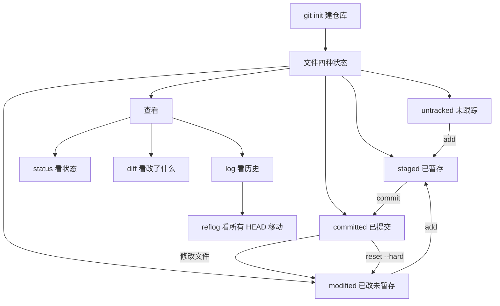

# 03 本地仓库与基础命令

## 1. 本节定位

- **对应视频**：P6 获取本地仓库（2:18）、P7 git 常用指令（30:36，本节的主菜）、P8 基础命令练习（5:48）、P14 上午总结（7:18）。
- **先修**：[[02-环境安装与配置]] 配好账号。
- **位置**：Git 的全部基本功都在这。分支、远程、协作，说到底都是在操作这套「工作区—暂存区—本地库」的流转。

## 2. 一句话结论

Git 只认三件事：**改了没（status）、加没加（add）、记没记（commit）**；所有后悔药都在 `reflog` 里。

## 3. 知识地图



## 4. 核心概念

### `git init` 到底干了什么

在目录里执行 `git init`，会生成一个隐藏的 `.git` 目录，里面最关键的几个东西：

| 路径 | 作用 |
| --- | --- |
| `.git/HEAD` | 现在在哪个分支上 |
| `.git/refs/heads/` | 每个分支一个文件，内容是指向的提交哈希 |
| `.git/objects/` | 所有提交、目录树、文件内容（压缩存储） |
| `.git/index` | 暂存区，`git add` 写的就是它 |
| `.git/config` | 仓库级配置 |

**看到 `.git` 就说明仓库建成了**，这个目录别删，删了整个历史就没了。

### 文件只有四种状态

```text
未跟踪 untracked ──add──▶ 已暂存 staged ──commit──▶ 已提交 committed
                              ▲                          │
                              └────────── add ──────── 已修改 modified
```

`git status` 的三种典型输出，认准这几句就够了：

```text
Untracked files:            # 新文件，Git 还没管
Changes not staged for commit:   # 改过但没 add
Changes to be committed:         # 已 add，等 commit
nothing to commit, working tree clean   # 干净
```

### 快照，不是差异

很多人以为 Git 存的是「每次改了几行」。实际上每次 `commit` 存的是一份**完整快照**（内容相同的文件用指针复用，不重复占空间）。这也解释了为什么切分支、回退那么快——换个指针的事。

### reset 三档，差在哪

| 命令 | 工作区 | 暂存区 | 提交历史 |
| --- | --- | --- | --- |
| `git reset --soft HEAD~1` | 保留 | 保留 | 撤销最后一次提交 |
| `git reset --mixed HEAD~1`（默认） | 保留 | 清空 | 撤销最后一次提交 |
| `git reset --hard HEAD~1` | **清空** | 清空 | 撤销最后一次提交 |

`--hard` 会连工作区的改动一起抹掉，敲之前确认没有没提交的东西。真抹了也别慌，只要之前 commit 过，`git reflog` 里能找到那条记录，`git reset --hard <哈希>` 回去。

## 5. 命令速查

```bash
git init                 # 建仓库（课程里默认 master）
git init -b main         # 指定初始分支为 main（Git 2.28+）
git status               # 看状态
git status -s            # 精简输出
git add 文件名            # 加入暂存区
git add .                # 当前目录全部改动
git add -A               # 全仓库改动（含删除）
git commit -m "说明"      # 提交
git commit -am "说明"     # 已跟踪文件：add + commit 一步（新文件不生效）
git log                  # 完整历史
git log --oneline --graph --all --decorate   # 推荐：一行一提交 + 分支图
git diff                 # 工作区 vs 暂存区
git diff --staged        # 暂存区 vs 最后一次提交
git reset --hard <哈希>   # 回到某个提交，工作区同步
git reflog               # HEAD 的所有移动记录（救命用）
```

## 6. 动手实验

```bash
mkdir -p ~/tmp/git-basic && cd ~/tmp/git-basic
git init
ls -a                      # 应该看到一个 .git
```

```bash
echo "count=0" > file01.txt
git status                 # Untracked files: file01.txt
git add .
git status                 # Changes to be committed
git commit -m "commit 001"
```

```bash
echo "count=1" > file01.txt
git diff                   # 能看到 -count=0 / +count=1
git commit -am "update file01"
git log --oneline
```

```bash
# 回退到上一次提交
git log --oneline          # 记下上一次的哈希
git reset --hard HEAD~1
git log --oneline          # 少了一条
git reflog                 # 还能看到被撤掉的那条
```

## 7. 补充：`.gitignore` 怎么写

课程给了示例，实战里补几条：

```gitignore
*.log                # 所有日志
build/               # 整个构建目录
!important.log       # 例外，这个要跟踪
/TODO                # 只忽略根目录的 TODO，子目录里的不管
doc/**/*.pdf         # doc 下任意层级的 pdf
.idea/               # IDE 配置
.DS_Store            # macOS 的目录元数据，必须忽略
```

规则要点：**后写的覆盖先写的**，`!` 是反向例外，`/` 开头表示从仓库根算，`**` 匹配任意层目录。已经被跟踪的文件再加进 `.gitignore` 是不生效的，要先 `git rm --cached 文件名` 从索引里摘掉。

现成模板可以从 [github/gitignore](https://github.com/github/gitignore) 抄，比手写靠谱。

## 8. 时效与差异

> [!warning] 会卡住 · 分支可能不叫 master
> 课程 `git init` 后默认 `master`。现在 GitHub 新仓库默认 `main`，本机也配了 `init.defaultBranch=main`，`git init` 出来就是 main。这时候照抄 `git checkout master` 会报 `pathspec 'master' did not match`。**先 `git branch` 看一眼真实名字**，比背结论靠谱。

> [!note] 推荐但不强制 · checkout 分家了
> 撤销修改的 `git checkout -- 文件`、切换分支的 `git checkout 分支`，现在推荐写成 `git restore 文件` / `git switch 分支`（Git 2.23 起）。checkout 仍然完全可用，效果一样，只是新写法语义更清楚。

> [!note] 补充 · 提交信息规范
> 课程练习写 `commit 001`，真实项目用 `feat:` / `fix:` 这类前缀更清楚。这属于团队约定，跟 Git 版本无关。

## 9. 自测 + 背诵卡

**Q1** `git commit -am "x"` 能不能把新建的文件也提交上去？
<details><summary>答案</summary>
不能。`-a` 只会把**已跟踪**文件的修改加入暂存区再提交，新文件（untracked）必须先 `git add`。
</details>

**Q2** 误敲 `git reset --hard` 把工作区改没了，还有救吗？
<details><summary>答案</summary>
有。`git reflog` 找到被重置前的提交哈希，再 `git reset --hard <哈希>`。前提是那些内容曾经 commit 过；从没提交过的改动救不回来。
</details>

**Q3** `.gitignore` 里加了 `*.class`，但某个 .class 还是被跟踪，为什么？
<details><summary>答案</summary>
它在这条规则之前已经被提交进版本库了。`.gitignore` 只对未跟踪文件生效，要先 `git rm --cached 该文件`，再提交一次。
</details>

**Q4** `git diff` 和 `git diff --staged` 分别比什么？
<details><summary>答案</summary>
前者比「工作区 vs 暂存区」，看还没 add 的改动；后者比「暂存区 vs 最后一次提交」，看这次提交会带上什么。
</details>

**背诵卡**

- 四态：untracked → modified → staged → committed。
- `add` 进暂存区，`commit` 进本地库，两者之间才能 `diff`。
- reset 三档：soft 留全部、mixed 清暂存、hard 连工作区一起清。
- reflog 记所有 HEAD 移动，是删提交、误 reset 的救命绳。
- `.gitignore` 只管未跟踪文件，已跟踪的要先 `rm --cached`。

## 10. 关联

- 上一篇：[[02-环境安装与配置]]
- 下一篇：[[04-分支与合并冲突]]
- 汇总：[[08-2021到2026过时内容对照]]、[[09-Git命令速查表]]
- 官方文档：[git-add](https://git-scm.com/docs/git-add)、[git-reset](https://git-scm.com/docs/git-reset)、[gitignore 规则](https://git-scm.com/docs/gitignore)
