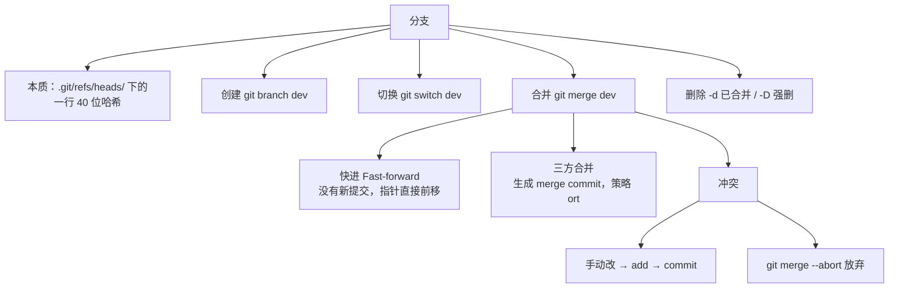

# 04 分支与合并冲突

## 1. 本节定位

- **对应视频**：P9 分支_常用指令（15:24）、P10 解决冲突（8:00）、P11 分支使用流程（5:48）、P13 补充_强制删除分支的场景（3:06）、P15 补充_合并的快进模式（5:06），合计约 37 分钟。
- **先修**：[[03-本地仓库与基础命令]] 的 `add / commit / log / reset`，以及「暂存区—本地仓库」两条线的状态流转。
- **位置**：这是 Git 从「一个人存档」变成「多人并行」的分水岭。往后所有协作（[[05-远程仓库与团队协作]]）都是在分支上做文章。

## 2. 一句话结论

**分支只是一个指向提交的指针，切分支只挪 HEAD、不动文件**；合并分快进和三方合并两种，冲突只发生在「同一个文件的同一处被两边改过」的时候。

## 3. 知识地图



## 4. 核心概念

### 分支是指针，不是文件夹

一开始最容易误会的是「切分支会把文件复制一份」。并不会。`.git/refs/heads/main` 里只有一个提交哈希，`git branch dev` 做的事就是**再写一个文件，内容指向同一个提交**。

```
        main
         ↓
A --- B --- C
         ↑
        dev
```

`HEAD` 则是指「我现在站在哪个分支上」，它通常写作 `refs/heads/main`。所以 `git switch dev` 改的只是 HEAD 这一行字，工作区的文件一个都没动——这就是切分支快得离谱的原因。

### 合并不止一种

| 形态 | 什么情况发生 | 结果 |
| --- | --- | --- |
| **快进 Fast-forward** | 目标分支是当前分支的**直系后代**（中间没分叉） | 指针前移，不产生新提交 |
| **三方合并** | 两个分支各自往前走过了，出现分叉 | 以共同祖先为 base，三方比对，生成一个 merge commit |
| **冲突** | 三方比对时，同一文件的同一区域两边改得不一样 | 停下，文件里写冲突标记，等你手工裁决 |

### 冲突标记怎么读

```text
<<<<<<< HEAD
main 改的内容
=======
feature2 改的内容
>>>>>>> feature2
```

`<<<<<<< HEAD` 到 `=======` 之间是**当前分支**的版本，`=======` 到 `>>>>>>> 分支名` 之间是**被合进来那方**的版本。解决 = 把这三行连同内容改成你想要的样子，删掉标记，然后 `git add`。

## 5. 命令速查

```bash
git branch                # 列出本地分支，* 是当前分支
git branch -v             # 带上最后一次提交的哈希和说明
git branch -a             # 连远程分支一起看（remotes/origin/...）
git branch dev            # 创建 dev（只创建，不切换）
git switch dev            # 切换
git switch -c dev         # 创建并切换
git branch -d dev         # 删除已合并的分支
git branch -D dev         # 强制删除（未合并也删）
git merge dev             # 把 dev 合到当前分支
git merge --no-ff dev     # 强制生成 merge commit，保留分支痕迹
git merge --abort         # 冲突解决不了，回到合并前
git log --oneline --graph --all   # 看清分叉长什么样
```

| 命令 | 什么时候用 | 注意 |
| --- | --- | --- |
| `git switch -c dev` | 开新功能 | 老教程写作 `git checkout -b dev`，两者等价 |
| `git merge --no-ff` | 想让历史里留下「这里合过一次」 | 快进合并会让分支痕迹消失 |
| `git branch -d` | 功能已合回主干 | 未合并会拒绝，见下面的报错 |
| `git merge --abort` | 冲突太多，想重来 | 只在 merge 进行中可用 |

## 6. 动手实验

从空目录跑一遍，三分钟能把「快进—冲突—强删」全走完。

```bash
mkdir -p ~/tmp/git-branch-demo && cd ~/tmp/git-branch-demo
git init
git config user.name "demo"
git config user.email "demo@example.com"

echo "第一行" > readme.txt
git add . && git commit -m "init"

git switch -c feature
echo "功能分支写的" >> readme.txt
git add . && git commit -m "feat: 追加一行"

git switch main
git merge feature
```

预期输出（快进）：

```text
Updating 3f2a1c9..8b7d0e4
Fast-forward
 readme.txt | 1 +
 1 file changed, 1 insertion(+)
```

再制造一次冲突：

```bash
git switch -c feature2
echo "feature2 改的" > readme.txt
git commit -am "feat2: 整行替换"

git switch main
echo "main 改的" > readme.txt
git commit -am "main: 整行替换"

git merge feature2
```

预期输出（**冲突**）：

```text
Auto-merging readme.txt
CONFLICT (content): Merge conflict in readme.txt
Automatic merge failed; fix conflicts and then commit the result.
```

`cat readme.txt` 会看到前面讲的三个标记。把文件改成你想要的内容，然后：

```bash
git add readme.txt
git commit -m "merge: 解决 readme 冲突"
```

不想解决了就 `git merge --abort`，一切回到合并前。

最后试试删掉一个还没合并的分支：

```bash
git branch -d feature2
```

```text
error: The branch 'feature2' is not fully merged.
If you are sure you want to delete it, run 'git branch -D feature2'.
```

## 7. 原理补丁

- **快进为什么没有 merge commit**：没有分叉就不需要「合并」这个动作，只是把一个指针往前挪。想让历史保留分支形状，用 `--no-ff`。
- **三方合并在算什么**：Git 找到两边的共同祖先（merge base），然后对 base、ours、theirs 三份内容做行级比对。只有「两边都改了同一行、且改得不一样」才叫冲突；一边改一边没改，Git 自己合。
- **为什么删分支不心疼**：分支只是指针，提交本身还在。只要提交被别的分支或 reflog 记着，`git branch -D` 删掉的只是一行引用，提交还能捞回来（见 [[03-本地仓库与基础命令]] 的 reflog）。

## 8. 易错点

1. **删分支先切走**。`git branch -d` 删不了当前所在分支，会提示 `Cannot delete branch 'dev' checked out at ...`。
2. **`-d` 和 `-D` 是两件事**。`-d` 会检查是否已合并，`-D` 不问。P13 讲的「强制删除场景」就是：分支上的尝试性提交不要了，`-d` 会一直拦着，只能 `-D`。
3. **解决完冲突忘了 `add`**。文件改完不 `git add`，Git 认为冲突还在，`git commit` 会告诉你还有未合并路径。
4. **`git switch` 一个不存在的分支** 不会自动创建，会报 `fatal: invalid reference`；要创建请用 `-c`。

## 9. 时效与差异

> [!warning] 会卡住 · 分支名 master 还是 main
> 课程所有示例都是 `master`。在 main 的仓库里敲 `git checkout master` 会直接失败。先 `git branch` 确认，再做后面的操作。

> [!note] 推荐但不强制 · checkout -b 换成 switch -c
> 两者等价，Git 2.23 起官方推荐 `git switch -c`。老命令照旧能用，不算坏。

> [!note] 只是看起来不一样 · 合并策略改名
> 2021 年非快进合并输出 `Merge made by the 'recursive' strategy.`，Git 2.34 起默认换成 `ort`。名字变了、行为等价，别以为出错。

> [!note] 补充 · 分支模型
> `master/develop/feature/hotfix` 是 Git Flow，现在中小团队更多用 trunk-based + PR。两种都成立，看团队规模，谈不上过时。

## 10. 自测 + 背诵卡

**Q1** 在 `main` 上执行 `git switch -c dev`，然后 `ls`，工作区文件有变化吗？为什么？
<details><summary>答案</summary>
没有变化。创建并切换分支只写了一个指向当前提交的新引用，HEAD 改指向它，工作区文件原样不动。
</details>

**Q2** 什么情况下 `git merge` 不会产生新的提交？
<details><summary>答案</summary>
快进合并：当前分支是目标分支的直系祖先，没有分叉，指针直接前移。想强行留一个合并提交可以加 `--no-ff`。
</details>

**Q3** 冲突文件里的 `=======` 上下两边分别是谁的内容？
<details><summary>答案</summary>
上边（`<<<<<<< HEAD` 到 `=======`）是当前分支的，下边（到 `>>>>>>> 分支名`）是被合进来那个分支的。
</details>

**Q4** `git branch -d hot` 报 `not fully merged`，你又确实不要这些提交，怎么办？
<details><summary>答案</summary>
确认提交真的不要了，用 `git branch -D hot` 强制删除。删的只是分支引用，提交本身还在 reflog 里留一阵。
</details>

**Q5** 冲突解决到一半想全放弃，回到合并前，用什么？
<details><summary>答案</summary>
`git merge --abort`。它把工作区和索引恢复到 merge 开始前。
</details>

**背诵卡**

- 分支 = 指针；HEAD = 你在哪个分支上。
- 快进不产生提交，三方合并产生 merge commit。
- 冲突三标记：`<<<<<<<` 当前分支 / `=======` 分界 / `>>>>>>>` 对方分支。
- 解决冲突三步：改文件 → `git add` → `git commit`。
- `-d` 检查、`-D` 强删；删之前先切走。

## 11. 关联

- 上一篇：[[03-本地仓库与基础命令]]
- 下一篇：[[05-远程仓库与团队协作]]
- 汇总：[[08-2021到2026过时内容对照]]、[[09-Git命令速查表]]
- 官方文档：[git-branch](https://git-scm.com/docs/git-branch)、[git-merge](https://git-scm.com/docs/git-merge)
