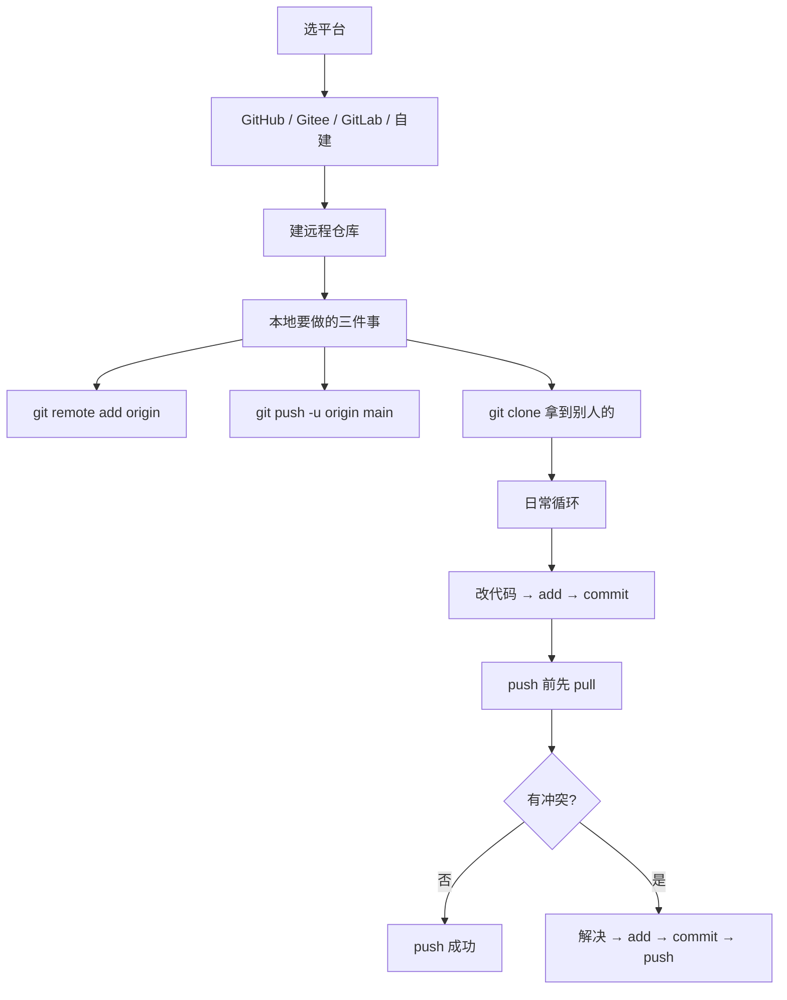

# 05 远程仓库与团队协作

## 1. 本节定位

- **对应视频**：P16 仓库托管_注册_建仓_配公钥（11:06）、P17 添加/查看/推送（11:42）、P18 复习+关联关系（2:00）、P19 clone（3:30）、P20 抓取和拉取（7:24）、P21 远程解决冲突（8:12）、P22 练习（3:00）。
- **先修**：[[03-本地仓库与基础命令]] 的 add/commit/log，[[04-分支与合并冲突]] 的 merge。
- **位置**：从「一个人的版本控制」跨到「一群人的协作」。这一节之后，才算真的会用 Git 干活。

## 2. 一句话结论

远程仓库只是**多了一个叫 origin 的普通仓库**：`push` 是把你本地的提交送过去，`fetch` 是把别人的提交取回来但不合并，`pull` 等于 fetch + merge，冲突永远在合并这一步爆。

## 3. 知识地图



## 4. 核心概念

### 远程仓库是什么

就是一个放在服务器上的 `.git`，跟本地那个没有本质区别。你给它起个名字叫 `origin`（惯例，可以改），之后所有 `fetch/pull/push` 都对着这个名字操作。

```bash
git remote add origin git@github.com:user/repo.git
git remote -v          # 看配置了哪些远程，带 push/fetch 两个 URL
git remote set-url origin <新地址>   # 换地址
git remote remove origin            # 删掉
```

### fetch、pull、push 三者

| 命令 | 方向 | 做了什么 | 会不会改工作区 |
| --- | --- | --- | --- |
| `git fetch` | 远程 → 本地仓库 | 下载别人的提交，只更新 `origin/xxx` 这个远程跟踪分支 | 不会 |
| `git merge origin/main` | 本地仓库 → 工作区 | 手动合并 | 会 |
| `git pull` | 远程 → 工作区 | fetch + merge（一步到位） | 会 |
| `git push` | 本地 → 远程 | 把本地提交送上去 | 不改本地 |

**建议**：先 `fetch` 看一眼别人改了什么再决定合不合，比直接 `pull` 更可控。课程里老师也强调 fetch「一般操作比较少」，但对新手来说它是理解 pull 的最好工具。

### 远程跟踪分支

`git branch -vv` 能看到本地分支和远程分支的绑定关系：

```text
* main  a1b2c3d [origin/main] 初始化
```

方括号里就是绑定的上游。`git push -u origin main` 的 `-u` 干的就是这事，绑一次之后 `git push` / `git pull` 不用再写远程名和分支名。

### 推不上去的时候

顺序永远是：**先拉后推**。多人同时改同一个仓库，别人先推了，你本地就落后了，Git 会拒绝（`rejected: non-fast-forward`）。处理流程：

```bash
git pull            # 把远程的拉下来合并
# 如果冲突：改文件 → git add → git commit
git push
```

## 5. 命令速查

```bash
git remote add origin <url>        # 关联远程
git remote -v                      # 查看
git push -u origin main            # 首次推送并绑定上游
git push                           # 之后直接推
git clone <url> [目录名]            # 克隆（目录名可省）
git clone --depth 1 <url>          # 只拉最近一次提交，快
git fetch                          # 只下载，不合并
git pull                           # 下载并合并
git pull --rebase                  # 下载后把本地提交搬到远程提交之后（历史更直）
git branch -vv                     # 看本地分支绑定的上游
```

| 场景 | 命令 | 注意 |
| --- | --- | --- |
| 本地已有项目，要推到新建的远程 | `remote add` + `push -u` | 远程仓库建议建**空的**，别勾选 README |
| 远程已有项目，要拿到本地 | `git clone` | 自动是仓库，自动配好 origin |
| 只想看看远程有啥变化 | `git fetch` + `git log origin/main` | 不动工作区 |
| 推送被拒 | `pull` → 解决冲突 → `push` | 别用 `-f` |
| 强制推送（仅限自己的分支） | `git push --force-with-lease` | 比 `-f` 安全，别人推过就拒绝 |

## 6. 动手实验

```bash
# 假装已经有远程仓库（用本地目录当远程，不用联网）
git init --bare ~/tmp/demo-remote.git

mkdir -p ~/tmp/git-remote && cd ~/tmp/git-remote
git init
git config user.name demo && git config user.email demo@example.com
echo "# demo" > README.md
git add . && git commit -m "init"
git remote add origin ~/tmp/demo-remote.git
git push -u origin main
```

```text
Enumerating objects: 3, done.
...
To /Users/you/tmp/demo-remote.git
 * [new branch]      main -> main
branch 'main' set up to track 'origin/main'.
```

再克隆一份，模拟同事：

```bash
cd ~/tmp && git clone demo-remote.git git-remote-2
cd git-remote-2 && echo "同事加的一行" >> README.md
git commit -am "同事提交" && git push
```

回到第一个仓库，`git pull` 就能看到这行；如果两边同时改了同一行，`git pull` 会像 [[04-分支与合并冲突]] 那样报冲突。

## 7. 补充：课程没讲但现在必需的 PR 流程

2021 年的课只讲了「直接 push 到主干」。现在团队里常见的是：

```text
1. 从 main 开功能分支：git switch -c feature/login
2. 提交并推送：git push -u origin feature/login
3. 在平台上发起 Pull Request（GitLab 叫 Merge Request）
4. 同事 Code Review + CI 跑测试
5. 通过后由平台合并进 main，删掉功能分支
6. 本地切回 main，git pull
```

这样做的好处：主干永远可发布、每次改动都有人看、有问题能回滚到某个 PR。**主干保护**（禁止直接 push main）几乎是现在的默认配置。

## 8. 时效与差异

> [!warning] 会卡住 · 分叉后 pull 直接报错
> 本地和远程各自有新提交时，现在的 `git pull` 不再默默合并：
> ```text
> fatal: Need to specify how to reconcile divergent branches.
> ```
> 这是 2.39 的实测结果（2.27 起先给 hint，后来收紧成 fatal）。配一次 `git config --global pull.rebase false`（走 merge）或 `true`（走 rebase）即可。

> [!warning] 会卡住 · 密码推不上去
> GitHub 2021-08-13 起 HTTPS 只认 PAT 或 SSH，课程里输密码那一步照抄会 403。国内 Gitee 多数场景还行，但同样在收紧。

> [!note] 推荐但不强制 · 强推换成 --force-with-lease
> 课程提过 `git push -f`，它没过时，但会覆盖别人的提交。`--force-with-lease` 在远端有你不认识的新提交时拒绝执行，安全得多。

> [!note] 补充 · 主干保护与 PR
> 课程是直接 push 主干，现在团队基本都开 PR + 保护分支 + CI。这是工作方式变了，不是命令变了。

## 9. 自测 + 背诵卡

**Q1** `fetch` 和 `pull` 的区别，用一句话说清。
<details><summary>答案</summary>
`fetch` 只把远程提交下载到本地的 `origin/xxx`，不动工作区；`pull` 等于 `fetch` 加一次合并，会改工作区。
</details>

**Q2** `git push` 报 `rejected (non-fast-forward)`，正确的处理顺序是什么？
<details><summary>答案</summary>
先 `git pull` 把远程的合并进来，解决冲突（如果有）、`add`、`commit`，再 `push`。绝对不能直接 `push -f` 覆盖别人的提交。
</details>

**Q3** `git push -u origin main` 里的 `-u` 有什么用？
<details><summary>答案</summary>
把本地 main 和远程 origin/main 绑定为上游关系，之后 `git push` / `git pull` 不用再写远程名和分支名。
</details>

**Q4** 克隆别人的仓库后，`git remote -v` 会显示什么？
<details><summary>答案</summary>
会自动配好一个叫 origin 的远程，fetch 和 push 两个 URL 都指向被克隆的地址。
</details>

**背诵卡**

- 远程就是一个起名叫 origin 的普通仓库。
- push 送出去，fetch 取回来不合并，pull = fetch + merge。
- 推不上去先 pull，解决冲突再 push，别 `-f`。
- `-u` 绑定上游，绑一次省一辈子。
- 现代团队靠 PR + 主干保护 + CI，不是直接推 main。

## 10. 关联

- 上一篇：[[04-分支与合并冲突]]
- 下一篇：[[06-IDEA集成Git]]
- 汇总：[[08-2021到2026过时内容对照]]、[[09-Git命令速查表]]
- 官方文档：[git-remote](https://git-scm.com/docs/git-remote)、[git-push](https://git-scm.com/docs/git-push)、[关于 Pull Request](https://docs.github.com/zh/pull-requests)
