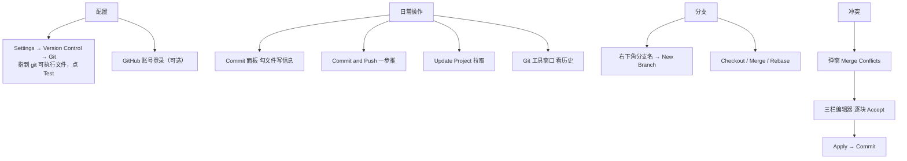

# 06 IDEA 集成 Git

## 1. 本节定位

- **对应视频**：P23 idea 配置_本地基本操作_push（11:18）、P24 idea 克隆_更新_解决冲突（10:06）、P25 分支操作（2:54）、P26 idea 快速操作入口（3:00）、P27 场景分析（1:36）。
- **先修**：[[03-本地仓库与基础命令]]、[[04-分支与合并冲突]]、[[05-远程仓库与团队协作]]。
- **位置**：把命令行那套搬到图形界面。**命令还是那些命令**，IDEA 只是替你敲，所以先懂原理再用按钮。

## 2. 一句话结论

IDEA 的 Git 面板就是 `status + diff + add + commit + push` 的可视化外壳，卡住的时候开 Terminal（Alt+F12）敲一句 `git status` 立刻知道现场是什么样。

## 3. 知识地图



## 4. 核心概念

### 先确认 IDEA 找得到 git

`Settings`（macOS `⌘,`）→ `Version Control` → `Git`，「Git executable」路径一般会自动填好，填 `/usr/bin/git` 或 Homebrew 的 `/opt/homebrew/bin/git`，点 `Test` 看到版本号就成了。

> [!note] 新版 UI 的菜单变了
> 2023.1 起 IDEA 默认新 UI，顶部菜单里的 `VCS` 改叫 `Git`，老的 `VCS → Git → ...` 路径在旧 UI 或关掉新 UI 后还能看到。找不到菜单时用 `⇧⇧`（Search Everywhere）直接搜 "Commit"、"Push"、"Pull"。

### 提交面板：最常用的地方

左侧 `Commit` 工具窗口（`⌘K`）列出所有改动：

- 勾选要提交的文件（不勾的留在工作区，这就是「部分提交」）
- 填 Commit Message
- `Commit` 只进本地库，`Commit and Push` 顺手推上去
- 旁边的箭头能展开 diff，逐行看改了什么

这等价于命令行的 `git add 文件` + `git commit -m`，只是把「选哪些文件」变成了勾选框。

### 更新与推送

| 动作 | 菜单 | 命令行等价 | 说明 |
| --- | --- | --- | --- |
| Update Project | `Git → Update Project`（`⌘T`） | `git pull` | 拉远程下来合并 |
| Push | `Git → Push`（`⌘⇧K`） | `git push` | 推本地提交 |
| Fetch | `Git → Fetch` | `git fetch` | 只下载不合并 |
| Show History | `Git → Show History` | `git log` | 看提交历史 |

### 分支：右下角就够了

窗口右下角显示当前分支名，点开可以：

- `New Branch` 新建并切过去（等价 `git switch -c`）
- 点其他分支 → `Checkout` 切换
- 选中某分支 → `Merge into Current`（等价 `git merge`）
- `Delete` 删除

P25 讲的就是这些点，比命令行直观，但**切分支前记得先提交或 stash**，否则 IDEA 会弹窗问你怎么办（Smart Checkout / Force Checkout / Don't Checkout），选错了容易把改动弄丢。

### 冲突：三栏编辑器

`Update Project` 或 `Merge` 遇到冲突，IDEA 会弹 `Merge Conflicts` 窗口，列出冲突文件，点 `Merge` 打开三栏编辑器：左「本地」、右「远程/对方」、中间「结果」。每个冲突块点 `>>` / `<<` / `X` 决定保留谁，改完 `Apply`，再 `Commit`。

这一步和命令行里手改 `<<<<<<<` 标记完全一样，只是不用自己删标记行。

## 5. 命令速查（IDEA 里对应的键位）

```text
⌘K        提交（Commit）
⌘⇧K       推送（Push）
⌘T        更新项目（Update Project / pull）
⌘⇧A 或 ⇧⇧ 搜索动作（找不到菜单时用）
⌥F12      打开 Terminal（卡住就敲 git status）
⌘9        版本控制 / Git 工具窗口（键位以 Keymap 为准）
```

macOS 上 `⌘` 对应 Windows 的 `Ctrl`，`⌥` 对应 `Alt`。

## 6. 动手实验

1. 新建一个普通 Java 项目，`Git → Enable Version Control Integration` → 选 Git（等价 `git init`）。
2. 改一个文件，`⌘K` 打开提交面板，勾上文件，写 `feat: 初始提交`，点 `Commit`。
3. 去 `Git → Manage Remotes` 添加远程地址（等价 `git remote add`），再 `⌘⇧K` 推送，首次会提示设置上游。
4. 用 `File → New → Project from Version Control` 克隆一份到别处，改点东西推上去。
5. 回到第一个项目 `⌘T` 拉取，制造一次同行冲突，走一遍三栏合并。

## 7. 补充：几个好用的入口

- **Annotate**：文件里右键 `Git → Annotate`，每行前面显示最后改它的人和提交，找 Bug 责任人神器。
- **Rollback**：提交面板里右键文件 → `Rollback`，撤销未提交的修改（等于 `git restore`，**不可恢复**）。
- **Stash**：`Git → Stash Changes`，把没改完的东西先存起来再切分支，回头 `Unstash`。
- **Local History**：就算没提交过，IDEA 自己也记本地历史，误删文件右键 `Local History → Show History` 能捞回来，不依赖 Git。

## 8. 时效与差异

> [!note] 界面差异 · 菜单从 VCS 挪到 Git
> 课程录的是旧 UI，路径 `File → Settings → Version Control → Git`、`VCS → Git → ...`。2023.1 起默认新 UI，顶部菜单叫 `Git`，设置直接 `⌘,` 打开。功能完全一样，找不到就 `⇧⇧` 搜动作。

> [!note] 环境差异 · 密码框没了
> 课程演示推 Gitee 时输密码。GitHub 现在只认 PAT 或 SSH，IDEA 里更推荐直接用 SSH 密钥，或在设置里用一次 token 登录。命令行的差别见 [[02-环境安装与配置]]。

> [!note] 补充 · 分支弹窗
> 新版分支弹窗能搜索、能直接 Rebase，课程只讲了 Checkout 和 Merge。多出来的是便利，不是替代。

## 9. 自测 + 背诵卡

**Q1** IDEA 里点 `Commit` 之后，代码到远程了吗？
<details><summary>答案</summary>
没有。`Commit` 只进本地仓库，要再 `Push` 才到远程；`Commit and Push` 才是两步一起。
</details>

**Q2** 切分支时 IDEA 弹窗问 Smart Checkout / Force Checkout，选哪个？
<details><summary>答案</summary>
Smart Checkout：先把当前改动 stash 起来再切，切回来能恢复；Force Checkout 会直接丢掉未提交改动。除非确定不要了，选 Smart。
</details>

**Q3** IDEA 卡在提交不动，怎么最快看到现场状态？
<details><summary>答案</summary>
`⌥F12` 开 Terminal 敲 `git status`，或者看 `Git` 工具窗口的 Log 面板。
</details>

**背诵卡**

- `⌘K` 提交、`⌘⇧K` 推送、`⌘T` 拉取。
- 提交面板的勾选框 = `git add` 选文件。
- 右下角分支名 = 分支的所有操作入口。
- 冲突用三栏编辑器，等价手改冲突标记。
- 菜单找不到就 `⇧⇧` 搜动作。

## 10. 关联

- 上一篇：[[05-远程仓库与团队协作]]
- 下一篇：[[07-实战流程与几条铁令]]
- 官方文档：[IntelliJ IDEA · Git](https://www.jetbrains.com/help/idea/using-git-integration.html)、[解决冲突](https://www.jetbrains.com/help/idea/resolving-conflicts.html)
