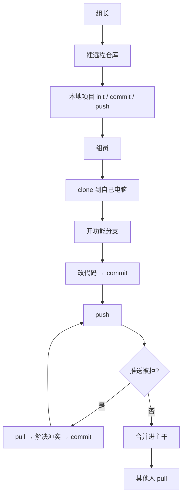

# 07 实战流程与几条铁令

## 1. 本节定位

- **对应视频**：P28 几条铁令 + IDEA 集成 GitBash（1:54）、P29 指令速查与 git 流程（2:30）、P30 实战要求（9:24）、P31 总结（3:54）。
- **先修**：前面五篇全都要。
- **位置**：把知识拼成一条能跑的流水线。到这里该能独立完成「克隆—开发—提交—推—处理冲突」一整轮。

## 2. 一句话结论

团队协作的顺序只有一条铁律：**动手前先拉，交出去前先拉，冲突当场解决，永远别删 `.git`**。

## 3. 知识地图



## 4. 核心概念

### 讲义的三条铁令

1. **切换分支前先提交本地修改**。没提交的改动会被带到新分支上，切回来就乱了；不想提交就 `git stash`。
2. **代码及时提交**。提交过的东西丢了能从 `reflog` 捞，没提交过的东西丢了就是真丢了。
3. **遇到问题不要删文件目录**，先找原因。`.git` 一删，历史全没，这是唯一不可逆的操作。

### 现在还得再加三条

4. **推送前先拉**。`rejected (non-fast-forward)` 不是错误，是提醒你落后了。
5. **不用 `git push -f` 动公共分支**。真要强推自己的分支，用 `--force-with-lease`。
6. **不提交密码、密钥、`.env`**。提交过一次，它就在历史里躺一辈子，删文件也删不掉。

### 一条完整的团队流程

```text
# 组员第一天
git clone git@github.com:team/project.git
cd project
git switch -c feature/login        # 开功能分支

# 开发循环
git add .
git commit -m "feat: 登录页骨架"
git pull --rebase                   # 先同步主干
git push -u origin feature/login    # 首次带 -u

# 在平台上发起 PR，评审通过后合并
git switch main
git pull
git branch -d feature/login
```

### commit message 写人话

课程里的 `commit 001` 只适合练习。真实项目推荐 Conventional Commits，一眼能看出这次改动的性质：

| 前缀 | 用途 | 例子 |
| --- | --- | --- |
| `feat` | 新功能 | `feat: 支持手机号登录` |
| `fix` | 修 Bug | `fix: 修正分页越界` |
| `docs` | 文档 | `docs: 补充部署说明` |
| `refactor` | 重构（不改行为） | `refactor: 抽取校验函数` |
| `test` | 测试 | `test: 补充分支覆盖` |
| `chore` | 杂项（依赖、构建） | `chore: 升级依赖` |

写清「做了什么」而不是「改了文件」，一年后的自己会感谢你。

## 5. 事故急救表

| 症状 | 原因 | 解药 |
| --- | --- | --- |
| `rejected (non-fast-forward)` | 远程有你没有的提交 | `git pull` → 解决冲突 → `push` |
| `fatal: Need to specify how to reconcile divergent branches` | 本地和远程分叉，且没配 pull 策略 | `git config --global pull.rebase false`（或 `true`） |
| 提交信息写错了（还没推） | 打错字 | `git commit --amend -m "新信息"` |
| 提交里混进了不该提交的文件 | 忘了加 `.gitignore` | `git rm --cached 文件` → 提交 |
| 误删分支 | `-D` 删过头 | `git reflog` 找到哈希 → `git switch -c 分支名 哈希` |
| 误 `reset --hard` | 手滑 | `git reflog` → `git reset --hard 哈希` |
| 改了半截要切分支 | 不想提交 | `git stash` → 切走 → `git stash pop` |
| 推送了敏感信息 | 密钥进了历史 | 立刻去平台**吊销密钥**，再考虑 `filter-repo` 清历史 |

## 6. 动手实验：模拟一次团队冲突

```bash
# 造一个"远程"
git init --bare ~/tmp/team.git

# 组长
mkdir -p ~/tmp/leader && cd ~/tmp/leader && git init
git config user.name leader && git config user.email l@example.com
echo "第一行" > app.txt && git add . && git commit -m "init"
git remote add origin ~/tmp/team.git && git push -u origin main

# 组员 A、B 分别克隆
cd ~/tmp && git clone team.git memberA && git clone team.git memberB
```

A 改同一行推上去：

```bash
cd ~/tmp/memberA
git config user.name A && git config user.email a@example.com
echo "A 改的" > app.txt && git commit -am "A 的修改" && git push
```

B 也改同一行：

```bash
cd ~/tmp/memberB
git config user.name B && git config user.email b@example.com
echo "B 改的" > app.txt && git commit -am "B 的修改"
git push          # 被拒：non-fast-forward
git pull          # 冲突
```

解决冲突后 `git add app.txt && git commit && git push`，完整走一遍真实协作里最慌的那一刻。

## 7. 时效与差异

> [!note] 工作方式 · 直接推主干不常见了
> 课程里组长组员都直接 push 到 master。现在多数团队开了主干保护，必须走 PR 评审。Git 本身没变，是协作流程变了。

> [!note] 环境差异 · Git Bash 是 Windows 的东西
> P28 教把 IDEA 的 Terminal 指向 Git Bash。macOS 上默认 `/bin/zsh` 就够用，设置位置一样，不用折腾。

> [!note] 与年代无关 · 别删 .git
> `.git` 一删历史全没，这是唯一不可逆的操作，2021 年和现在一样。

## 8. 自测 + 背诵卡

**Q1** 推送被拒，最不该做的三件事是什么？
<details><summary>答案</summary>
直接 `push -f`、删掉本地仓库重新克隆（会丢未提交改动）、把远程仓库整个删了重建。
</details>

**Q2** 改到一半要紧急切分支，怎么保住手上的活？
<details><summary>答案</summary>
`git stash`（或 `git stash -u` 连未跟踪文件一起），切回来 `git stash pop`。
</details>

**Q3** 已经把密码提交并推上去了，第一件事做什么？
<details><summary>答案</summary>
去平台吊销/更换那个密码或密钥。清历史是第二步，且要所有人重新克隆，先止损。
</details>

**背诵卡**

- 三条铁令：切分支前先提交、及时提交、别删 `.git`。
- 再加三条：推前先拉、别强推公共分支、别提交密钥。
- 推被拒 → pull → 解决冲突 → push。
- commit message：`feat/fix/docs/refactor/test/chore`。
- 一切「丢了」先从 `git reflog` 里找。

## 9. 关联

- 上一篇：[[06-IDEA集成Git]]
- 汇总：[[08-2021到2026过时内容对照]]、[[09-Git命令速查表]]
- 回到入口：[[00-Git学习地图]]
- 官方文档：[Conventional Commits](https://www.conventionalcommits.org/zh-hans/)
