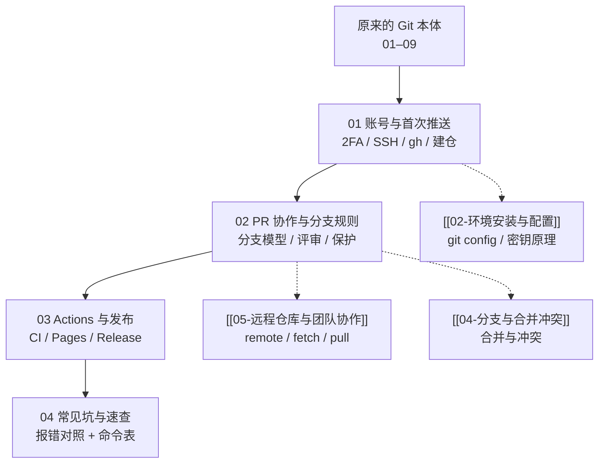

# 00 GitHub 版 · 学习地图

## 这一册是什么

原来那 9 篇（[[00-Git学习地图]]）讲的是 **Git 本体**：对象模型、分支指针、暂存区、合并冲突。这些东西跟放代码的平台无关，换成 GitHub、GitLab、自建都一样，**不用重写**。

真正需要另写一册的，是 **GitHub 这个平台自己的用法**：账号安全、SSH/gh 认证、PR 评审流、分支规则、Actions、Pages、Release。国内教程大多以码云为例（讲义原文写的是「Gitee」），照搬到 GitHub 会在三处翻车：HTTPS 密码不认、默认分支不叫 master、没有 PR 流程概念。

所以：**Git 本体看原来那 9 篇，平台操作看这一册三篇。**

## 学习路线

## 三篇索引

| 篇 | 一句话 | 什么时候看 |
| --- | --- | --- |
| [[01-GitHub账号与首次推送]] | 2FA、SSH、gh CLI、把本地仓库推上去 | 第一次用 GitHub，或换电脑重配 |
| [[02-PR协作与分支规则]] | 开 PR、评审、合并方式、rulesets、fork 同步 | 和别人一起写代码之前 |
| [[03-Actions与Pages发布]] | 最小 CI、矩阵、缓存、Pages、Release、LFS | 想让仓库自动跑测试、挂个网页 |
| [[04-GitHub常见坑与速查]] | 报错对照、命令表、2021→2026 差异 | 卡住时查 |

## 本机现状（2026-10-31 实测）

| 项 | 状态 |
| --- | --- |
| Git | 2.39.2 (Apple Git-143)，`/usr/bin/git` |
| GitHub 账号 | `SunJionglin` |
| SSH 身份 | `~/.ssh/github_ed25519`（ED25519，注释 1002991974@qq.com） |
| SSH 配置 | `~/.ssh/config` 里把 github.com 指到 `ssh.github.com:443` |
| 连通性 | `ssh -T git@github.com` 返回 `Hi SunJionglin!`，**已通** |
| gh CLI | **未安装**，要装就 `brew install gh` |

那行 `ssh.github.com:443` 不是多此一举：GitHub 的 22 端口在国内不少网络里被掐，443 是官方给的备用入口，写法见 [[01-GitHub账号与首次推送]]。

## 练手清单

- [ ] 用 `gh auth status` 确认 gh 登录成功（装完之后）
- [ ] 新建一个私有仓库，从空目录推上第一条 commit
- [ ] 开一个 feature 分支，提 PR，自己 review 自己，squash 合并并删分支
- [ ] 给 main 配一条 ruleset：必须走 PR、必须过 CI
- [ ] 加一个 Actions：push 时自动编译 + 跑测试
- [ ] 用 Pages 把一个静态页挂上网
- [ ] 打一个 tag，发一个 Release
- [ ] 故意把 60MB 的文件提交一次，用 `git lfs` 补救

## 与原有笔记的关系

- 平台无关的：[[01-版本控制与Git概述]]、[[03-本地仓库与基础命令]]、[[04-分支与合并冲突]]、[[09-Git命令速查表]] —— 照旧看。
- 需要替换的：[[05-远程仓库与团队协作]] 里以码云演示的「建仓、输密码、推上去」，在 GitHub 上走 [[01-GitHub账号与首次推送]]。
- 讲「过时」的：[[08-2021到2026过时内容对照]] 是 Git 层面的；GitHub 层面单列在 [[04-GitHub常见坑与速查]]。

## 时效声明

- 整理：2026-10-31，本机 Git 2.39.2。
- 平台政策变化快（2FA、Actions 额度、rulesets 默认值），以 [GitHub Docs](https://docs.github.com/) 和 [gh 手册](https://cli.github.com/manual/) 为准。
- 每条命令都在本机或官方文档核对过；没跑过的会标「未实测」。
