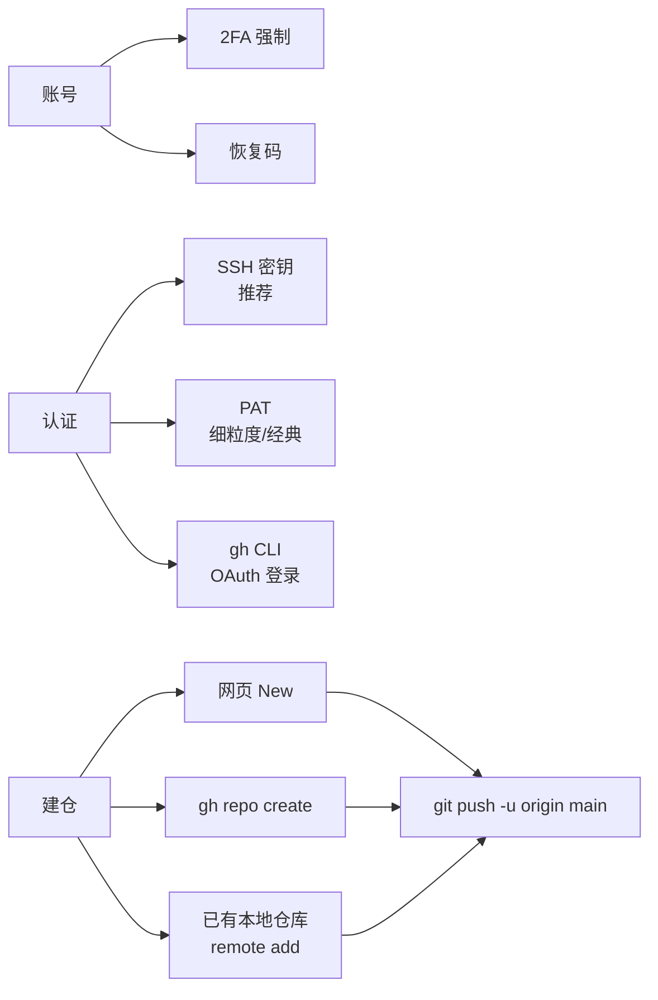

# 01 GitHub 账号与首次推送

## 1. 本节定位

接着 [[02-环境安装与配置]] 往下走：那边讲的是 `git config` 和密钥的原理，这一节讲**在 GitHub 上真正把代码推上去**要过的三关——账号安全、认证方式、仓库创建。先修：会 `init`、`add`、`commit`（[[03-本地仓库与基础命令]]）。

## 2. 一句话结论

**GitHub 的 HTTPS 密码早就废了**，只有两条活路：SSH 密钥，或者 Personal Access Token；装个 `gh` 命令行能把「建仓、登录、开 PR」全包了，省一半鼠标。

## 3. 知识地图



## 4. 核心概念

### 4.1 为什么密码不能用了

2021-08-13 起，GitHub 对 HTTPS 推送**不再接受账号密码**，一律要 token 或 SSH。讲义里「输入用户名密码」那一步是 2021 年之前的写法，照做会收到：

```
remote: Support for password authentication was removed on August 13, 2021.
fatal: Authentication failed for 'https://github.com/xxx/yyy.git/'
```

### 4.2 双因子（2FA）

GitHub 从 2023-03 起要求**所有在 GitHub.com 上贡献代码的账号**开启 2FA，2026 年还在继续收紧（[官方说明](https://docs.github.com/en/authentication/securing-your-account-with-two-factor-authentication-2fa/configuring-two-factor-authentication)、[社区讨论](https://github.com/orgs/community/discussions/191012)）。没开的话，往别人仓库推代码、参与 PR 会被拦。

三种方式，选一种：

| 方式 | 适合 | 注意 |
| --- | --- | --- |
| TOTP App（1Password / Authy / 微软验证器） | 大多数人 | 扫码或用「手动输入设置密钥」 |
| 安全密钥（YubiKey 等 FIDO2） | 想更稳 | 要买硬件 |
| 短信 | 部分区号可用 | 国内号码不一定支持 |

**开了 2FA 第一件事：把 10 个恢复码存到密码管理器里**，手机丢了就靠它。

### 4.3 SSH 与 443 端口

GitHub 的 SSH 默认端口 22 在国内很多网络（校园网、公司网）会被掐，官方给了备用入口 `ssh.github.com:443`。本机就是这么配的：

```bash
# ~/.ssh/config
Host github.com
    HostName ssh.github.com
    Port 443
    User git
    IdentityFile ~/.ssh/github_ed25519
```

没配过的话，生成一把 ED25519 钥匙：

```bash
ssh-keygen -t ed25519 -C "1002991974@qq.com"
# 一路回车，或者给个密码短语
cat ~/.ssh/id_ed25519.pub   # 复制整行
```

然后 GitHub 网页 → Settings → SSH and GPG keys → New SSH key → 粘贴。

> [!warning] 2021 → 2026
> 课程里写 `ssh-keygen -t rsa -b 4096`。RSA 现在仍然能用，但**新钥匙一律用 ed25519**：更短、更快、抗量子讨论里也更早被推荐。GitHub 支持 ed25519 已经很多年。

### 4.4 PAT（Personal Access Token）

不想配 SSH、又必须走 HTTPS 时用。Settings → Developer settings → Personal access tokens：

- **Fine-grained**（细粒度，推荐）：可以只授权某一个仓库、只给 `contents: read/write`。
- **Classic**：一把钥匙开所有有权限的仓库，权限宽，能不用就不用。

克隆时把 token 当密码：

```bash
git clone https://<token>@github.com/用户名/仓库.git
```

token 写在 URL 里会被 shell 历史记录，更稳的做法是 `gh auth login` 或者用 credential helper。

### 4.5 gh CLI：官方的命令行客户端

`gh` 不是 Git 的一部分，是 GitHub 官方单独发的工具，把「建仓库、登录、开 PR、看 CI、发 release」都变成了命令。

```bash
brew install gh            # macOS
gh auth login              # 选 GitHub.com → HTTPS 或 SSH → 浏览器授权
gh auth status             # 看当前登录了谁
gh auth switch             # 多账号时切换
```

> [!tip] 为什么建议装
> 后面 [[02-PR协作与分支规则]] 整个 PR 流程都能用 `gh` 一条命令完成；只开网页也能做，但慢。本机**还没装**。

## 5. 命令速查

| 目的 | 命令 | 注意 |
| --- | --- | --- |
| 看当前 gh 身份 | `gh auth status` | 多账号会列出全部 |
| 浏览器登录 | `gh auth login --web` | 可选 `--clipboard` 自动复制一次性码 |
| 用 token 登录 | `gh auth login --with-token < token.txt` | 适合 CI / 无浏览器环境 |
| 建仓库并推上去 | `gh repo create 名字 --private --source=. --push` | 本地已有代码时最好用 |
| 网页建仓后关联 | `git remote add origin git@github.com:用户名/仓库.git` | 再 `git push -u origin main` |
| 验证 SSH | `ssh -T git@github.com` | 成功返回 `Hi 用户名!` |
| 看远程地址 | `git remote -v` | 顺手确认是 SSH 还是 HTTPS |

## 6. 动手实验：从空目录推到 GitHub

```bash
mkdir ~/demo-gh && cd ~/demo-gh
git init -b main                      # 直接指定主分支叫 main
echo "# demo" > README.md
git add . && git commit -m "init: 第一条提交"

# 方式 A：用 gh（需要先 gh auth login）
gh repo create demo-gh --private --source=. --push

# 方式 B：先网页建仓，再手动关联
git remote add origin git@github.com:SunJionglin/demo-gh.git
git push -u origin main
```

预期输出（方式 A）：

```
✓ Created repository SunJionglin/demo-gh on GitHub
✓ Added remote git@github.com:SunJionglin/demo-gh.git
✓ Pushed commits to git@github.com:SunJionglin/demo-gh.git
```

## 7. 原理补丁：为什么推荐 SSH 而不是 token

SSH 密钥是「非对称密钥对」，私钥永远不出本机，GitHub 只存公钥；token 是「对称的字符串」，一旦泄露，谁拿到谁是本人，只能靠过期时间和权限范围兜底。日常开发（每天几十次 push）用 SSH 更省心：配一次，之后不输任何东西。

## 8. 易错点与报错

**① `Permission denied (publickey)`**

```
git@github.com: Permission denied (publickey).
fatal: Could not read from remote repository.
```

原因：GitHub 上没有这把公钥，或者 `ssh-agent` 没加载、`~/.ssh/config` 指错了 IdentityFile。查：

```bash
ssh -T git@github.com          # 看认不认
ssh -vT git@github.com 2>&1 | grep -i "identity file"   # 看用了哪把钥匙
```

**② `Connection timed out` / 卡在 22 端口**

校园网或公司网掐了 22 端口。用上面的 `ssh.github.com:443` 配置，改完 `ssh -T` 立刻能验证。

**③ `remote: Permission to xxx denied to yyy`**

gh 或 credential helper 里登录的是另一个账号。`gh auth switch` 切回来，或者 `git remote -v` 看 remote 里带的用户名对不对。

## 9. 自测 + 背诵卡

<details>
<summary>Q1：为什么 `git push` 提示要输入密码，输对了却报 403？</summary>

因为 GitHub 2021-08-13 起不接受 HTTPS 密码。要么换 SSH（`git@github.com:...`），要么用 PAT 当密码。403 不是密码错，是「密码这种认证方式本身被废了」。
</details>

<details>
<summary>Q2：本机的 SSH 为什么要走 443 端口？</summary>

默认 22 端口在国内部分网络被阻断，GitHub 官方提供 `ssh.github.com:443` 作为备用。配置里 Host 仍写 `github.com`，靠 HostName/Port 重定向，这样 `git@github.com:...` 的地址不用改。
</details>

<details>
<summary>Q3：`gh repo create --source=. --push` 里的 `--push` 做了什么？</summary>

建完远端仓库后，把本地 `origin` 指过去，并把当前分支推上去（等价于 `git remote add` + `git push -u origin HEAD`），省掉两步。
</details>

**背诵卡**

1. HTTPS 密码已废 → SSH 或 PAT。
2. 2FA 是硬门槛，恢复码先存好。
3. 新钥匙 `ed25519`，22 不通就 443。
4. `gh auth status` 是排错第一句。
5. 新仓库默认分支叫 `main`。

## 10. 关联

- 上一篇：[[00-GitHub版地图]]
- 下一篇：[[02-PR协作与分支规则]]
- 原理对照：[[02-环境安装与配置]]（git config、密钥原理）
- 官方文档：[Connecting to GitHub with SSH](https://docs.github.com/en/authentication/connecting-to-github-with-ssh)、[gh auth login 手册](https://cli.github.com/manual/gh_auth_login)
