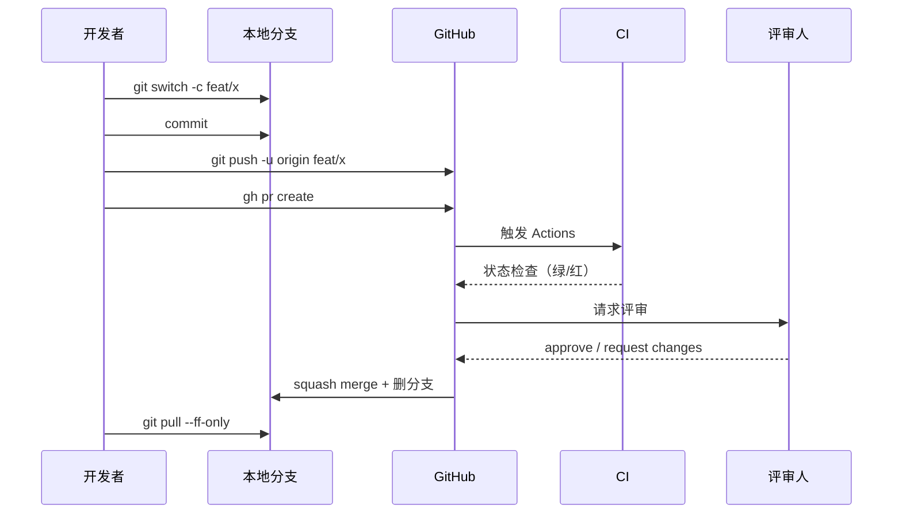

# 02 PR 协作与分支规则

## 1. 本节定位

[[05-远程仓库与团队协作]] 讲的是 `remote / push / pull / clone` 这一层，停在「能把代码推上去」。这一节讲推上去**之后**的事：怎么让别人看你的改动、怎么合并、怎么防止有人直接往主干上怼。先修：[[04-分支与合并冲突]]。

## 2. 一句话结论

**PR 的本质是「一条分支的合并申请」**，它的价值不在合并那一下，在合并之前的 diff + 评审 + 自动检查；主干上只允许 PR 进来，是团队协作唯一靠得住的纪律。

## 3. 知识地图



## 4. 核心概念

### 4.1 分支模型：别再背 Git Flow

| 模型 | 分支 | 适合 |
| --- | --- | --- |
| Git Flow | main / develop / release / hotfix / feature | 有版本发布节奏的老项目 |
| GitHub Flow（trunk-based） | main + 短命 feature 分支 | 大部分团队、个人项目 |
| 主干开发 | 只在 main 上，靠 feature flag 控制 | 成熟 CI + 敢上线 |

课程里讲的是老式 Git Flow，现在绝大多数项目用 **GitHub Flow**：main 永远可发布，任何改动都开一条短分支（活不过几天），走 PR 合回去。

### 4.2 PR 里真正发生的四件事

1. **Diff**：分支对 main 的差异，reviewer 逐行看。
2. **评审**：approve / comment / request changes 三种动作。
3. **自动检查**：Actions 报告的 pass/fail，可设成合并的前置条件。
4. **合并**：三种方式选一个，见下表。

### 4.3 三种合并方式怎么选

| 方式 | 结果 | 适合 | 代价 |
| --- | --- | --- | --- |
| Create a merge commit | main 上多一个合并节点，分支历史完整保留 | 特征分支很重要、要保留过程 | 主干 graph 变花 |
| **Squash and merge** | 分支所有 commit 压成 main 上一个 | 默认选项，小 PR | 细粒度历史丢失 |
| Rebase and merge | 把分支 commit 逐个搬到 main 上，无合并节点 | 想要线性历史且 commit 干净 | 每个 commit 都要能单独编译 |

个人项目和课程作业：**一律 Squash**，主干一条直线，回滚方便。

### 4.4 分支保护：Rulesets 是新写法

老写法是 Branch protection rules（Settings → Branches）。2023 年起 GitHub 推 **Rulesets**，功能是超集：

| | Branch protection rule | Rulesets |
| --- | --- | --- |
| 条数 | 每个分支模式一条 | 可多条并存，叠加生效 |
| 粒度 | 仓库内 | 仓库 + 组织级 |
| 例外 | 有 bypass 列表 | bypass 更细，可按角色 |
| 目标 | 只保护分支 | 分支 + tag |
| 状态 | 仍可用 | **新项目用这个** |

典型一条 ruleset 该勾的：

- Require a pull request before merging（必须走 PR）
- Require approvals：1（小团队至少 1 个人看过）
- Require status checks to pass：选上 CI 的 job 名
- Require branches to be up to date before merging（强制先 rebase 到最新 main）
- Block force pushes（禁止强推主干）

> [!note] 合并队列（Merge Queue）
> 人多的仓库可以开 merge queue，GitHub 会把待合并的 PR 排队、逐个跟最新 main 跑一遍 CI 再合。**目前只在组织拥有的公共仓库，或 Enterprise Cloud 的私有仓库可用**，个人免费账号没有。

### 4.5 CODEOWNERS：谁的地盘谁审

放 `.github/CODEOWNERS`，按路径指定必审人：

```
# 默认：所有人
*               @SunJionglin

# 这个目录必须我审
/src/core/      @SunJionglin
*.sql           @SunJionglin
```

配合 ruleset 里的「Require review from Code Owners」，改到你地盘的文件就自动拉你进评审。

### 4.6 Fork 与 upstream：给别人的项目提代码

没写权限时不能直接推分支，流程是：

```bash
# 1. 在网页上 Fork 一份到自己账号下
git clone git@github.com:SunJionglin/某项目.git
cd 某项目

# 2. 加原仓库为 upstream
git remote add upstream git@github.com:原作者/某项目.git

# 3. 从 upstream 的最新 main 开分支
git fetch upstream
git switch -c fix/typo upstream/main

# 4. 提交并推到自己 fork
git push -u origin fix/typo

# 5. 开 PR，base 选原仓库
gh pr create --repo 原作者/某项目 --base main --head SunJionglin:fix/typo

# 6. 之后同步 upstream
gh repo sync -b main          # 或 git fetch upstream && git merge --ff-only upstream/main
```

### 4.7 Issue / Projects / 标签

Issue 不是「提 bug 的地方」，是**任务的最小单位**：一个 issue = 一件可关闭的事，可以挂 PR（PR 里写 `Closes #12`，合并后自动关）。

- 标签：`bug` / `enhancement` / `good first issue`
- 里程碑：把一个版本的 issue 打包
- Projects：看板视图，拖动卡片

## 5. 命令速查

| 目的 | 命令 |
| --- | --- |
| 开 PR | `gh pr create --fill`（用分支名和 commit 自动填标题） |
| 看 PR 状态 | `gh pr status` |
| 检出别人的 PR 到本地 | `gh pr checkout 42` |
| 看 CI 检查 | `gh pr checks` |
| 合并并删分支 | `gh pr merge --squash --delete-branch` |
| 打个草稿 PR | `gh pr create --draft` |
| 看 issue 列表 | `gh issue list --state open` |
| 关 issue | `gh issue close 12` |
| 本地分支推送后设上游 | `git push -u origin HEAD` |

## 6. 动手实验：完整走一遍 PR

```bash
cd ~/demo-gh
git switch -c feat/readme-badge
echo "" >> README.md
git commit -am "docs: 加 CI 徽章"
git push -u origin feat/readme-badge

gh pr create --fill --body "Closes #1"
gh pr checks              # 等 CI 绿
gh pr merge --squash --delete-branch

git switch main
git pull --ff-only
git branch -d feat/readme-badge   # 本地分支也删掉
```

预期：网页上 PR 显示 `Merged`，分支列表里 `feat/readme-badge` 已消失，main 上多一条 squash 后的 commit。

## 7. 原理补丁：squash 之后分支为什么不能接着用

squash 合并会把分支的 N 个 commit 压成一个**新的 commit**（hash 不同于分支上任何一个）。分支如果继续往上提交再开 PR，Git 会认为两边的历史无关，diff 里会重复出现已经合过的改动。

规矩：**一个 PR 合并后，分支就删掉；要继续改，从最新 main 重新开一条。**

## 8. 易错点与报错

**① `! [rejected] main -> main (non-fast-forward)`**

本地 main 落后于远端（或者你在本地 rebase 过）。别直接 `push -f` 到 main，先：

```bash
git pull --rebase origin main
```

**② PR 里出现几十个「不该有」的 commit**

分支是从旧的 main 切出来的，或者 main 更新后没同步。`git fetch origin && git rebase origin/main` 之后再推（会需要 `--force-with-lease`，因为历史改了）。

**③ 合并后本地还留着旧分支，下次 `git switch` 报错**

```bash
git fetch --prune           # 清掉远端已删的跟踪分支
git branch -d feat/x        # 删本地
```

**④ 设了 Required status checks，但 PR 一直灰着**

检查名对不上：ruleset 里选的是 job 名，而 workflow 某个 job 之前失败了；或者 job 只在 `pull_request` 事件触发，而你的 ruleset 只检查 `push`。看 `gh pr checks` 的输出逐条对。

## 9. 自测 + 背诵卡

<details>
<summary>Q1：小团队为什么默认 Squash，而不是保留全部 commit？</summary>

主干历史一条直线，回滚是一个 revert 搞定；合并节点和「随手 commit」的噪音对读历史的人是负担。代价是细粒度历史丢失——真要保留细节，就在本地写好 commit message，squash 时 GitHub 会把它们拼成 PR 描述。
</details>

<details>
<summary>Q2：Rulesets 和老的 Branch protection 有什么本质区别？</summary>

Rulesets 可以多条并存、组织级下发、同时管分支和 tag，bypass 粒度更细；branch protection 一条规则一个分支模式，配置分散。新项目直接用 Rulesets。
</details>

<details>
<summary>Q3：给别人的开源项目提 PR，为什么必须 Fork 而不是直接推分支？</summary>

你对原仓库没有写权限，`git push` 会被拒。Fork 是你账号下的一份副本，所有推送落在自己这里，PR 只是「请求原仓库从你的副本拉一段分支」。
</details>

**背诵卡**

1. PR = 分支的合并申请，重点是评审和检查。
2. 主干只吃 PR，规则用 Rulesets 写。
3. 合并优先 Squash，合完就删分支。
4. 合完的分支别再续用，从新 main 重开。
5. 开源贡献：Fork → upstream → 分支 → PR。

## 10. 关联

- 上一篇：[[01-GitHub账号与首次推送]]
- 下一篇：[[03-Actions与Pages发布]]
- 基础：[[04-分支与合并冲突]]（合并与冲突的四步解法）、[[05-远程仓库与团队协作]]（fetch/pull/push 的本质）
- 官方文档：[About pull requests](https://docs.github.com/en/pull-requests)、[About rulesets](https://docs.github.com/en/repositories/configuring-branches-and-merges-in-your-repository/managing-rulesets/about-rulesets)
