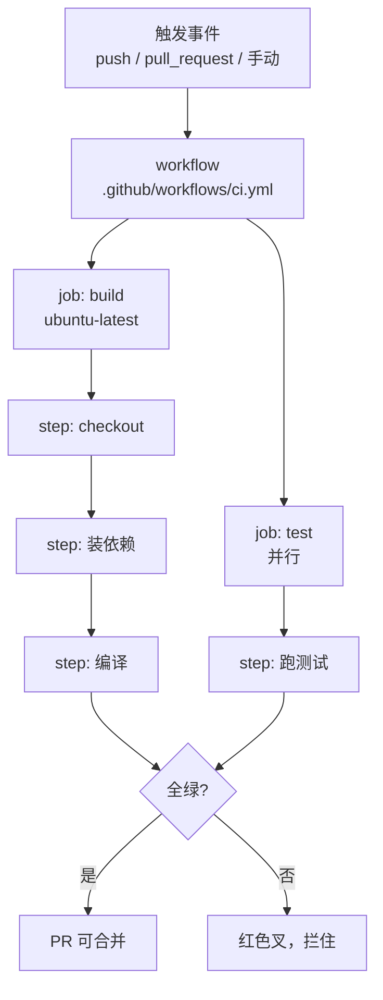

# 03 GitHub Actions 与 Pages 发布

## 1. 本节定位

前两节解决了「代码能推上去、改动能评审」。这一节解决「推上去之后自动做点事」：编译、跑测试、打包、把网页挂出去。课程 2021 年录的时候 Actions 刚上线，讲义完全没讲；这部分全靠后补。先修：会写 PR（[[02-PR协作与分支规则]]）。

## 2. 一句话结论

**Actions = 仓库自带的免费小服务器**：在 `.github/workflows/` 下放一个 YAML，写清「什么事件 → 跑什么命令」，push 就自动执行；CI 和 Pages 部署都是同一个机制。

## 3. 知识地图



## 4. 核心概念

### 4.1 四个关键词

| 词 | 含义 | 位置 |
| --- | --- | --- |
| workflow | 一个 YAML 文件 = 一条流水线 | `.github/workflows/xxx.yml` |
| event | 什么时候跑 | `on:` |
| job | 一台机器上的一段工作，**默认并行** | `jobs:` |
| step | job 里的一步，**串行** | `steps:` |

step 有两种写法：`uses:`（用别人写好的 action）和 `run:`（直接敲 shell）。

### 4.2 触发事件

```yaml
on:
  push:
    branches: [main]
  pull_request:
    branches: [main]
  workflow_dispatch:      # 网页/gh 上手动点
  schedule:
    - cron: "0 3 * * 1"   # 每周一 03:00 UTC
```

`pull_request` 和 `pull_request_target` 不一样：后者能拿到 secrets，**别在不可信的分支上用**。

### 4.3 最小可用的 C++ CI

`ubuntu-latest` 上 g++、cmake、make 都是预装的，通常不用额外装：

```yaml
name: CI

on:
  push:
    branches: [main]
  pull_request:

jobs:
  build:
    runs-on: ubuntu-latest
    steps:
      - uses: actions/checkout@v4

      - name: 编译
        run: g++ -std=c++17 -O2 -Wall -Wextra main.cpp -o app

      - name: 跑测试
        run: |
          echo "[1,2,3]" | ./app
```

> [!tip] 版本号怎么写
> `actions/checkout@v4` 这种主版本号是能自动升级的；要更稳就锁 commit hash。别抄教程里的 `@v1`，太老会被废弃。

### 4.4 矩阵：一次跑多套环境

```yaml
strategy:
  matrix:
    os: [ubuntu-latest, macos-latest, windows-latest]
    std: [c++17, c++20]
runs-on: ${{ matrix.os }}
```

3 × 2 = 6 个 job 并行跑，任何一个红色整条流水线就红。

### 4.5 缓存：别每次都重新下载

```yaml
- uses: actions/cache@v4
  with:
    path: ~/.cache/pip
    key: ${{ runner.os }}-pip-${{ hashFiles('requirements.txt') }}
```

key 里带 `hashFiles(依赖文件)` 是关键：依赖没变就命中缓存，变了自动换新 key。

### 4.6 Secrets 与权限

- 敏感值放 Settings → Secrets and variables → Actions，或 `gh secret set API_KEY`。
- 用的时候 `${{ secrets.API_KEY }}`，日志里会自动打码。
- **`GITHUB_TOKEN` 是自动给的**，但默认权限保守；要发 Release 得显式升权：

```yaml
permissions:
  contents: write      # 发 release / 推 tag 需要
```

### 4.7 免费额度

| 仓库 | 额度 |
| --- | --- |
| 公共仓库 | 免费，不限分钟（[官方](https://docs.github.com/billing/managing-billing-for-github-actions/about-billing-for-github-actions)） |
| 私有仓库 · Free | 2000 分钟/月 |
| 私有仓库 · Team | 3000 分钟/月 |

Linux 跑 1 分钟算 1 分钟，macOS/Windows 有倍率（贵），别在私有仓库里拿 macos runner 刷时长。

### 4.8 Pages：把静态站挂上网

两种来源：

1. **从分支发布**：Settings → Pages → Deploy from a branch，选 `main` + `/docs` 或 `/root`。
2. **用 Actions 发布**（更灵活，能先构建再发）：

```yaml
name: Deploy Pages
on:
  push:
    branches: [main]
permissions:
  contents: read
  pages: write
  id-token: write
jobs:
  deploy:
    runs-on: ubuntu-latest
    environment:
      name: github-pages
      url: ${{ steps.deployment.outputs.page_url }}
    steps:
      - uses: actions/checkout@v4
      - uses: actions/upload-pages-artifact@v3
        with:
          path: ./public
      - id: deployment
        uses: actions/deploy-pages@v4
```

地址是 `https://SunJionglin.github.io/仓库名/`（用户主页仓库除外）。

### 4.9 Release：打 tag + 发版

```bash
git tag -a v1.0.0 -m "第一个版本"
git push origin v1.0.0
gh release create v1.0.0 --generate-notes
```

`--generate-notes` 会自动把这段时间的 PR 列表整理成 release notes。

### 4.10 大文件：LFS

GitHub 单文件超过 100MB 直接拒；超过 50MB 会警告。

```bash
brew install git-lfs
git lfs install
git lfs track "*.zip" "*.psd"
git add .gitattributes
```

注意：**LFS 也要占额度**（免费 1GB 存储 + 1GB/月流量），照片和数据集别往仓库里塞。

## 5. 命令速查

| 目的 | 命令 |
| --- | --- |
| 看最近运行 | `gh run list` |
| 实时看某次运行 | `gh run watch` |
| 重跑失败的任务 | `gh run rerun <id> --failed` |
| 手动触发 workflow | `gh workflow run ci.yml` |
| 设 secret | `gh secret set API_KEY` |
| 看 secret 列表 | `gh secret list` |
| 发 Release | `gh release create v1.0.0 --generate-notes` |
| 下载 Release 附件 | `gh release download v1.0.0` |
| 看 Pages 配置 | `gh api repos/{owner}/{repo}/pages` |

## 6. 动手实验：给 demo 仓库加 CI

```bash
cd ~/demo-gh
mkdir -p .github/workflows
cat > .github/workflows/ci.yml <<'YAML'
name: CI
on: [push, pull_request]
jobs:
  build:
    runs-on: ubuntu-latest
    steps:
      - uses: actions/checkout@v4
      - run: g++ --version
      - run: echo "编译通过"
YAML

git add .github && git commit -m "ci: 加最小流水线"
git push
gh run list --limit 3        # 看它跑起来了
gh run watch                 # 实时看日志
```

预期：push 后十几秒，仓库 Actions 页面出现一条绿色 ✓；README 里加徽章就能显示状态。

## 7. 原理补丁：为什么 workflow 要锁版本

`uses: actions/checkout@v4` 里的 `v4` 是一个会移动的 tag，官方修 bug 时会挪它。可复现的构建应该锁到 commit：

```yaml
- uses: actions/checkout@11bd71901bbe5b1630ceea73d27597364c9af683  # v4.2.2
```

自己写 action 时，第三方 action 也尽量锁 hash —— 供应链攻击就是从被劫持的 action 进来的。

## 8. 易错点与报错

**① YAML 缩进错，报 `Invalid workflow file`**

```
Invalid workflow file: .github/workflows/ci.yml#L12
You have an error in your yaml syntax on line 12
```

两空格一级，Tab 一律不行。

**② 发 Release 报 `Resource not accessible by integration`**

`GITHUB_TOKEN` 权限不够。workflow 里加 `permissions: contents: write`。

**③ `secret` 是空字符串**

secret 建在**仓库**上，但 workflow 跑在 **fork 的 PR** 里时拿不到（安全设计）。或者名字写错大小写。

**④ 本地能跑，runner 上 `command not found`**

`ubuntu-latest` 只有常见工具；node/python 版本要显式 `uses: actions/setup-node@v4`，其他要 `apt-get install -y xxx`，还要 `sudo`。

**⑤ push 被拒：文件太大**

```
remote: error: File big.zip is 120.00 MB; this exceeds GitHub's file size limit of 100.00 MB
```

当次提交里的大文件即使后来删掉，仍然在历史里。要么 `git lfs` 重来，要么用 `git filter-repo` 清洗历史（force push）。

## 9. 自测 + 背诵卡

<details>
<summary>Q1：`jobs` 和 `steps` 的执行关系是什么？</summary>

同一 workflow 里的 job **默认并行**（各自一台干净机器，不共享文件），需要顺序就用 `needs:`；同一个 job 里的 step **串行**，共享工作目录和文件系统。
</details>

<details>
<summary>Q2：为什么缓存 key 要带 `hashFiles('依赖文件')`？</summary>

缓存按 key 精确匹配：依赖没变 → key 一样 → 命中；依赖改了 → hash 变 → 新 key，自动重新装。不带 hash 的话，要么永远命中旧缓存（装的是旧依赖），要么永远不命中。
</details>

<details>
<summary>Q3：私有仓库里为什么不该用 macOS runner 跑日常 CI？</summary>

私有仓库的免费额度按「分钟 × 操作系统倍率」算，macOS 倍率高（Linux 是 1×），同样的流水线在 macOS 上消耗快得多；只在确实需要 macOS 的构建（比如打 iOS 包）时才用。
</details>

**背诵卡**

1. `.github/workflows/*.yml` = 一条流水线。
2. job 并行，step 串行，跨 job 要共享就上传 artifact。
3. 发 Release 要 `permissions: contents: write`。
4. 缓存 key 里放依赖文件的 hash。
5. 单文件 100MB 顶线，大文件走 LFS。

## 10. 关联

- 上一篇：[[02-PR协作与分支规则]]（PR 上的状态检查就是 Actions 报的）
- 回目录：[[00-GitHub版地图]]
- 排错：[[04-GitHub常见坑与速查]]
- 官方文档：[Actions 快速入门](https://docs.github.com/en/actions/quickstart)、[Pages 部署](https://docs.github.com/en/pages/getting-started-with-github-pages/using-custom-workflows-with-github-pages)
