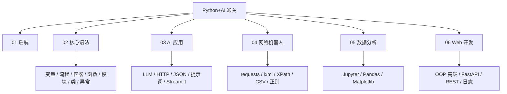

## 这门课解决什么

从「会 C++」到「能用 Python 做 AI 应用」：先补语法差异，再练四个实战方向——AI 应用、爬虫、数据分析、Web 开发。

## 六章知识树



## 建议学习路径

1. **02 核心语法**：对照 C++ 快速过，重点是容器、函数参数、类。
2. **03 AI 应用**：跟做 AI 伴侣，跑通一次「调 API + 会话记忆」。
3. **04 爬虫**：跟做电影榜单，练 XPath 和清洗。
4. **05 数据分析**：跟做 TOP300，练 Pandas + 画图。
5. **06 Web 开发**：跟做汉字谜盒，练接口设计。

01 章可以最后扫一眼，环境问题遇到再查。

## 能力自检

- [ ] 能说清 Python 和 C++ 在变量、除法、字符串、作用域上的差异
- [ ] 能熟练用 list / dict / set / tuple，并知道什么时候用哪个
- [ ] 能写带默认参数、`*args`、`**kwargs` 的函数
- [ ] 能读懂并修改一个类，知道 `self`、类属性、魔法方法
- [ ] 能调通一个大模型 API，并维护多轮会话
- [ ] 能用 XPath + CSV 抓一个榜单
- [ ] 能用 Pandas 清洗数据并画四张图
- [ ] 能写一个带增删改查的 FastAPI 服务

## 全库索引

```dataview
TABLE chapter AS "章", section AS "节", difficulty AS "难度", status AS "状态"
FROM "Python"
WHERE section > 0
SORT chapter ASC, section ASC
```

## 复盘方法

- 每周挑一章，只看「速记」和「易错点」，能复述就过。
- 每月跑一次 [[00 提示词集]] 里的「复习卡」提示词，把笔记转成问答。
- 卡住的知识点，用「单点深挖」提示词单独问，不要重读整篇。

## 关联

- 生成规则：[[00 提示词集]]
- 第 1 章：[[01-00 章节总览]]
- 第 2 章：[[02-00 章节总览]]
- 第 3 章：[[03-00 章节总览]]
- 第 4 章：[[04-00 章节总览]]
- 第 5 章：[[05-00 章节总览]]
- 第 6 章：[[06-00 章节总览]]
