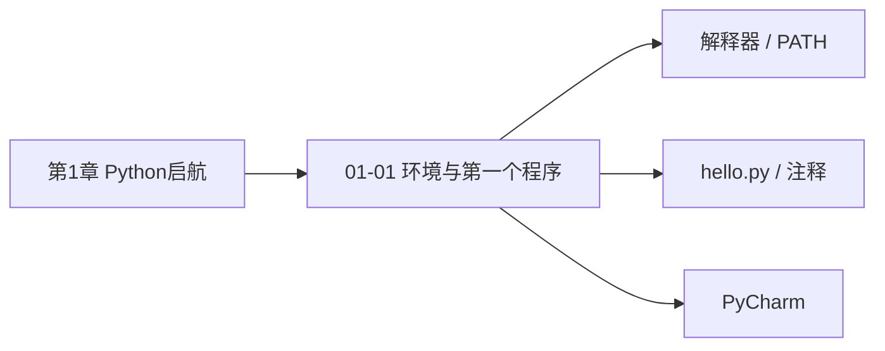

## 本章解决什么

只干一件事：**把环境跑起来**。装解释器、配 PATH、装 PyCharm、跑通第一个 `.py`，顺便搞清楚注释和运行方式。

## 知识树



## C++ 选手最容易想当然的地方

1. 没有 `main()`，顶层代码直接执行。
2. 不用编译，改完保存就能跑。
3. 语句不写分号，靠换行。
4. 符号必须是英文半角，中文括号直接语法错误。
5. 文件后缀是 `.py`，不是 `.cpp`。

## 笔记索引

```dataview
TABLE section AS "节", difficulty AS "难度", status AS "状态"
FROM "Python"
WHERE chapter = 1 AND section > 0
SORT section ASC
```

## 下一章

[[02-00 章节总览]]
