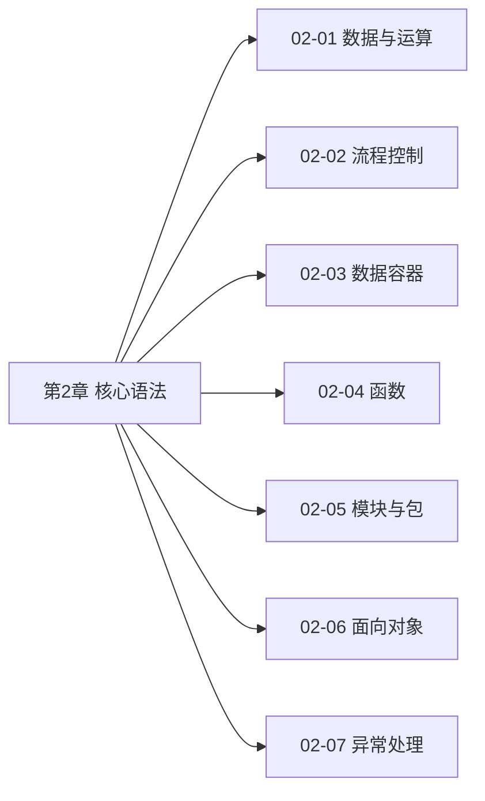

## 本章解决什么

把 C++ 的语法习惯翻译成 Python：变量与类型、流程控制、容器、函数、模块、类与异常。重点只有两个——**写法差异**和**Python 特有的坑**。

## 知识树



## C++ 选手最容易想当然的 5 个地方

1. `a = b` 是换绑标签，不是拷贝值。
2. `/` 是浮点除法，整除要写 `//`。
3. 循环变量出了循环仍然存在，不是块作用域。
4. 字符串不可变，所有方法都返回新串。
5. 函数参数是对象引用传递，改可变对象会影响外部。

## 学习顺序

02-01 → 02-02 → 02-03 → 02-04 → 02-05 → 02-06 → 02-07。
其中 **02-03 数据容器** 和 **02-04 函数** 必须动手敲代码，其余看一遍即可。

## 笔记索引

```dataview
TABLE section AS "节", difficulty AS "难度", status AS "状态"
FROM "Python"
WHERE chapter = 2 AND section > 0
SORT section ASC
```

## 下一章

[[03-00 章节总览]]
