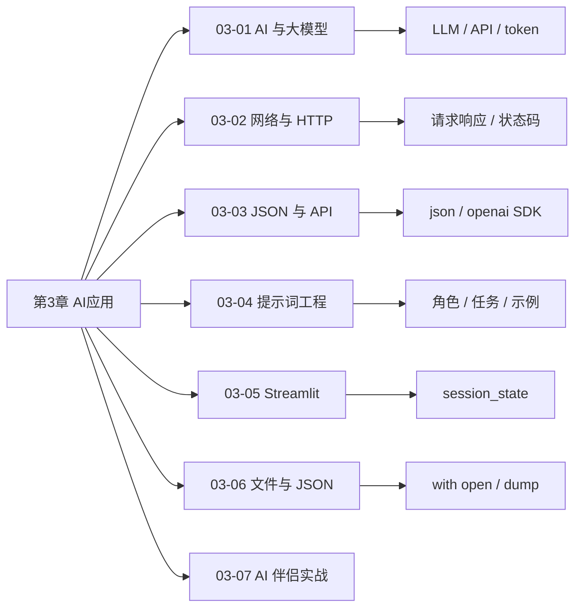

## 本章解决什么

把「调用大模型」变成能跑的产品：先搞懂 LLM 和 API，再学 HTTP/JSON，最后用 Streamlit 做一个带会话记忆的 AI 伴侣。

## 知识树



## C++ 选手最容易想当然的 5 个地方

1. 程序输出不再是确定的，同一输入可能不同输出。
2. 错误不再是异常，而是「看起来很对的幻觉」。
3. 依赖不是编译链接，而是网络、Key 和余额。
4. HTTP 无状态，对话记忆要自己维护。
5. 成本按 token 持续计费，不是一次买断。

## 学习顺序

03-01 → 03-02 → 03-03 → 03-04 → 03-05 → 03-06 → 03-07。
**03-07 是总装**，前面六节都是它的零件，建议最后一定亲手跑一遍。

## 笔记索引

```dataview
TABLE section AS "节", difficulty AS "难度", status AS "状态"
FROM "Python"
WHERE chapter = 3 AND section > 0
SORT section ASC
```

## 下一章

[[04-00 章节总览]]
