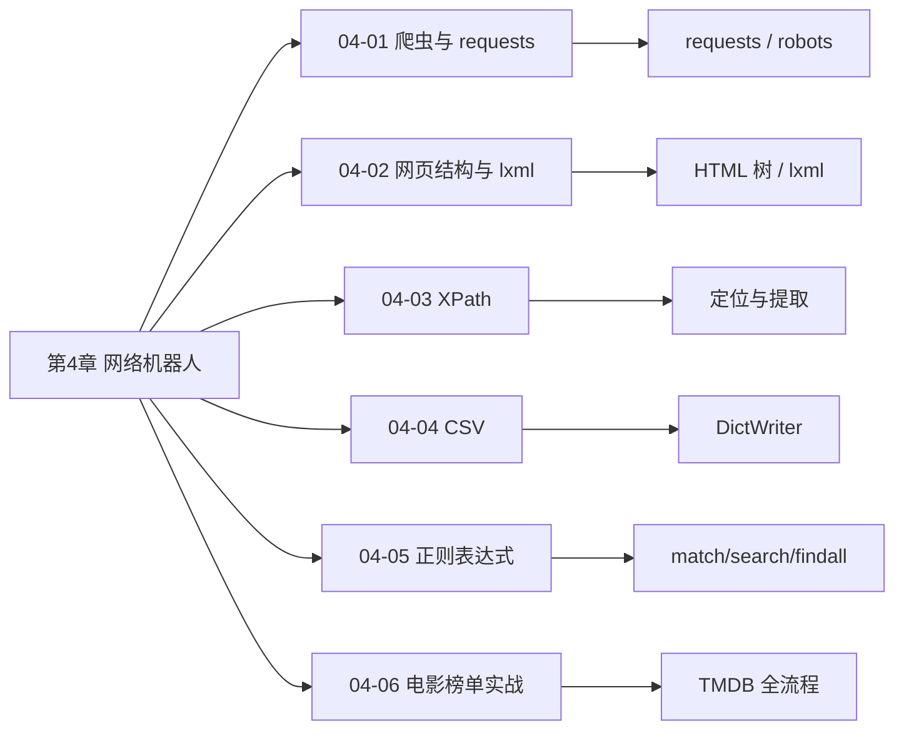

## 本章解决什么

写一个能自动抓网页、解析出字段、清洗后存成 CSV 的爬虫。核心是「请求 → 解析 → 清洗 → 存储」这条流水线。

## 知识树



## 写爬虫最容易想当然的 5 个地方

1. `requests.get()` 返回的是 Response，不是字符串。
2. XPath 下标从 1 开始，`[0]` 永远匹配不到。
3. 浏览器里的 DOM 和源码不一样（`tbody` 是浏览器补的）。
4. 翻页不一定还是 GET，第 2 页起可能变成 POST。
5. CSV 不能用 `split(",")` 解，字段里可能带逗号。

## 学习顺序

04-01 → 04-02 → 04-03 → 04-04 → 04-05 → 04-06。
**04-06 是总装**，前五节都是它的零件。跑通它，这一章就算过关。

## 笔记索引

```dataview
TABLE section AS "节", difficulty AS "难度", status AS "状态"
FROM "Python"
WHERE chapter = 4 AND section > 0
SORT section ASC
```

## 下一章

[[05-00 章节总览]]
