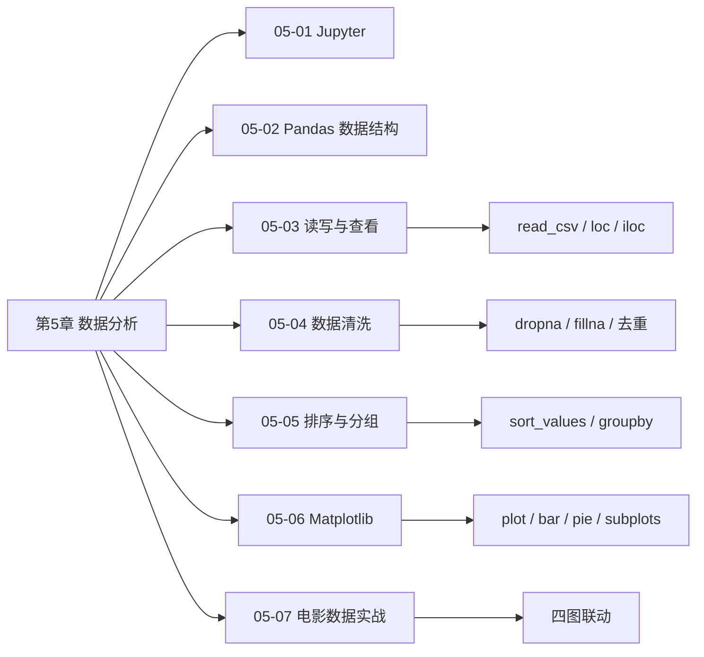

## 本章解决什么

把一份 CSV 变成结论：读进来 → 看一眼 → 清洗 → 分组统计 → 画图。工具是 Pandas + Matplotlib，环境是 Jupyter。

## 知识树



## 写数据分析最容易想当然的 5 个地方

1. `df['列']` 是 Series，`df[['列']]` 才是 DataFrame。
2. `loc` 区间闭合，`iloc` 左闭右开，别混。
3. 清洗方法默认返回新表，不赋值等于白做。
4. 分组结果的索引是分组键，画图前先 `reset_index()`。
5. 中文图例要先设字体，否则全是方框。

## 学习顺序

05-01 → 05-02 → 05-03 → 05-04 → 05-05 → 05-06 → 05-07。
**05-07 是总装**，四张图分别对应折线、柱状、饼图三种图型，跑通它这一章就闭环了。

## 笔记索引

```dataview
TABLE section AS "节", difficulty AS "难度", status AS "状态"
FROM "Python"
WHERE chapter = 5 AND section > 0
SORT section ASC
```

## 下一章

[[06-00 章节总览]]
