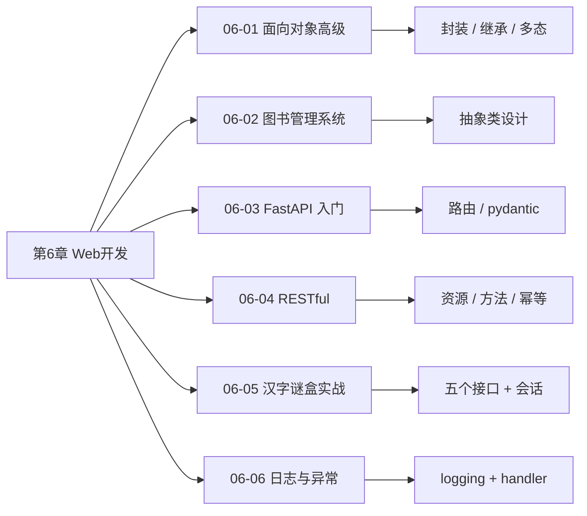

## 本章解决什么

先补面向对象的三件套（封装、继承、多态），再用 FastAPI 写一个前后端分离的 AI 字谜游戏：静态页面、五个 REST 接口、会话持久化、日志与全局异常。

## 知识树



## 写 Web 最容易想当然的 5 个地方

1. `__` 不是真私有，只是名字改写。
2. `super()` 在多继承里是 MRO 的下一站，不一定是父类。
3. REST 的 URL 只放资源，动作交给 HTTP 方法。
4. FastAPI 的请求体必须用 Pydantic 模型，否则没有校验。
5. 异常处理器必须返回 `Response`，返回 dict 会报错。

## 学习顺序

06-01 → 06-02 → 06-03 → 06-04 → 06-05 → 06-06。
06-01/02 是设计能力，06-03/04 是接口能力，06-05 是总装，06-06 是收尾。

## 课程终点自检

- 能不看资料写出一个带增删改查的 FastAPI 服务吗？
- 能说清 GET/POST/PUT/DELETE 的语义和幂等性吗？
- 能把异常统一成 `{code, message, data}` 吗？

三个都「能」，这门课就算通关了。

## 笔记索引

```dataview
TABLE section AS "节", difficulty AS "难度", status AS "状态"
FROM "Python"
WHERE chapter = 6 AND section > 0
SORT section ASC
```

## 下一章

课程完结，回到 [[00 课程总览]] 复盘一遍。
